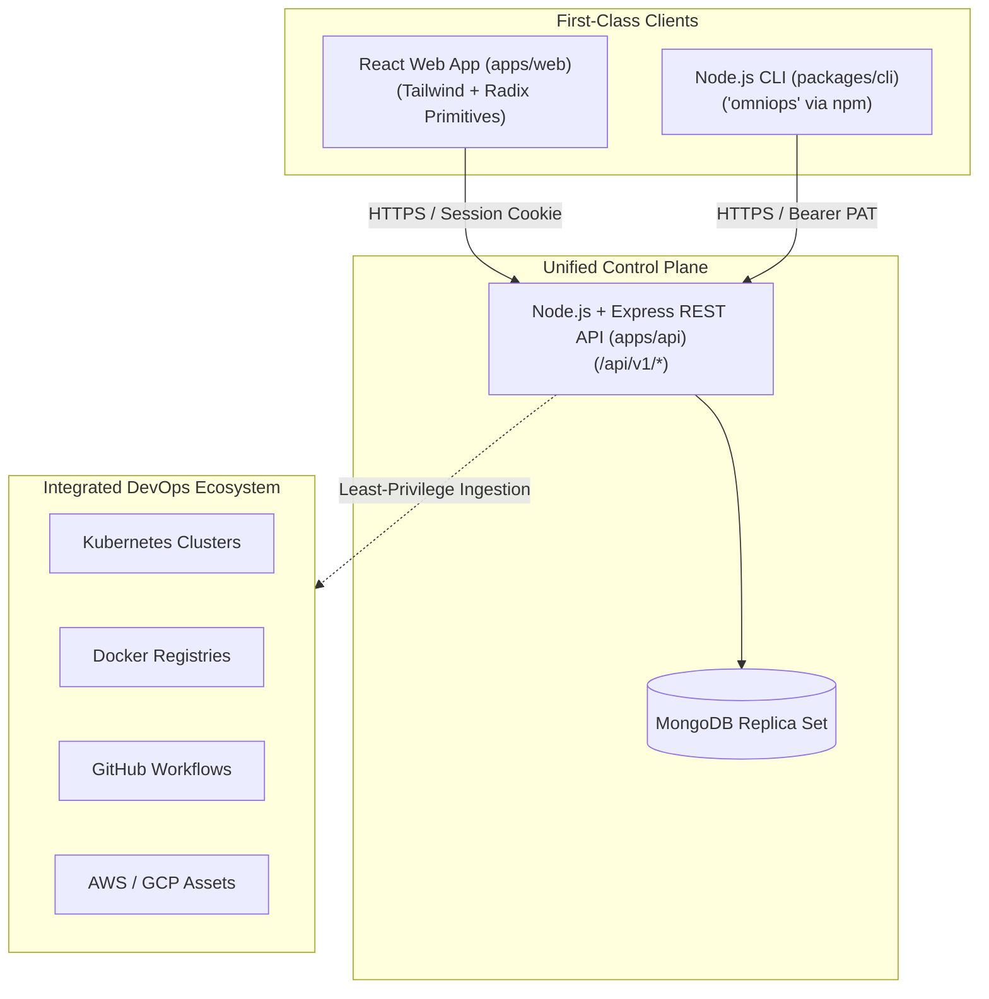

# OmniOPS — Unified DevOps Command Center

| Attribute | Details |
| :--- | :--- |
| **Status** | `Draft / In Active Engineering Specification` |
| **Monorepo Version**| `0.1.0` |
| **License** | [MIT](LICENSE) |
| **Maintained By** | OmniOPS Core Architecture Team Placeholder |
| **Last Updated** | 2026-11-04 (UTC) |

---

> **Disclaimer**: OmniOPS is currently in the active architecture and scaffolding phase. Capabilities described below represent planned architectural specifications and engineering contracts.

---

## 1. Project Overview & Vision

**OmniOPS** is an open-source unified DevOps command center engineered to eliminate context switching across modern infrastructure stacks. It aggregates telemetry, status, logs, and incidents from Kubernetes, Docker, GitHub, and Cloud Providers into a synchronized control plane accessible via two first-class clients:
1. **Authenticated React Web Application**: High-density operational dashboards, cross-cluster topology views, and role-based access management.
2. **Independently Installable Node.js CLI (`omniops`)**: Native terminal client with full API parity for developer workflows and headless CI/CD automation.

Both clients interact strictly through a single, secure, versioned **Node.js + Express REST API** persisting to **MongoDB**.



---

## 2. Core Planned Modules

1. **Command Center Dashboard**: Aggregated operational health score, active deployment feeds, and alert tickers.
2. **GitHub Integration**: Repository sync, Pull Request status checks, and workflow webhook ingestion.
3. **CI/CD Management**: Aggregated pipeline runs, duration analytics, and failed step log inspection.
4. **Docker Management**: Container runtime status, image registry cataloging, and CVE scan indicators.
5. **Kubernetes Management**: Multi-cluster overview, namespace pod inspection, and real-time log streaming.
6. **Infrastructure Monitoring**: Host/cluster telemetry proxies (CPU, memory, disk, network).
7. **Centralized Logging**: Structured log search with automated regex PII and secret redaction.
8. **Cloud Management**: Multi-cloud asset inventory and cost anomaly indicators (Deferred).
9. **Incident Management**: Webhook alert ingestion, SEV-1 through SEV-4 triage rooms, and resolution workflows.
10. **Terraform / IaC Management**: Workspace state inspection and drift detection alerts (Deferred).
11. **Team & Access Management**: Multi-tenant organizations, RBAC (`Owner`, `Admin`, `Operator`, `Viewer`), and CLI PAT lifecycle.
12. **Intelligent DevOps Assistant**: AI-augmented root cause analysis with strict human execution confirmation (Deferred).

---

## 3. Repository Architecture & Layout

The project is organized as a modular monorepo managed via Turborepo:

```
omniops/
├── apps/
│   ├── web/                     # React JavaScript SPA (Vite + Tailwind + Radix UI)
│   └── api/                     # Node.js + Express Modular Monolith API
├── packages/
│   ├── cli/                     # Node.js 'omniops' Command-Line Interface
│   ├── shared/                  # Common utilities, constants, error classes
│   ├── config/                  # Shared ESLint, Prettier, and tooling configs
│   └── validation/              # Shared Zod validation schemas
├── infrastructure/              # Docker Compose, Dockerfiles, and Terraform
├── docs/                        # Complete technical architecture documentation
├── .env.example                 # Root environment variable template
├── package.json                 # Monorepo root workspace configuration
└── turbo.json                   # Turborepo task pipeline definition
```

---

## 4. Quick Start & Local Development

### 4.1 Prerequisites
- **Node.js**: v18.0.0+ LTS
- **Package Manager**: `npm` v9+ or `pnpm`
- **Docker Engine & Docker Compose**: v24+

### 4.2 Local Setup
```bash
# 1. Clone repository
git clone git@github.com:omniops/omniops.git
cd omniops

# 2. Install workspace dependencies
npm install

# 3. Setup environment configuration
cp .env.example .env

# 4. Start local MongoDB container
docker compose -f infrastructure/docker/docker-compose.dev.yml up -d

# 5. Start development servers
npm run dev
```

- Web Portal: `http://localhost:3000`
- API Control Plane: `http://localhost:4000`
- Health Probe: `http://localhost:4000/api/v1/health`

---

## 5. Documentation Directory Map

Comprehensive production-grade specifications are located in [`docs/`](docs/):

- [`docs/00-overview/`](docs/00-overview/): [Project Overview](docs/00-overview/PROJECT_OVERVIEW.md) · [PRD](docs/00-overview/PRODUCT_REQUIREMENTS.md) · [Roadmap](docs/00-overview/PRODUCT_ROADMAP.md) · [Scope & Features](docs/00-overview/SCOPE_AND_FEATURES.md)
- [`docs/01-architecture/`](docs/01-architecture/): [System Architecture](docs/01-architecture/SYSTEM_ARCHITECTURE.md) · [Monorepo](docs/01-architecture/MONOREPO_ARCHITECTURE.md) · [Folder Structure](docs/01-architecture/FOLDER_STRUCTURE.md) · [Data Flow](docs/01-architecture/DATA_FLOW.md) · [ADRs](docs/01-architecture/ARCHITECTURAL_DECISIONS.md)
- [`docs/02-frontend/`](docs/02-frontend/): [Frontend Spec](docs/02-frontend/FRONTEND_SPECIFICATION.md) · [Design System](docs/02-frontend/UI_UX_DESIGN_SYSTEM.md) · [Routing](docs/02-frontend/ROUTING_AND_NAVIGATION.md) · [State Management](docs/02-frontend/FRONTEND_STATE_MANAGEMENT.md)
- [`docs/03-backend/`](docs/03-backend/): [Backend Spec](docs/03-backend/BACKEND_SPECIFICATION.md) · [API Standards](docs/03-backend/API_STANDARDS.md) · [API Endpoints](docs/03-backend/API_ENDPOINTS.md) · [Auth & RBAC](docs/03-backend/AUTHENTICATION_AND_AUTHORIZATION.md) · [Jobs & Events](docs/03-backend/BACKGROUND_JOBS_AND_EVENTS.md)
- [`docs/04-cli/`](docs/04-cli/): [CLI Product Spec](docs/04-cli/CLI_PRODUCT_SPECIFICATION.md) · [CLI Architecture](docs/04-cli/CLI_ARCHITECTURE.md) · [Command Reference](docs/04-cli/CLI_COMMAND_REFERENCE.md) · [Config & Auth](docs/04-cli/CLI_CONFIGURATION_AND_AUTH.md)
- [`docs/05-database/`](docs/05-database/): [Database Design](docs/05-database/DATABASE_DESIGN.md) · [Data Models](docs/05-database/DATA_MODELS_AND_SCHEMAS.md) · [Lifecycle & Backups](docs/05-database/DATA_LIFECYCLE_AND_BACKUPS.md)
- [`docs/06-security/`](docs/06-security/): [Security Architecture](docs/06-security/SECURITY_ARCHITECTURE.md) · [Threat Model](docs/06-security/THREAT_MODEL.md) · [Compliance](docs/06-security/SECURITY_AND_COMPLIANCE.md)
- [`docs/07-testing/`](docs/07-testing/): [Testing Strategy](docs/07-testing/TESTING_STRATEGY.md) · [Quality Standards](docs/07-testing/QUALITY_STANDARDS.md)
- [`docs/08-devops/`](docs/08-devops/): [Containerization](docs/08-devops/CONTAINERIZATION_AND_LOCAL_DEVELOPMENT.md) · [CI/CD](docs/08-devops/CI_CD_AND_DEPLOYMENT.md) · [IaC](docs/08-devops/INFRASTRUCTURE_AS_CODE.md)
- [`docs/09-developer-experience/`](docs/09-developer-experience/): [Dev Guidelines](docs/09-developer-experience/DEVELOPMENT_GUIDELINES.md) · [API Docs Guidelines](docs/09-developer-experience/API_DOCUMENTATION_GUIDELINES.md)

---

## 6. Contributing & Security

- Contributions are governed by our [Contribution Guidelines](CONTRIBUTING.md) and [Development Guidelines](docs/09-developer-experience/DEVELOPMENT_GUIDELINES.md).
- To report a security vulnerability, refer to our [Security Policy](SECURITY.md).
