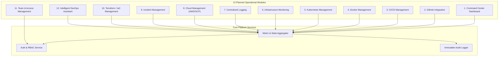
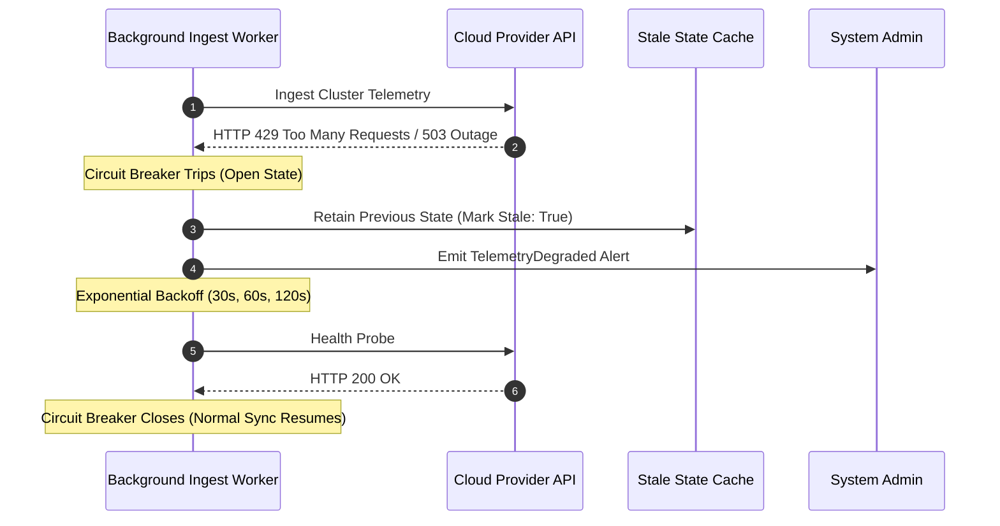

# OmniOPS — Product Requirements Document (PRD)

| Attribute | Details |
| :--- | :--- |
| **Document ID** | `DOC-00-OVR-02` |
| **Status** | `Draft` (Pending Architectural Review) |
| **Version** | `0.1.0` |
| **Document Owner** | Lead Product Manager Placeholder |
| **Target Audience** | Product Managers, Engineering Leads, Frontend/Backend/CLI Engineers, QA Leads |
| **Last Updated** | 2026-11-04 (UTC) |

---

## 1. Document Control & Executive Summary

### 1.1 Executive Summary
This Product Requirements Document (PRD) defines the functional and non-functional specifications for OmniOPS. It establishes unambiguous, verifiable requirements with stable identifiers (`FR-xxx` for functional requirements and `NFR-xxx` for non-functional requirements), explicit acceptance criteria, operational workflows, and failure modes across both client tiers (React Web App and Node.js CLI) and the shared Express API control plane.

### 1.2 System Boundary & Product Baseline
All requirements in this PRD adhere to the OmniOPS foundational baseline:
- Client Tiers: Single-page React Application (JavaScript, Tailwind CSS, Radix UI primitives) and Node.js CLI (`omniops`).
- Shared API: Node.js + Express REST API backed by MongoDB.
- Security Model: Mandatory multi-tenancy, least-privilege provider access, read-only default postures, and zero client-side secret exposure.

---

## 2. Purpose, Audience, Scope & Terminology

### 2.1 Scope & Phasing
- **Phase 1 (MVP)**: Focuses on core authentication, multi-tenant workspace partitioning, unified command center dashboard, read-only telemetry aggregation for GitHub, Docker, Kubernetes, and Cloud, paired with CLI parity and comprehensive audit trails.
- **Phase 2 (Post-MVP)**: Gated mutation workflows, incident management alerting, Terraform state drift inspection, and intelligent DevOps assistance.
- **Explicit Exclusions (Non-Goals)**:
  - Replacing native cloud provider billing engines.
  - Arbitrary remote shell execution via browser sessions.
  - Autonomous write-action executions without human approval.

### 2.2 Requirement Priority Definitions
- **P0 (Critical / Blocker)**: Core MVP requirement; system cannot ship without it.
- **P1 (High)**: Essential operational capability; scheduled for MVP release or immediate fast-follow.
- **P2 (Medium)**: Enhanced usability, workflow automation, or secondary integration; planned for subsequent releases.

---

## 3. Normative Functional Requirements (FR)

### 3.1 Authentication & Workspace Identity Management

#### `FR-AUTH-001`: User Registration & Authentication
- **Priority**: `P0`
- **Actor**: Unauthenticated User / Developer
- **Preconditions**: User has valid email address or OAuth account.
- **Main Flow**:
  1. User navigates to web signup or invokes `omniops auth login`.
  2. User inputs credentials (email/password) or authenticates via GitHub OAuth.
  3. Server validates credentials against MongoDB users collection.
  4. Server issues secure HTTP-only session cookie (Web) or Personal Access Token (CLI).
- **Alternate / Error Flows**:
  - Invalid credentials return HTTP 401 Unauthorized with standardized error payload.
  - Exceeded rate limits return HTTP 429 Too Many Requests.
- **Acceptance Criteria**:
  - Web sessions persist across page refreshes via secure cookies.
  - CLI tokens are securely saved in OS keychain/credential store.
  - Passwords hashed using Argon2id or bcrypt (minimum cost factor 12).

#### `FR-TENANT-002`: Multi-Tenant Organization & Workspace Partitioning
- **Priority**: `P0`
- **Actor**: Authenticated Organization Admin
- **Preconditions**: User is logged in.
- **Main Flow**:
  1. User creates an Organization entity.
  2. Organization is partitioned into one or more Workspaces (e.g., `Production`, `Staging`).
  3. All subsequent entities (integrations, alerts, pods, logs) are tagged with `organizationId` and `workspaceId`.
- **Acceptance Criteria**:
  - Cross-tenant data leakage is mathematically impossible at the database query layer.
  - Users can switch active workspaces in both Web UI and CLI without re-authenticating.

#### `FR-RBAC-003`: Role-Based Access Control (RBAC)
- **Priority**: `P0`
- **Actor**: Organization Member
- **Preconditions**: User belongs to an active Organization.
- **Role Hierarchy**:
  - `Owner`: Full administrative control, billing, deletion of organization.
  - `Admin`: Workspace creation, integration credential management, member provisioning.
  - `Operator`: Read-only access to all modules + permission to acknowledge alerts and trigger approved rollbacks.
  - `Viewer`: Read-only access across all dashboards, metrics, logs, and CLI status queries.
- **Acceptance Criteria**:
  - An `Operator` or `Viewer` attempting a credential rotation receives HTTP 403 Forbidden.
  - Role permissions are validated on every API endpoint via shared authorization middleware.

---

### 3.2 Unified Command Center & Core Modules

#### `FR-CMD-004`: Unified Command Center Dashboard
- **Priority**: `P0`
- **Actor**: All Authenticated Users
- **Main Flow**:
  1. User opens root web dashboard (`/dashboard`) or runs `omniops status`.
  2. Aggregator collates health statuses across active Kubernetes clusters, active CI/CD pipelines, pending incidents, and cloud health.
  3. Renders a unified timeline, high-priority alert cards, and system status indicators.
- **Acceptance Criteria**:
  - Dashboard loads initial paint in under 1.5 seconds on a broadband connection.
  - Real-time updates push via SSE or TanStack Query polling (configurable interval: default 30s).

#### `FR-K8S-005`: Kubernetes Cluster Telemetry & Pod Inspection
- **Priority**: `P0` (Read-only MVP)
- **Actor**: Operator / Developer
- **Main Flow**:
  1. User selects cluster and namespace in Web UI or executes `omniops k8s pods -n <namespace>`.
  2. Control plane proxies query to configured cluster agent/read-only kubeconfig.
  3. Displays pod status (`Running`, `CrashLoopBackOff`, `Pending`), restart counts, and CPU/memory quotas.
- **Acceptance Criteria**:
  - Cluster tokens/credentials are decrypted only in backend memory and never sent to clients.
  - Pod log retrieval supports streaming tail (last 100 lines) with ANSI color preservation in CLI.

#### `FR-LOG-006`: Centralized Log Stream Ingestion & Search
- **Priority**: `P1`
- **Actor**: Developer / SRE
- **Main Flow**:
  1. User queries logs via UI search bar or `omniops logs search --query "error"`.
  2. Aggregator filters indexed log records by timestamp range, severity (`INFO`, `WARN`, `ERROR`), and service tags.
- **Acceptance Criteria**:
  - Search results return in under 500ms for queries spanning the previous 24 hours.
  - Sensitive values (tokens, credit cards, bearer tokens) are masked via redaction filters prior to indexing.

#### `FR-INC-007`: Incident Ingestion & Escalation Workflow
- **Priority**: `P1`
- **Actor**: SRE / On-Call Engineer
- **Main Flow**:
  1. Webhook alert triggers from external system (PagerDuty/Prometheus Alertmanager) or internal threshold breach.
  2. OmniOPS creates an Incident object with severity `SEV-1` through `SEV-4`.
  3. On-call user acknowledges incident via Web or `omniops incident ack <id>`.
- **Acceptance Criteria**:
  - Duplicate alerts within a 15-minute sliding window are automatically deduplicated.
  - Audit record is created detailing the acknowledge timestamp and actor ID.

---

### 3.3 Command-Line Interface (CLI) Parity

#### `FR-CLI-008`: CLI Command Parity & Authentication
- **Priority**: `P0`
- **Actor**: Developer in Terminal
- **Preconditions**: Node.js installed; package `omniops` installed.
- **Main Flow**:
  1. User runs `omniops auth login`. CLI generates local loopback server or browser verification code.
  2. Browser confirms authorization; API generates personal access token.
  3. CLI securely stores token and config in OS credential vault.
  4. Subsequent commands (`omniops status`, `omniops k8s`, `omniops logs`) automatically supply token.
- **Acceptance Criteria**:
  - Output formats support interactive human-readable tables and raw JSON (`--json` flag) for scripting.
  - Token expiration prompts clean re-authentication message without stack traces.

---

## 4. Normative Non-Functional Requirements (NFR)

### 4.1 Performance & Latency Targets

| Requirement ID | Category | Target Metric | Verification Method |
| :--- | :--- | :--- | :--- |
| **`NFR-PERF-001`** | API Latency | P95 < 250ms for read requests | Automated k6 load tests in CI |
| **`NFR-PERF-002`** | Dashboard First Contentful Paint | FCP < 1.2s, LCP < 2.0s | Lighthouse CI audits |
| **`NFR-PERF-003`** | CLI Cold Startup Time | Execution initiation < 200ms | Benchmark test suite |
| **`NFR-PERF-004`** | Database Index Efficiency | Zero unindexed collection scans | MongoDB explain query audits |

### 4.2 Security, Privacy & Compliance Targets

| Requirement ID | Category | Specification | Verification Method |
| :--- | :--- | :--- | :--- |
| **`NFR-SEC-001`** | Secret Storage | AES-256-GCM envelope encryption for stored cloud/K8s credentials | Automated cryptographic unit tests |
| **`NFR-SEC-002`** | Transport Security | TLS 1.3 mandatory; HSTS enabled with max-age 31536000 | SSL Labs A+ rating verification |
| **`NFR-SEC-003`** | Audit Logging | Immutable audit entries for 100% of state-changing operations | Audit log integration assertions |
| **`NFR-SEC-004`** | Least Privilege Default | MVP provider connections default to Read-Only IAM/RBAC scopes | Integration setup validation rules |

### 4.3 Availability & Fault Tolerance Targets
- **`NFR-REL-001`**: Control plane API target availability of 99.9% uptime during business hours.
- **`NFR-REL-002`**: Graceful degradation when external providers (e.g., GitHub API outage) fail; UI displays stale cache warning without crashing.

### 4.4 Accessibility & UX
- **`NFR-A11Y-001`**: Web UI **MUST** adhere to WCAG 2.1 Level AA standards, supporting full keyboard navigation, screen-reader aria attributes, and minimum 4.5:1 color contrast ratios.

---

## 5. Workflows, Edge Cases & Failure Recovery

### 5.1 Provider Sync Failure Mode & Circuit Breaking

### 5.2 Edge Cases
- **Clock Drift**: All API timestamps are parsed and stored in strict UTC (ISO-8601). Display clients convert to local timezone dynamically.
- **Token Invalidation**: When a user rotates an API key or password, all active sessions and CLI tokens for that key are immediately revoked across all worker nodes.

---

## 6. Testing Strategy & Measurable Acceptance Criteria

1. **Unit Test Coverage**: Minimum 85% statement coverage across core business logic, RBAC middleware, and validation schemas.
2. **Contract Testing**: OpenAPI/Swagger contract testing ensuring Web and CLI consume identical schema payloads.
3. **Multi-Tenancy Leak Testing**: Automated negative security suite attempting cross-tenant record retrieval (`tenant_A` attempting to query `tenant_B` records).

---

## 7. Dependencies, Risks & Unresolved Decisions

### 7.1 Dependencies
- Stable Node.js LTS runtime and MongoDB replica set availability.
- Cloud provider IAM permission availability for read-only telemetry roles.

### 7.2 Open Technical Decisions
- **PRD-DEC-01**: Confirmation of real-time protocol (Server-Sent Events vs WebSockets) for live log and incident streaming.
- **PRD-DEC-02**: Finalization of background job runner framework (Redis-backed BullMQ vs MongoDB-based agenda/worker).

---

## 8. Related Documents & Traceability

- [Project Overview](PROJECT_OVERVIEW.md)
- [Product Roadmap](PRODUCT_ROADMAP.md)
- [Scope & Feature Catalog](SCOPE_AND_FEATURES.md)
- [System Architecture](../01-architecture/SYSTEM_ARCHITECTURE.md)
- [API Standards](../03-backend/API_STANDARDS.md)
- [Security Architecture](../06-security/SECURITY_ARCHITECTURE.md)
