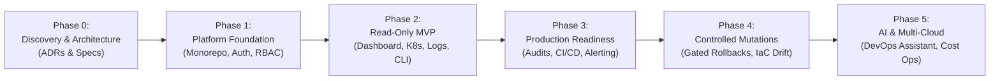
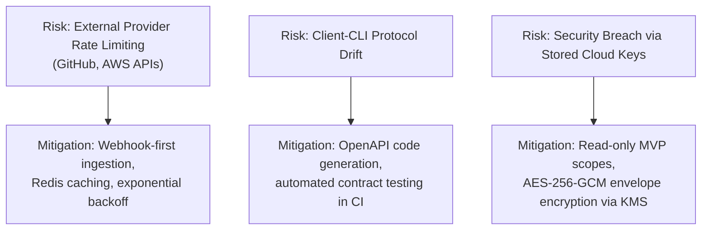

# OmniOPS — Product Roadmap

| Attribute | Details |
| :--- | :--- |
| **Document ID** | `DOC-00-OVR-03` |
| **Status** | `Draft` (Pending Architectural Review) |
| **Version** | `0.1.0` |
| **Document Owner** | Head of Product / Technical Program Manager Placeholder |
| **Target Audience** | Engineering Leadership, Product Managers, Platform Engineers, SREs |
| **Last Updated** | 2026-11-04 (UTC) |

---

## 1. Document Control & Executive Summary

### 1.1 Executive Summary
This document outlines the dependency-aware, phased product roadmap for OmniOPS. The platform trajectory follows a strict evolutionary engineering principle: establishing an uncompromised, **read-only observability and control foundation** before introducing state-mutating infrastructure operations and AI-augmented automation.

### 1.2 Phasing Philosophy & Guardrails
- **Read-Only First**: Initial production phases strictly ingest telemetry, metadata, and status records. Mutation capabilities (pod restart, deployment rollback, scaling) are decoupled into secondary milestones gated by policy engines and approval workflows.
- **Client Parity**: Every milestone delivers synchronized features across both the Web Application and the Node.js CLI.
- **Zero Hallucinated Dates**: Milestones are sequenced by dependency completion gates and exit criteria rather than calendar dates.

---

## 2. Purpose, Audience, Scope & Terminology

### 2.1 Purpose
To provide an unambiguous engineering roadmap that sequences architectural decisions, core platform services, module delivery, security audits, and production launch gates.

### 2.2 Scope & Governance
- **Committed Scope**: Phases 0 through 3 (Discovery through Production MVP).
- **Candidate / Future Scope**: Phases 4 and 5 (Advanced Mutations, AI DevOps Assistant, Multi-Cloud Policy Automation).
- **Roadmap Governance**: Amendments to milestone exit criteria require approval from the Principal Architect, Security Lead, and Product Lead via formal ADR revision.

---

## 3. High-Level Phase Progression

---

## 4. Detailed Milestone Specifications

### Phase 0: Discovery & Architecture Baseline
- **Objective**: Establish all core engineering contracts, technical selections, and interface specifications prior to writing production code.
- **Key Deliverables**:
  - Authoritative Architecture Decision Records (ADRs) for Monorepo tool (Turborepo vs Nx), Auth framework, and MongoDB data layer.
  - Complete OpenAPI 3.1 specification for core API routes.
  - UI/UX Design System tokens based on Tailwind CSS and Radix UI primitives.
- **Exit Criteria / Gates**:
  - 100% of core architecture specifications approved by lead reviewers.
  - Zero unaddressed critical security ambiguities.

---

### Phase 1: Core Platform Foundation
- **Objective**: Implement the baseline monorepo scaffold, shared packages, authentication engine, and tenant isolation layers.
- **Key Deliverables**:
  - Monorepo tooling active (`apps/web`, `apps/api`, `packages/cli`, `packages/shared`, `packages/config`, `packages/validation`).
  - Express API foundation with security middleware (Helmet, CORS, rate limiting).
  - MongoDB database schemas with automated tenant-scoping plugins.
  - Authentication engine: Web session cookies + CLI Personal Access Tokens (PAT).
  - RBAC authorization middleware enforcing `Owner`, `Admin`, `Operator`, `Viewer`.
- **Exit Criteria / Gates**:
  - Automated integration tests verify that cross-tenant data access is blocked (HTTP 403/404).
  - CLI `omniops auth login` and `omniops auth status` successfully authenticate against the Express API.

---

### Phase 2: Read-Only MVP Delivery
- **Objective**: Deliver a production-grade read-only operations cockpit across the Web UI and CLI.
- **Module Focus**:
  - **Module 1**: Command Center Dashboard (Aggregated health widgets).
  - **Module 2**: GitHub Integration (Repository listing, PR status, run telemetry).
  - **Module 4**: Docker Management (Container status, image registries).
  - **Module 5**: Kubernetes Management (Cluster pods, namespaces, service health, log tails).
  - **Module 7**: Centralized Logging (Structured log querying and severity filtering).
  - **Module 11**: Team & Access Management (User invitations, API key management).
- **Exit Criteria / Gates**:
  - P95 query latency under 250ms for aggregated dashboard views.
  - No secret tokens, private keys, or passwords ever exposed in client responses or CLI debug output.
  - End-to-end telemetry sync validated across at least one staging Kubernetes cluster.

---

### Phase 3: Production Readiness & Beta Launch
- **Objective**: Harden the platform for external beta deployment, multi-region observability, and operational resilience.
- **Key Deliverables**:
  - Infrastructure-as-Code (Terraform) scripts for production deployment.
  - Containerization: Production Dockerfiles and Docker Compose local stacks.
  - Comprehensive CI/CD pipelines with gitleaks secret scanning and OWASP dependency audits.
  - Formal Threat Model review and third-party penetration testing remediation.
- **Exit Criteria / Gates**:
  - Zero High or Critical CVEs in production container images.
  - Target 99.9% availability demonstrated in staging soak test.
  - Automated database backup and point-in-time restore verified.

---

### Phase 4: Controlled Mutations & Incident Management (Post-MVP)
- **Objective**: Introduce strictly audited, policy-gated infrastructure mutations.
- **Module Focus**:
  - **Module 3**: CI/CD Management (Rerun failed workflows with approval).
  - **Module 9**: Incident Management (Alert ingestion, escalation policies, PagerDuty sync).
  - **Module 10**: Terraform Management (State drift detection, speculative plan previews).
- **Exit Criteria / Gates**:
  - Two-person rule (dual authorization) enforced for production-level destructive actions.
  - 100% of mutation requests generate immutable audit log records.

---

### Phase 5: Intelligent DevOps Assistant & Advanced Cloud Ops (Future Vision)
- **Objective**: Deliver AI-augmented diagnostic capabilities and automated multi-cloud resource governance.
- **Module Focus**:
  - **Module 8**: Cloud Management (AWS/GCP cost anomaly detection, unattached disk cleanup recommendations).
  - **Module 12**: Intelligent DevOps Assistant (Context-aware root cause analysis from pod logs and stack traces).
- **Exit Criteria / Gates**:
  - AI prompt-injection guardrails formally validated against OWASP LLM Top 10.
  - Strict human-in-the-loop requirement: AI suggestions require explicit operator execution confirmation.

---

## 5. Milestone Traceability Matrix

| Milestone | Modules Addressed | Client Capabilities Delivered | Security & Compliance Gates |
| :--- | :--- | :--- | :--- |
| **Phase 0** | Specs & ADRs | Architecture documentation & mockups | Security baseline established |
| **Phase 1** | Auth, Core Scaffolding | CLI login, Web login, Workspace switcher | Tenant isolation unit tests |
| **Phase 2** | Modules 1, 2, 4, 5, 7, 11 | Read-only K8s/Docker/GitHub views, CLI tail | Read-only IAM validation |
| **Phase 3** | Production Ops, CI/CD | Beta access, self-service onboarding | Pen-test & secret scan sign-off |
| **Phase 4** | Modules 3, 9, 10 | Incident triage, safe rollback triggers | Policy-gated mutation verification |
| **Phase 5** | Modules 8, 12 | Cloud cost audits, AI log summaries | AI guardrail & privacy sign-off |

---

## 6. Risks, Dependencies & Mitigation Strategies

---

## 7. Related Documents & Traceability

- [Project Overview](PROJECT_OVERVIEW.md)
- [Product Requirements Document](PRODUCT_REQUIREMENTS.md)
- [Scope & Feature Catalog](SCOPE_AND_FEATURES.md)
- [System Architecture](../01-architecture/SYSTEM_ARCHITECTURE.md)
- [Testing Strategy](../07-testing/TESTING_STRATEGY.md)
- [CI/CD & Deployment](../08-devops/CI_CD_AND_DEPLOYMENT.md)
