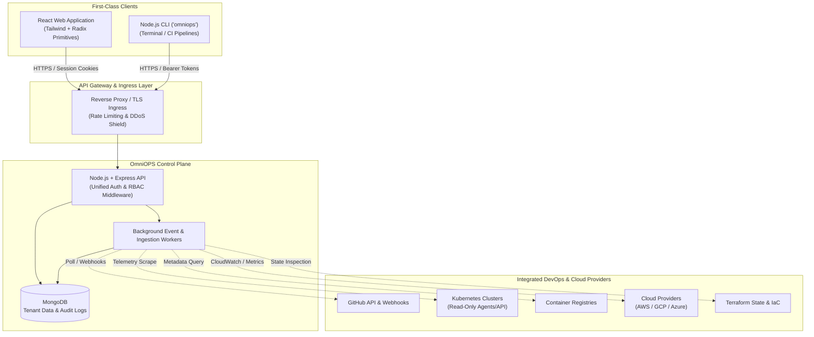
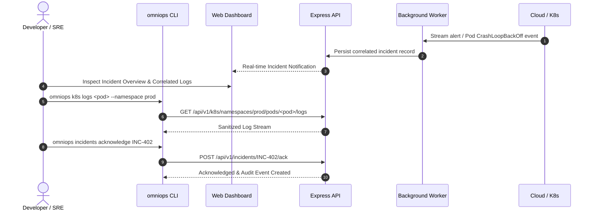

# OmniOPS — Project Overview

| Attribute | Details |
| :--- | :--- |
| **Document ID** | `DOC-00-OVR-01` |
| **Status** | `Draft` (Pending Architectural Review) |
| **Version** | `0.1.0` |
| **Document Owner** | Principal Architect Placeholder |
| **Target Audience** | Engineering Leadership, Architects, Product Managers, Security Engineers, DevOps Engineers |
| **Last Updated** | 2026-11-04 (UTC) |

---

## 1. Document Control & Executive Summary

### 1.1 Executive Summary
OmniOPS is a planned, unified DevOps command center engineered to eliminate operational fragmentation across modern cloud-native engineering organizations. The platform establishes a single operational control plane that bridges two first-class clients:
1. A **Public React Website & Authenticated React Web Application** providing high-visibility command center dashboards, cross-cloud observability, and role-based access management.
2. An independently installable **Node.js Command-Line Interface (CLI)** (`omniops`) tailored for developer terminal workflows, scripted operations, and CI/CD pipelines.

Both clients interact strictly through a single, secure, versioned **Node.js + Express REST API** coupled to a schema-enforced **MongoDB** datastore. By emphasizing an initial **read-only, least-privilege security posture**, OmniOPS aggregates infrastructure state across GitHub, CI/CD, Docker, Kubernetes, Cloud Providers (AWS/GCP/Azure), and Terraform into correlated timelines and intelligent incident views before permitting strictly audited, policy-gated mutation workflows.

---

## 2. Purpose, Audience, Scope, Non-Goals & Terminology

### 2.1 Purpose
This document serves as the canonical foundational charter for OmniOPS. It establishes the high-level system context, strategic goals, target user personas, system boundaries, and governing engineering principles that guide all subsequent architecture and specification documents.

### 2.2 Target Audience
- **Core Engineering Teams**: Guides client, server, CLI, and infrastructure implementations.
- **Security & Compliance Auditors**: Defines system boundaries, isolation guarantees, and operational constraints.
- **Product & DevOps Stakeholders**: Sets roadmap expectations, functional scope, and module categorization.

### 2.3 Product Scope & Boundaries
- **In Scope**:
  - Unified multi-tenant control plane for infrastructure aggregation and visualization.
  - Multi-provider read-only state correlation for containers, clusters, cloud assets, and deployment pipelines.
  - Granular Role-Based Access Control (RBAC) and tenant workspace isolation.
  - Unified logging, metric ingestion proxies, and incident correlation engines.
  - Secure developer CLI parity with the REST control plane.
- **Out of Scope (Non-Goals)**:
  - Replacing specialized monitoring backends (OmniOPS is an aggregation layer, not a replacement for Prometheus, Datadog, or Grafana).
  - Arbitrary remote shell access or untrusted remote code execution from web browsers.
  - Autonomous write-action executions without human approval or policy gates.
  - Direct relational SQL migrations (MongoDB is the designated primary database).

### 2.4 Terminology & Acronyms
- **Control Plane**: The centralized Node.js/Express API and background workers orchestrating state, auth, and external provider synchronization.
- **First-Class Client**: A user interface (Web UI or CLI) that consumes the public control plane API with full feature authorization parity.
- **ADR**: Architecture Decision Record; formal justification for architectural choices.
- **RBAC**: Role-Based Access Control enforcing tenant-scoped permissions (`Viewer`, `Operator`, `Admin`, `Owner`).
- **Least-Privilege Ingestion**: Ingesting read-only infrastructure telemetry prior to granting any mutation capabilities.

---

## 3. Normative Requirements & System Constraints

### 3.1 Normative Requirements (RFC 2119)
- **REQ-001**: The platform **MUST** expose a single, uniform REST API consumed identically by the Web client and the CLI client.
- **REQ-002**: The CLI **MUST NOT** bypass server-side authorization or access the database directly.
- **REQ-003**: The Web UI **MUST** be authored using React with JavaScript (`.jsx`), Tailwind CSS, and Radix UI / shadcn/ui primitives. TypeScript or Next.js **MUST NOT** be used unless approved via an explicit ADR.
- **REQ-004**: Credentials, secret keys, and cloud tokens **MUST NOT** be stored in plaintext or exposed to browser bundles.
- **REQ-005**: All destructive operations (pod restarts, rollbacks, infrastructure destruction) **MUST** require explicit confirmation, role authorization, and comprehensive audit log generation.

### 3.2 Technical Baseline & Constraints

| Component | Standard / Technology | Decision State |
| :--- | :--- | :--- |
| **Frontend Framework** | React (JavaScript / JSX) | `APPROVED DECISION` |
| **Frontend Styling** | Tailwind CSS + Radix UI Primitives | `APPROVED DECISION` |
| **Client Data Fetching** | TanStack Query + HTTP Caching | `APPROVED DECISION` |
| **Backend Runtime** | Node.js (LTS) + Express | `APPROVED DECISION` |
| **Primary Database** | MongoDB (Document Store) | `APPROVED DECISION` |
| **CLI Runtime** | Node.js (`omniops`) via npm | `APPROVED DECISION` (npm name availability pending) |
| **Monorepo Build System** | Turborepo vs Nx | `PROPOSED DESIGN` (Pending ADR-0001) |
| **Auth Engine** | Better Auth vs Auth.js vs Custom JWT | `PROPOSED DESIGN` (Pending ADR-0002) |
| **ORM / Data Access** | Mongoose vs Native MongoDB Driver | `PROPOSED DESIGN` (Pending ADR-0003) |
| **Background Queue** | Redis BullMQ vs MongoDB Worker | `PROPOSED DESIGN` (Pending ADR-0004) |

---

## 4. Product Context & Architecture Overview

### 4.1 System Context Diagram

### 4.2 Planned Product Modules Overview

OmniOPS organizes operational capabilities into 12 core functional modules. All modules are currently in `PROPOSED DESIGN` status for progressive delivery:

1. **Command Center Dashboard**: Aggregated high-level health score, active deployment streams, incident alerts, and cross-cluster resource utilization.
2. **GitHub Integration**: Repository sync, Pull Request status tracking, release monitoring, and webhook event streaming.
3. **CI/CD Management**: Aggregated visualization of build pipelines, workflow runs, duration trends, and failure root-cause pointers.
4. **Docker Management**: Local and remote container runtime visibility, image registry inspection, vulnerability scan status, and container lifecycles.
5. **Kubernetes Management**: Multi-cluster namespace overview, pod health, deployment status, rollout history, and read-only resource events.
6. **Infrastructure Monitoring**: Host and cluster telemetry (CPU, memory, disk, network) aggregated via Prometheus/CloudWatch ingestion adapters.
7. **Centralized Logging**: Structured log stream aggregation, multi-service correlation, severity filtering, and error spike detection.
8. **Cloud Management**: AWS/GCP resource inventory, cost anomaly indicators, region status, and security compliance postures.
9. **Incident Management**: Alert ingestion, deduplication, incident triage rooms, on-call timeline correlation, and resolution tracking.
10. **Terraform / IaC Management**: Workspace state tracking, drift detection notifications, plan inspection, and policy-as-code validation.
11. **Team & Access Management**: Multi-tenant organizations, workspaces, team provisioning, API key lifecycle, and audit logs.
12. **Intelligent DevOps Assistant**: AI-augmented log analysis, incident remediation summaries, and policy-guarded query assistance.

---

## 5. User Personas & Workflows

### 5.1 Key Personas

| Persona | Primary Role | Primary Goals | Key Touchpoints |
| :--- | :--- | :--- | :--- |
| **DevOps / Platform Engineer** | Infrastructure & Cluster Ops | Maintain uptime, orchestrate deployments, debug cluster failures | K8s Module, Terraform Module, Monitoring, CLI |
| **Software Developer** | Application Feature Delivery | Track PR builds, check service logs, inspect staging containers | GitHub Module, CI/CD Module, Logging, CLI |
| **Site Reliability Engineer (SRE)** | Reliability & Incident Response | Rapid incident triage, alert correlation, post-mortem analysis | Incident Management, Monitoring, Audit Logs |
| **Engineering Leader / VP** | Governance & Security | Cost visibility, security compliance, cross-team velocity | Command Center, Cloud Costs, Team Access |

### 5.2 Primary Operational Workflow: Incident Detection to Remediation

---

## 6. Security, Tenancy & Compliance Baseline

### 6.1 Multi-Tenant Isolation
- Every core entity (user, integration, incident, audit log) **MUST** be bounded by an `organizationId` and optional `workspaceId`.
- Cross-tenant queries are strictly prohibited via mandatory database query scoping middleware.

### 6.2 Authentication & Authorization Parity
- **Web App**: Uses secure, `HttpOnly`, `SameSite=Lax`, TLS-encrypted session cookies with CSRF double-submit token protection.
- **CLI**: Uses scoped API Personal Access Tokens (PAT) stored locally in the OS keychain/secret-store (`secret-tool`, macOS Keychain, Windows Credential Vault). Plaintext storage in home directories is prohibited.

### 6.3 Audit Trail Guarantee
- Any action resulting in a state mutation, credential update, or infrastructure query **MUST** write an immutable audit log entry containing: `timestamp` (UTC), `actorId`, `actorType` (`user` | `cli` | `system`), `action`, `resourceId`, `ipAddress`, and `result`.

---

## 7. Performance, Reliability & Scalability

- **API Latency SLA**: P95 response times **MUST** remain under 250ms for aggregated metadata queries.
- **Client Cache Strategy**: TanStack Query **MUST** employ optimistic updates for UI mutations and stale-while-revalidate policies (default 30s TTL) for external provider data.
- **Worker Backoff**: Provider polling workers **MUST** respect exponential backoff and rate-limit headers (e.g., GitHub API 5,000 req/hr limits) to prevent cascading ingestion failures.

---

## 8. Testing Strategy & Acceptance Criteria

### 8.1 Verification Criteria
1. **Zero Plaintext Secrets**: Automated static analysis (gitleaks) must pass in CI.
2. **Client Parity Verification**: Core read APIs must be covered by integration tests validating identical payloads returned to Web and CLI clients.
3. **RBAC Enforcement**: Negative tests must verify that `Viewer` roles receive HTTP 403 Forbidden on mutation endpoints.

---

## 9. Dependencies, Risks & Unresolved Decisions

### 9.1 Open Architecture Decisions
- **DEC-001**: Choice between Turborepo and Nx for monorepo workspace management.
- **DEC-002**: Choice of authentication library (`Better-Auth` vs `Auth.js` vs standalone JWT session engine).
- **DEC-003**: Selection of MongoDB abstraction layer (`Mongoose` vs `@prisma/client` with MongoDB provider vs native driver).
- **DEC-004**: Selection of npm package name for CLI (`omniops` check required before public release).

### 9.2 Key Risks
- **External API Rate Limiting**: Heavy multi-tenant polling of GitHub/AWS can exhaust rate limits; requires webhook-first design.
- **Credential Storage Security**: Storing customer cloud keys requires a dedicated KMS envelope encryption strategy.

---

## 10. Related Documents & Traceability

- [Product Requirements Document (PRD)](PRODUCT_REQUIREMENTS.md)
- [Product Roadmap](PRODUCT_ROADMAP.md)
- [Scope & Features Catalog](SCOPE_AND_FEATURES.md)
- [System Architecture Specification](../01-architecture/SYSTEM_ARCHITECTURE.md)
- [Monorepo Architecture](../01-architecture/MONOREPO_ARCHITECTURE.md)
- [Folder Structure Specification](../01-architecture/FOLDER_STRUCTURE.md)
- [Architectural Decision Records](../01-architecture/ARCHITECTURAL_DECISIONS.md)
