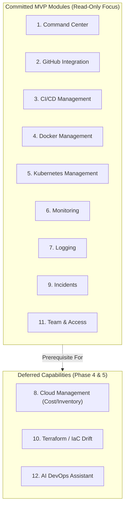
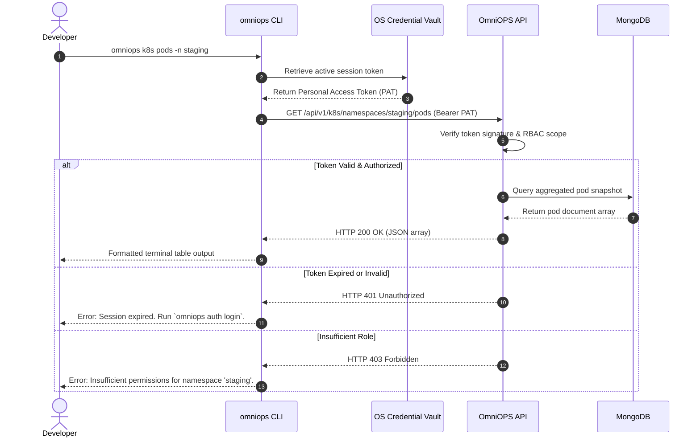

# OmniOPS — Scope & Feature Catalog

| Attribute | Details |
| :--- | :--- |
| **Document ID** | `DOC-00-OVR-04` |
| **Status** | `Draft` (Pending Architectural Review) |
| **Version** | `0.1.0` |
| **Document Owner** | Lead Technical Product Manager Placeholder |
| **Target Audience** | Engineering Leadership, Product Managers, Frontend/Backend/CLI Engineers, QA Leads |
| **Last Updated** | 2026-11-04 (UTC) |

---

## 1. Document Control & Executive Summary

### 1.1 Executive Summary
This document establishes the exhaustive feature inventory, scope boundaries, and client parity mapping across the 12 planned functional modules of OmniOPS. It demarcates what is included in the **Minimum Viable Product (MVP)** versus what is intentionally **Deferred to Later Phases** or categorized as an explicit **Non-Goal**.

### 1.2 Module Scope Matrix Summary

| # | Module Name | MVP Status | Security Scope | Primary Client Surface |
| :--- | :--- | :--- | :--- | :--- |
| **1** | Command Center Dashboard | `Committed MVP` | Low (Aggregated Metadata) | Web Dashboard, CLI `status` |
| **2** | GitHub Integration | `Committed MVP` | Medium (OAuth Scopes) | Web Repos, CLI `repo` |
| **3** | CI/CD Management | `Committed MVP` | Medium (Read Telemetry) | Web Pipelines, CLI `pipeline` |
| **4** | Docker Management | `Committed MVP` | High (Registry & Container metadata) | Web Containers, CLI `docker` |
| **5** | Kubernetes Management | `Committed MVP` | High (Read-Only Cluster Telemetry) | Web K8s, CLI `k8s` |
| **6** | Infrastructure Monitoring | `Committed MVP` | Medium (Metric Ingestion) | Web Metrics, CLI `metrics` |
| **7** | Centralized Logging | `Committed MVP` | High (Sanitized Log Streams) | Web Logs, CLI `logs` |
| **8** | Cloud Management (AWS/GCP) | `Deferred (Phase 4)` | Critical (Cloud IAM Credentials) | Web Cloud, CLI `cloud` |
| **9** | Incident Management | `Committed MVP` | Medium (Alert Triage) | Web Incidents, CLI `incident` |
| **10** | Terraform / IaC Management | `Deferred (Phase 4)` | High (State File Metadata) | Web Terraform, CLI `terraform` |
| **11** | Team & Access Management | `Committed MVP` | Critical (RBAC, PAT Lifecycle) | Web Settings, CLI `auth` / `team` |
| **12** | Intelligent DevOps Assistant | `Deferred (Phase 5)` | High (Untrusted Log Synthesis) | Web AI Drawer, CLI `ask` |

---

## 2. Purpose, Audience, Scope & Terminology

### 2.1 Purpose
To provide developers, architects, and product leads with an authoritative, granular reference catalog for every planned capability, specifying exact Web routes, API endpoints, CLI command syntax, and acceptance gates.

### 2.2 System Non-Goals & Out-of-Scope Capabilities
- **Arbitrary Remote Code Execution**: Direct execution of un-sandboxed shell commands inside customer environments from the Web UI is strictly out of scope.
- **Direct Database SQL/NoSQL Administrative Consoles**: OmniOPS is not a database administration tool (e.g., pgAdmin or MongoDB Compass).
- **Autonomous Destructive Infrastructure Deletion**: OmniOPS will not autonomously delete clusters, cloud VPCs, or databases without multi-signature human approval.

---

## 3. Granular Module Specifications

---

### Module 1: Command Center Dashboard
- **Status**: `Committed MVP`
- **Capabilities**:
  - Global operational health index calculation.
  - Live timeline of cluster alerts, deployment events, and failed CI/CD jobs.
  - Active incident banner with one-click navigation to triage rooms.
- **Web Screens**: `/dashboard` (Executive & Operations views).
- **API Domains**: `GET /api/v1/dashboard/summary`, `GET /api/v1/dashboard/feed`.
- **CLI Commands**:
  - `omniops status` (Displays formatted summary table).
  - `omniops status --json` (Outputs raw payload for shell scripting).
- **Security & Authorization**: `Viewer`, `Operator`, `Admin`, `Owner`.

---

### Module 2: GitHub Integration
- **Status**: `Committed MVP`
- **Capabilities**:
  - Read-only repository sync and metadata indexing.
  - Pull Request status, reviewer approvals, and branch build checks.
  - GitHub App webhook ingestion for real-time deployment synchronization.
- **Web Screens**: `/integrations/github`, `/repositories`.
- **API Domains**: `GET /api/v1/integrations/github/repos`, `GET /api/v1/integrations/github/pulls`.
- **CLI Commands**:
  - `omniops repo list` (Lists synchronized repositories).
  - `omniops repo prs <repo-name>` (Lists active Pull Requests).
- **Security & Authorization**: Requires GitHub App installation with read-only repository metadata scopes.

---

### Module 3: CI/CD Management
- **Status**: `Committed MVP` (Read Telemetry); `Deferred` (Rerun / Cancel mutations).
- **Capabilities**:
  - Aggregated view of GitHub Actions / GitLab CI pipeline runs.
  - Duration analytics, failure rates, and step-by-step log output for failed jobs.
- **Web Screens**: `/cicd/pipelines`, `/cicd/runs/:runId`.
- **API Domains**: `GET /api/v1/cicd/runs`, `GET /api/v1/cicd/runs/:runId/logs`.
- **CLI Commands**:
  - `omniops pipeline list`
  - `omniops pipeline view <runId>`
- **Security & Authorization**: `Viewer` for logs; `Operator` for rerun mutations in Phase 4.

---

### Module 4: Docker Management
- **Status**: `Committed MVP` (Read-only); `Deferred` (Container restart/stop).
- **Capabilities**:
  - Container registry cataloging (Docker Hub, AWS ECR, GitHub Packages).
  - Vulnerability scan status reporting (CVE counts by severity).
  - Staging/production container runtime metadata (uptime, image tag, restart counts).
- **Web Screens**: `/docker/registries`, `/docker/containers`.
- **API Domains**: `GET /api/v1/docker/containers`, `GET /api/v1/docker/registries`.
- **CLI Commands**:
  - `omniops docker containers`
  - `omniops docker images`
- **Security & Authorization**: Registry secrets encrypted via AES-256-GCM. Docker daemon socket is never exposed over public HTTP.

---

### Module 5: Kubernetes Management
- **Status**: `Committed MVP` (Read-only Telemetry); `Deferred` (Pod eviction / Deployment rollback).
- **Capabilities**:
  - Multi-cluster overview with namespace-level resource partitioning.
  - Pod lifecycle telemetry: `Pending`, `Running`, `CrashLoopBackOff`.
  - Deployment rollout status, replica counts, and pod event logs.
  - Sanitized, streaming pod log tailing.
- **Web Screens**: `/kubernetes/clusters`, `/kubernetes/pods`, `/kubernetes/deployments`.
- **API Domains**: `GET /api/v1/k8s/clusters`, `GET /api/v1/k8s/namespaces/:ns/pods`, `GET /api/v1/k8s/pods/:podId/logs`.
- **CLI Commands**:
  - `omniops k8s clusters`
  - `omniops k8s pods -n <namespace>`
  - `omniops k8s logs <pod-name> -n <namespace> --tail 100`
- **Security & Authorization**: Read-only ServiceAccount token authentication with cluster-scoped RBAC limits.

---

### Module 6: Infrastructure Monitoring
- **Status**: `Committed MVP`
- **Capabilities**:
  - Host and cluster telemetry charts (CPU utilization, memory usage, disk I/O, network ingress/egress).
  - Ingestion proxies for Prometheus, Datadog, or AWS CloudWatch metric endpoints.
  - Metric threshold breach visualization.
- **Web Screens**: `/monitoring/overview`, `/monitoring/metrics`.
- **API Domains**: `GET /api/v1/metrics/timeseries`, `GET /api/v1/metrics/hosts`.
- **CLI Commands**:
  - `omniops metrics summary`
  - `omniops metrics host <hostId>`
- **Security & Authorization**: All authenticated workspace members (`Viewer` minimum).

---

### Module 7: Centralized Logging
- **Status**: `Committed MVP`
- **Capabilities**:
  - Unified structured log aggregation across microservices and containers.
  - Full-text search, regex filtering, and severity stratification (`DEBUG`, `INFO`, `WARN`, `ERROR`).
  - Automated regex-based PII and secret masking prior to persistence.
- **Web Screens**: `/logs/explorer`.
- **API Domains**: `GET /api/v1/logs/query`, `GET /api/v1/logs/stream`.
- **CLI Commands**:
  - `omniops logs tail --service <serviceName>`
  - `omniops logs search --query "connection timeout" --since 1h`
- **Security & Authorization**: Masked logs viewable by `Developer`; raw unmasked logs strictly restricted to `Admin`/`Owner` with audit logging.

---

### Module 8: Cloud Management (AWS / GCP / Azure)
- **Status**: `Deferred (Phase 4)`
- **Capabilities**:
  - Multi-cloud asset inventory (EC2, S3, RDS, Cloud Run, GKE).
  - Cost anomaly alerts and daily expenditure burn rate tracking.
  - Security posture indicators (e.g., publicly accessible S3 buckets).
- **Web Screens**: `/cloud/inventory`, `/cloud/costs`.
- **API Domains**: `GET /api/v1/cloud/resources`, `GET /api/v1/cloud/costs/trend`.
- **CLI Commands**:
  - `omniops cloud resources`
  - `omniops cloud cost`
- **Security & Authorization**: Cross-account AWS IAM AssumeRole or GCP Workload Identity Federation with read-only policies.

---

### Module 9: Incident Management
- **Status**: `Committed MVP`
- **Capabilities**:
  - Ingestion of alerts from external webhooks (PagerDuty, Prometheus Alertmanager, Grafana).
  - Incident severity assignment (`SEV-1` through `SEV-4`) and deduplication engine.
  - Incident acknowledgment, triage timeline, and resolution recording.
- **Web Screens**: `/incidents`, `/incidents/:incidentId`.
- **API Domains**: `GET /api/v1/incidents`, `POST /api/v1/incidents/:id/ack`, `POST /api/v1/incidents/:id/resolve`.
- **CLI Commands**:
  - `omniops incident list --status active`
  - `omniops incident ack <id>`
  - `omniops incident resolve <id> --note "Pod restarted and recovered"`
- **Security & Authorization**: `Operator`, `Admin`, `Owner` can acknowledge and resolve; `Viewer` can read.

---

### Module 10: Terraform / Infrastructure-as-Code Management
- **Status**: `Deferred (Phase 4)`
- **Capabilities**:
  - Terraform Cloud / S3 backend state metadata inspection.
  - Drift detection alert streaming when infrastructure state departs from code.
  - Plan review viewer for speculative pull requests.
- **Web Screens**: `/terraform/workspaces`, `/terraform/runs/:runId`.
- **API Domains**: `GET /api/v1/iac/workspaces`, `GET /api/v1/iac/drifts`.
- **CLI Commands**:
  - `omniops iac workspaces`
  - `omniops iac drift-check`
- **Security & Authorization**: State files contain sensitive variables; state file viewing requires strict RBAC and access logging.

---

### Module 11: Team & Access Management
- **Status**: `Committed MVP`
- **Capabilities**:
  - User invitations, role assignments (`Owner`, `Admin`, `Operator`, `Viewer`).
  - Personal Access Token (PAT) generation, scoping, and immediate revocation for CLI use.
  - Comprehensive, immutable audit log explorer.
- **Web Screens**: `/settings/organization`, `/settings/members`, `/settings/audit-logs`, `/settings/tokens`.
- **API Domains**: `GET/POST /api/v1/team/members`, `GET /api/v1/auth/tokens`, `GET /api/v1/audit/logs`.
- **CLI Commands**:
  - `omniops team members`
  - `omniops auth token create --name "ci-token" --scope "read:k8s"`
  - `omniops auth token revoke <tokenId>`
- **Security & Authorization**: `Admin` and `Owner` only for member invites and role mutations.

---

### Module 12: Intelligent DevOps Assistant
- **Status**: `Deferred (Phase 5)`
- **Capabilities**:
  - Context-aware natural language query interface for logs, incidents, and infrastructure health.
  - Automated root-cause hypothesis generation during active SEV-1/SEV-2 incidents.
  - Strict human-in-the-loop: Assistant provides recommended remediation commands but cannot autonomously execute.
- **Web Screens**: `/assistant` (Global floating drawer across web app).
- **API Domains**: `POST /api/v1/assistant/query`, `POST /api/v1/assistant/incident-summary`.
- **CLI Commands**:
  - `omniops ask "Why is the payments pod crash looping?"`
- **Security & Authorization**: Zero training on customer telemetry; sanitization of queries prior to LLM submission.

---

## 4. Workflows & Failure Modes

### 4.1 CLI Command Execution Workflow

---

## 5. Security, Tenancy & Compliance Boundaries

- **Zero Ingestion of Root Keys**: AWS root keys, GitHub personal credentials, and cluster admin certificates are rejected at the API validation layer.
- **Audited Queries**: Queries involving sensitive pod logs or audit trails write access-event entries in the database to detect unauthorized reconnaissance.

---

## 6. Testing Strategy & Acceptance Criteria

1. **CLI Parity Verification**: Every MVP API endpoint must have a corresponding CLI command test confirming schema parity.
2. **Role Boundaries**: Test matrix asserting that `Viewer` cannot perform write actions on any of the 12 modules.
3. **Data Masking**: Log ingestion test confirming credit card numbers, passwords, and AWS secret keys are converted to `[REDACTED]` before saving.

---

## 7. Related Documents & Traceability

- [Project Overview](PROJECT_OVERVIEW.md)
- [Product Requirements Document](PRODUCT_REQUIREMENTS.md)
- [Product Roadmap](PRODUCT_ROADMAP.md)
- [System Architecture](../01-architecture/SYSTEM_ARCHITECTURE.md)
- [API Endpoints Reference](../03-backend/API_ENDPOINTS.md)
- [CLI Command Reference](../04-cli/CLI_COMMAND_REFERENCE.md)
