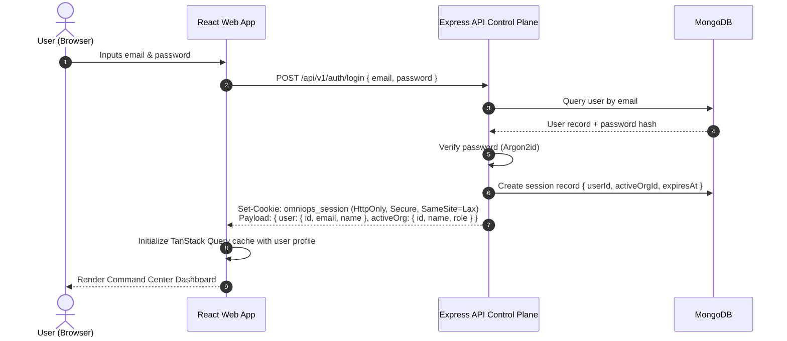
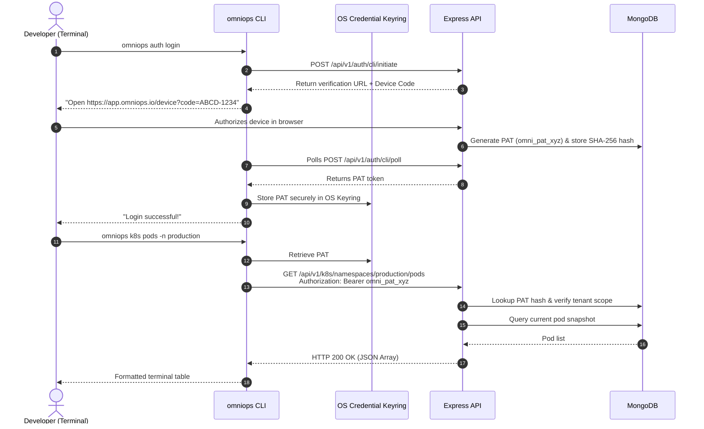
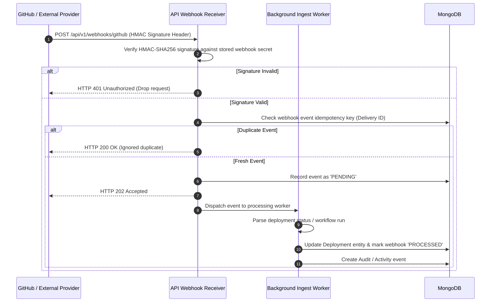
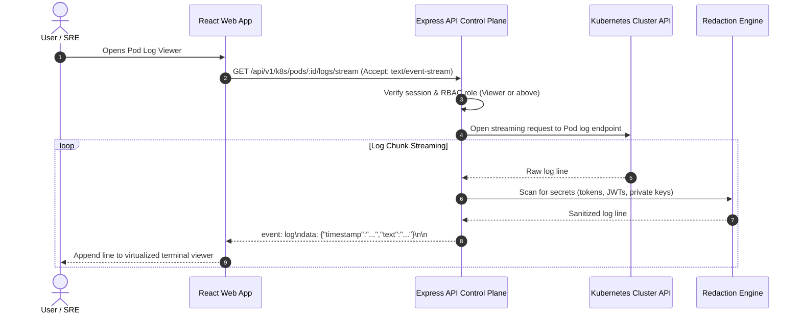
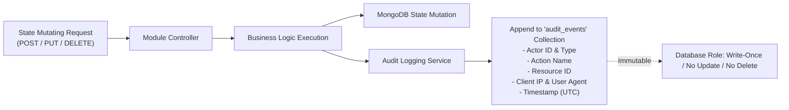

# OmniOPS — End-to-End Data Flow Specification

| Attribute | Details |
| :--- | :--- |
| **Document ID** | `DOC-01-ARC-04` |
| **Status** | `Draft` (Pending Review) |
| **Version** | `0.1.0` |
| **Document Owner** | Principal Data Architect Placeholder |
| **Target Audience** | Backend Engineers, Security Engineers, Frontend/CLI Developers, Auditors |
| **Last Updated** | 2026-11-04 (UTC) |

---

## 1. Document Control & Executive Summary

### 1.1 Executive Summary
This document specifies the lifecycle, transit paths, transformation pipelines, and isolation mechanisms for all data flowing through OmniOPS. It details both client-to-control-plane communication (Web and CLI) and control-plane-to-external-provider interactions (GitHub, Kubernetes, Cloud Providers, Registries).

The core tenet of OmniOPS data engineering is **Zero Secret Egress**: sensitive credentials and private keys are decrypted exclusively in server worker memory and never emitted to client responses, log streams, or error payloads.

---

## 2. Data Classification Matrix

| Data Classification Tier | Examples | Storage Standard | Egress Restrictions |
| :--- | :--- | :--- | :--- |
| **Tier 1: Secrets & Credentials** | GitHub App Private Keys, AWS Secret Access Keys, Kubeconfig tokens, User password hashes | AES-256-GCM Envelope Encrypted; Argon2id for passwords | **Zero Egress**: Never sent to Web or CLI clients. |
| **Tier 2: Tenant Configuration & PII** | User emails, workspace names, team membership, integration endpoints | MongoDB with tenant scoping & TLS in transit | Sent only to authenticated members of that organization. |
| **Tier 3: Infrastructure Telemetry** | Pod names, replica counts, container statuses, CI/CD run durations | Staged in MongoDB collections with TTL indexing | Accessible via RBAC (Viewer and above). |
| **Tier 4: Logs & Events** | Application stdout/stderr logs, cluster event messages | Redaction engine masks PII & API keys before storage | Masked by default; unmasking requires Owner role & audit log. |
| **Tier 5: Audit Records** | Actor ID, mutation action, timestamp, target resource ID, IP | Append-only immutable MongoDB collection | Read-only; cannot be updated or deleted by any user. |

---

## 3. Core Lifecycle Data Flows

### 3.1 Flow 1: Web Client Authentication & Workspace Context Binding

---

### 3.2 Flow 2: CLI Authentication & API Invocation

---

### 3.3 Flow 3: External Webhook Ingestion & Deduplication Pipeline

---

### 3.4 Flow 4: Real-Time Pod Log Streaming & Redaction Pipeline

---

## 4. Tenant Context Propagation & Database Query Scoping

Every protected API request goes through tenant isolation middleware before reaching business logic:
1. **Identification**: The tenant context (`organizationId` and active `workspaceId`) is extracted from the session cookie or the PAT token.
2. **Context Binding**: The Express request object is decorated: `req.tenant = { orgId, workspaceId, role }`.
3. **Database Scoping**:
   - All Mongoose schema queries automatically attach `{ organizationId: req.tenant.orgId }`.
   - Direct database queries that omit `organizationId` throw an unhandled assertion error in development and return HTTP 500 in production, preventing accidental cross-tenant data leaks.

---

## 5. Audit Event Ingestion & Immutability Guarantee

---

## 6. Failure Modes, Retries & Idempotency

1. **Provider Rate Limiting**: If an external API returns HTTP 429, the worker pauses the synchronization queue for that specific provider using the `Retry-After` header value, preventing IP bans.
2. **Idempotency Keys**: All mutation endpoints (e.g., incident acknowledgment, rollback triggers) accept an `Idempotency-Key` header. Duplicate submissions within 60 seconds return the cached response without re-executing.
3. **Worker Crashing**: Background workers utilize atomic locking (`status: "PROCESSING"`, `lockedAt: Date`) with a 5-minute timeout. If a worker dies mid-task, another worker node reclaims the task.

---

## 7. Related Documents & Traceability

- [System Architecture](SYSTEM_ARCHITECTURE.md)
- [Monorepo Architecture](MONOREPO_ARCHITECTURE.md)
- [Folder Structure](FOLDER_STRUCTURE.md)
- [Database Design](../05-database/DATABASE_DESIGN.md)
- [API Endpoints Reference](../03-backend/API_ENDPOINTS.md)
- [Security Architecture](../06-security/SECURITY_ARCHITECTURE.md)
