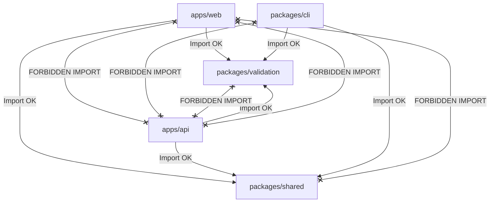

# OmniOPS — Folder Structure Specification

| Attribute | Details |
| :--- | :--- |
| **Document ID** | `DOC-01-ARC-03` |
| **Status** | `Draft` (Pending Review) |
| **Version** | `0.1.0` |
| **Document Owner** | Lead Software Architect Placeholder |
| **Target Audience** | All Software Engineers, Monorepo Maintainers, Code Reviewers |
| **Last Updated** | 2026-11-04 (UTC) |

---

## 1. Document Control & Executive Summary

### 1.1 Executive Summary
This specification defines the authoritative directory hierarchy, file organization standards, naming conventions, and module boundaries for the OmniOPS monorepo. It details the internal structure for `apps/web` (React JavaScript SPA), `apps/api` (Node.js/Express modular monolith), `packages/cli` (Node.js CLI), shared internal packages (`packages/shared`, `packages/config`, `packages/validation`), infrastructure definitions, and documentation sets.

---

## 2. Global Naming & File Conventions

1. **File Extensions**:
   - React components and views containing JSX: `.jsx`
   - Pure JavaScript files (utilities, services, tests, CLI commands): `.js`
   - Configuration files: `.json`, `.yml`, `.yaml`, or `.js`
   - Documentation: `.md`
2. **Casing Standards**:
   - React Component files: `PascalCase.jsx` (e.g., `PodStatusCard.jsx`, `IncidentTable.jsx`)
   - Services, controllers, routes, hooks, utilities: `kebab-case.js` (e.g., `k8s-service.js`, `use-auth.js`, `tenant-middleware.js`)
   - Test files: Co-located with implementation using `.test.js` or `.test.jsx` (e.g., `auth-service.test.js`, `PodStatusCard.test.jsx`)
3. **Environment Configurations**:
   - Templates stored in `.env.example` in repo root and application roots.
   - Actual `.env` and `.env.local` files are strictly added to `.gitignore`.

---

## 3. High-Level Monorepo Structure

```
omniops/
├── apps/
│   ├── web/                     # React JavaScript Single Page Application (SPA)
│   └── api/                     # Node.js + Express Modular Monolith API
├── packages/
│   ├── cli/                     # Node.js 'omniops' Command-Line Interface
│   ├── shared/                  # Common utilities, constants, custom errors
│   ├── config/                  # Shared linting, formatting, and tooling configs
│   └── validation/              # Shared Zod validation schemas
├── infrastructure/              # Docker, Docker Compose, Terraform, Kubernetes manifests
├── docs/                        # Complete technical and architectural documentation
├── .env.example                 # Root environment variable template
├── package.json                 # Monorepo root workspace configuration
├── turbo.json                   # Turborepo task pipeline definition
├── README.md                    # Repository entry point
├── CONTRIBUTING.md              # Engineering contribution guide
├── LICENSE                      # MIT Open Source License
├── CHANGELOG.md                 # Semantic version changelog
└── SECURITY.md                  # Security and disclosure policy
```

---

## 4. Detailed Application Directory Layouts

### 4.1 Frontend Web Application (`apps/web/`)

`apps/web` is a modern single-page application built with React (JavaScript/JSX), Vite, Tailwind CSS, and Radix UI primitives.

```
apps/web/
├── index.html                   # HTML entry point
├── package.json                 # Web client dependencies & build scripts
├── vite.config.js               # Vite build configuration & proxy rules
├── tailwind.config.js           # Tailwind design tokens & plugins
├── postcss.config.js            # PostCSS configuration
├── src/
│   ├── main.jsx                 # Application bootstrapping & DOM mount
│   ├── App.jsx                  # Root layout, routing & context providers
│   ├── assets/                  # Static SVGs, logos, branding assets
│   ├── components/              # Reusable UI component library
│   │   ├── ui/                  # Radix UI + Tailwind primitive components (buttons, dialogs, dropdowns)
│   │   │   ├── Button.jsx
│   │   │   ├── Dialog.jsx
│   │   │   └── Tooltip.jsx
│   │   └── common/              # Cross-cutting UI widgets (Header, Sidebar, UserMenu)
│   │       ├── Header.jsx
│   │       └── Sidebar.jsx
│   ├── features/                # Domain-driven feature modules
│   │   ├── auth/                # Login, Signup, Password Reset
│   │   │   ├── components/      # Feature-specific components
│   │   │   ├── hooks/           # Auth queries & mutations (useLogin, useAuth)
│   │   │   └── pages/           # LoginPage.jsx, RegisterPage.jsx
│   │   ├── dashboard/           # Command Center overview widgets & pages
│   │   │   ├── components/      # HealthScoreCard.jsx, ActivityFeed.jsx
│   │   │   └── pages/           # DashboardPage.jsx
│   │   ├── k8s/                 # Kubernetes cluster & pod inspection
│   │   │   ├── components/      # PodList.jsx, PodLogViewer.jsx
│   │   │   └── pages/           # ClusterOverviewPage.jsx
│   │   ├── incidents/           # Incident triage rooms & alert cards
│   │   │   ├── components/      # IncidentTable.jsx, IncidentTimeline.jsx
│   │   │   └── pages/           # IncidentsPage.jsx
│   │   └── settings/            # Workspace, Team, and Token management
│   ├── hooks/                   # Global utility hooks (use-debounce, use-local-storage)
│   ├── lib/                     # Client infrastructure libraries
│   │   ├── api-client.js        # Axios / Fetch client configured with CSRF & base URLs
│   │   └── query-client.js      # TanStack QueryClient instance & default cache options
│   └── styles/
│       └── globals.css          # Tailwind base directives and design tokens
```

---

### 4.2 Backend API Control Plane (`apps/api/`)

`apps/api` is structured as a modular monolith. Each domain module encapsulates its routes, controllers, services, and models.

```
apps/api/
├── package.json                 # Express dependencies & start scripts
├── src/
│   ├── server.js                # HTTP server initiation & graceful shutdown
│   ├── app.js                   # Express application setup, middleware registration
│   ├── config/                  # Server environment configuration & validation
│   │   ├── env.js               # Validates process.env against Zod schema
│   │   └── database.js          # MongoDB connection pool & event handlers
│   ├── middleware/              # Cross-cutting Express middlewares
│   │   ├── auth-middleware.js   # Session cookie and PAT bearer token verification
│   │   ├── rbac-middleware.js   # Role-based permission evaluation (requireRole)
│   │   ├── tenant-middleware.js # Multi-tenant organization scoping injector
│   │   ├── audit-middleware.js  # Intercepts state mutations and creates audit logs
│   │   ├── rate-limiter.js      # IP and tenant based request rate limiting
│   │   └── error-handler.js     # Global normalized error response serializer
│   ├── modules/                 # Modular domain modules
│   │   ├── auth/                # Authentication, sessions, and PAT lifecycle
│   │   │   ├── auth-controller.js
│   │   │   ├── auth-service.js
│   │   │   ├── auth-routes.js
│   │   │   └── models/          # User.js, Session.js, ApiKey.js
│   │   ├── k8s/                 # Kubernetes cluster telemetry & log streaming
│   │   │   ├── k8s-controller.js
│   │   │   ├── k8s-service.js
│   │   │   ├── k8s-routes.js
│   │   │   └── models/          # ClusterSnapshot.js
│   │   ├── incidents/           # Incident ingestion, deduplication, triage
│   │   │   ├── incident-controller.js
│   │   │   ├── incident-service.js
│   │   │   ├── incident-routes.js
│   │   │   └── models/          # Incident.js, AlertRecord.js
│   │   ├── logs/                # Centralized structured log query proxy
│   │   └── audit/               # Immutable audit log recording and search
│   ├── workers/                 # Background task workers (telemetry sync, health checks)
│   │   ├── telemetry-worker.js
│   │   └── webhook-worker.js
│   └── utils/                   # Server-only utilities (crypto, secret envelope encryption)
│       ├── encryption.js        # AES-256-GCM envelope encrypt/decrypt
│       └── logger.js            # Structured JSON logger (Pino or Winston)
```

---

### 4.3 Command-Line Interface (`packages/cli/`)

```
packages/cli/
├── package.json                 # Declares "bin": { "omniops": "./bin/omniops.js" }
├── bin/
│   └── omniops.js               # Executable entry point with shebang (#!/usr/bin/env node)
├── src/
│   ├── index.js                 # Command registration via Commander.js
│   ├── commands/                # Command action handlers
│   │   ├── auth.js              # omniops auth login, logout, status
│   │   ├── status.js            # omniops status (dashboard overview)
│   │   ├── k8s.js               # omniops k8s pods, logs, clusters
│   │   ├── incidents.js         # omniops incident list, ack, resolve
│   │   └── logs.js              # omniops logs tail, search
│   ├── lib/
│   │   ├── api-client.js        # HTTP client configured with PAT authorization
│   │   ├── config-store.js      # OS keyring credential management
│   │   └── output-formatter.js  # Terminal tables (cli-table3) and JSON formatter
│   └── utils/
│       └── error-handler.js     # User-friendly CLI error presentation (no raw stack traces)
```

---

### 4.4 Shared Monorepo Packages (`packages/`)

- **`packages/validation/`**:
  ```
  packages/validation/
  ├── package.json
  └── src/
      ├── index.js               # Central export for all schemas
      ├── auth.schema.js         # Zod schemas for login, register, PAT creation
      ├── k8s.schema.js          # Zod schemas for pod query parameters
      └── incident.schema.js     # Zod schemas for incident creation and ack
  ```
- **`packages/shared/`**:
  ```
  packages/shared/
  ├── package.json
  └── src/
      ├── index.js               # Exports shared utilities
      ├── constants.js           # Roles (OWNER, ADMIN, OPERATOR, VIEWER), HTTP codes
      ├── errors.js              # AppError, NotFoundError, ForbiddenError classes
      └── sanitizers.js          # Regex masks for credentials and sensitive data
  ```
- **`packages/config/`**:
  ```
  packages/config/
  ├── package.json
  ├── eslint/                    # Shared ESLint configuration rules
  │   ├── base.js
  │   └── react.js
  └── prettier/                  # Shared Prettier formatting configuration
      └── index.json
  ```

---

### 4.5 Infrastructure & Deployment (`infrastructure/`)

```
infrastructure/
├── docker/
│   ├── Dockerfile.web           # Production multi-stage build for React SPA
│   ├── Dockerfile.api           # Production Node.js LTS container build
│   └── docker-compose.dev.yml   # Local dev stack (API, Web, MongoDB, mock services)
├── terraform/                   # AWS production cloud resources
│   ├── main.tf                  # Provider definitions & root modules
│   ├── variables.tf             # Input variables
│   ├── outputs.tf               # Infrastructure outputs
│   └── modules/
│       ├── vpc/                 # Network subnets & security groups
│       ├── ecs/                 # Container compute cluster for API & Workers
│       └── documentdb/          # Managed MongoDB-compatible database
└── k8s/                         # Kubernetes deployment manifests & Helm charts
    ├── api-deployment.yaml
    └── web-ingress.yaml
```

---

## 5. Import Direction & Forbidden Dependencies



### 5.1 Forbidden Dependency Rules
1. **Application-to-Application Imports**: `apps/web` cannot import from `apps/api` and vice versa. Communication occurs exclusively over HTTP.
2. **Package-to-Application Imports**: Packages in `packages/*` cannot import from `apps/*`.
3. **Database Drivers in Frontend/CLI**: `mongoose` and `mongodb` are forbidden inside `apps/web` and `packages/cli`.

---

## 6. Related Documents & Traceability

- [System Architecture](SYSTEM_ARCHITECTURE.md)
- [Monorepo Architecture](MONOREPO_ARCHITECTURE.md)
- [Data Flow Specification](DATA_FLOW.md)
- [Development Guidelines](../09-developer-experience/DEVELOPMENT_GUIDELINES.md)
