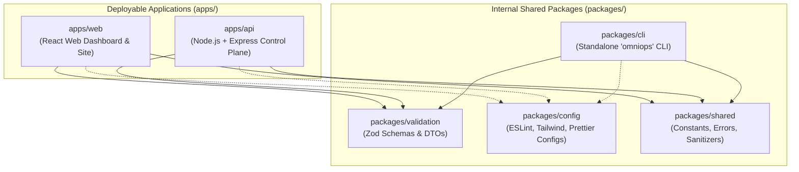

# OmniOPS — Monorepo Architecture Specification

| Attribute | Details |
| :--- | :--- |
| **Document ID** | `DOC-01-ARC-02` |
| **Status** | `Draft` (Pending Review) |
| **Version** | `0.1.0` |
| **Document Owner** | Principal Platform Engineer / Lead DevOps Architect Placeholder |
| **Target Audience** | All Software Engineers, CI/CD Engineers, Monorepo Maintainers |
| **Last Updated** | 2026-11-04 (UTC) |

---

## 1. Document Control & Executive Summary

### 1.1 Executive Summary
This document defines the monorepo architecture, workspace topology, dependency boundaries, task pipelines, and CI caching strategies for the OmniOPS codebase. The monorepo manages two standalone applications (`apps/web` and `apps/api`) alongside four dedicated internal packages (`packages/cli`, `packages/shared`, `packages/config`, `packages/validation`).

The architecture guarantees strict physical boundaries between browser code, backend server logic, CLI distribution assets, and shared utility contracts.

---

## 2. Purpose, Audience, Scope & Terminology

### 2.1 Scope & Package Boundaries
- **Applications (`apps/`)**: Deployable runtime targets. Applications consume packages but **MUST NEVER** import code directly from sibling applications (e.g., `apps/web` cannot import from `apps/api`).
- **Packages (`packages/`)**: Reusable shared modules. Packages must maintain explicit dependency graphs, clean entry-point exports (`package.json#exports`), and zero circular dependencies.

### 2.2 Strict Non-Sharing Rules
To prevent catastrophic security leaks and runtime incompatibilities:
1. **Server Secrets**: Database credentials, encryption keys, and third-party API private keys **MUST NEVER** be placed in `packages/shared` or imported into `apps/web` or `packages/cli`.
2. **Browser-Only Code**: DOM manipulation, Radix UI primitives, React hooks, or CSS styles **MUST NEVER** leak into `apps/api` or `packages/cli`.
3. **Privileged Cloud SDKs**: Direct AWS/Kubernetes execution libraries belong exclusively in `apps/api`.

---

## 3. Monorepo Build Tooling Evaluation & Recommendation

### 3.1 Turborepo vs. Nx Comparison

| Feature / Criteria | Turborepo | Nx | OmniOPS Context Evaluation |
| :--- | :--- | :--- | :--- |
| **Configuration Overhead** | Minimal (`turbo.json`) | Moderate to High (`nx.json`, project.json) | Turborepo fits JavaScript/JSX with less boilerplate |
| **Ecosystem Fit** | Seamless with npm/pnpm workspaces | Complete framework ecosystem | Turborepo has lower friction for plain Node.js |
| **Computation Caching** | High-performance Rust binary | Advanced distributed calculation | Both support remote caching |
| **Code Generation** | Minimal / Unopinionated | Heavy built-in generators | OmniOPS prefers lightweight tooling |
| **Package Independence** | Standard Node.js `package.json` | Project graph overrides | Turborepo keeps npm packages completely standard |

### 3.2 Architectural Recommendation (Pending ADR-0001)
We recommend **Turborepo** utilizing standard **npm workspaces** (or pnpm). Turborepo enables straightforward pipeline execution (`turbo run build`, `turbo run lint`, `turbo run test`), blazing fast local and CI caching, and enforces clean boundary declarations without locking the repository into complex proprietary framework wrappers.

---

## 4. Workspace Topology & Package Inventory



### 4.1 Package Specifications & Export Boundaries

| Workspace Directory | Package Name | Target Runtime | Exported Capabilities |
| :--- | :--- | :--- | :--- |
| `apps/web` | `@omniops/web` | Browser (Vite/ESM) | React SPA bundle, HTML, CSS |
| `apps/api` | `@omniops/api` | Node.js LTS (ESM/CJS) | Express REST API server, Workers |
| `packages/cli` | `omniops` | Node.js (Bin executable) | Global CLI executable distributed via npm |
| `packages/validation` | `@omniops/validation` | Universal (Isomorphic) | Zod schemas, input validation functions |
| `packages/shared` | `@omniops/shared` | Universal (Isomorphic) | HTTP status codes, error classes, date utilities |
| `packages/config` | `@omniops/config` | Development Tooling | Shared ESLint presets, Prettier rules |

---

## 5. Pipeline Tasks & Dependency Graph

### 5.1 Pipeline Task Graph (`turbo.json`)
The monorepo defines strict pipeline tasks ensuring artifacts build in topological order:

```json
{
  "$schema": "https://turbo.build/schema.json",
  "pipeline": {
    "topo": {
      "dependsOn": ["^topo"]
    },
    "build": {
      "dependsOn": ["^build"],
      "outputs": ["dist/**", "build/**"]
    },
    "test": {
      "dependsOn": ["build"],
      "outputs": ["coverage/**"],
      "inputs": ["src/**/*.js", "src/**/*.jsx", "test/**/*.js"]
    },
    "lint": {
      "outputs": []
    },
    "clean": {
      "cache": false
    }
  }
}
```

### 5.2 Root Package Management Scripts
The root `package.json` provides centralized lifecycle triggers:

```json
{
  "name": "omniops-monorepo",
  "private": true,
  "workspaces": [
    "apps/*",
    "packages/*"
  ],
  "scripts": {
    "build": "turbo run build",
    "dev": "turbo run dev --parallel",
    "lint": "turbo run lint",
    "test": "turbo run test",
    "format": "prettier --write \"**/*.{js,jsx,json,md}\"",
    "clean": "turbo run clean && rm -rf node_modules"
  }
}
```

---

## 6. Versioning, Packaging & CI Strategy

### 6.1 CLI Packaging & Distribution Isolation
While internal packages (`@omniops/*`) are private workspace dependencies, `packages/cli` is bundled for public distribution to npm under the package name `omniops`.
- The CLI build step bundles its dependencies or declares standard production runtime dependencies.
- It **MUST NEVER** bundle or depend on `apps/api` or database drivers.

### 6.2 CI Affected-Scope Strategy
To maintain sub-5-minute CI pipelines, GitHub Actions CI leverages Turborepo's git-aware change detection:
- `turbo run test --filter=...[origin/main]` runs tests exclusively for packages altered in the current branch or Pull Request, alongside packages that depend on them.
- If only `docs/**` is changed, code test pipelines are skipped entirely.

---

## 7. Security, Tenancy & Compliance Boundaries

- **Static Secret Analysis**: CI runs secret scanners (e.g., `gitleaks`) across the entire repository history before merging any PR.
- **Dependency Audit**: `npm audit --omit=dev` runs in CI to verify zero High or Critical vulnerabilities in production dependencies across all packages.

---

## 8. Testing Strategy & Acceptance Criteria

1. **Circular Dependency Verification**: `madge` or similar tooling must assert zero circular imports across all workspace packages.
2. **Boundary Enforcement**: Automated lint rules verify that `@omniops/web` cannot import Node.js core modules (`fs`, `crypto`, `net`).
3. **Pipeline Determinism**: `turbo run build` must be bit-for-bit reproducible and verify remote cache hits on unchanged commits.

---

## 9. Related Documents & Traceability

- [System Architecture](SYSTEM_ARCHITECTURE.md)
- [Folder Structure](FOLDER_STRUCTURE.md)
- [Architectural Decision Records](ARCHITECTURAL_DECISIONS.md)
- [Development Guidelines](../09-developer-experience/DEVELOPMENT_GUIDELINES.md)
