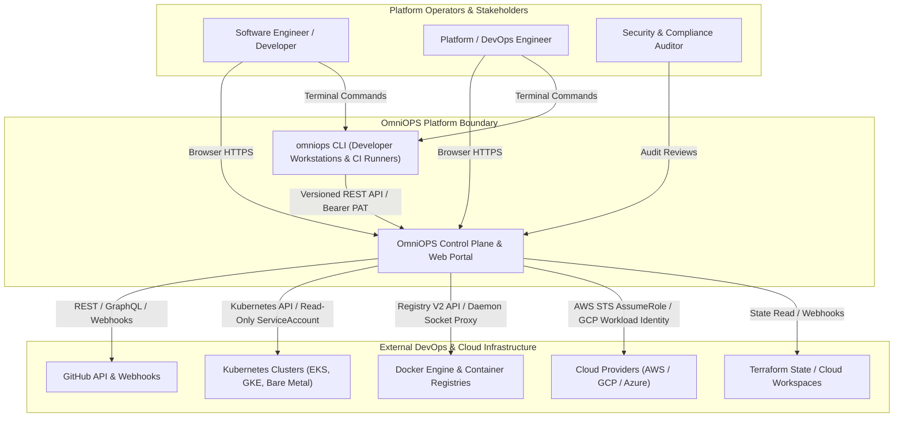
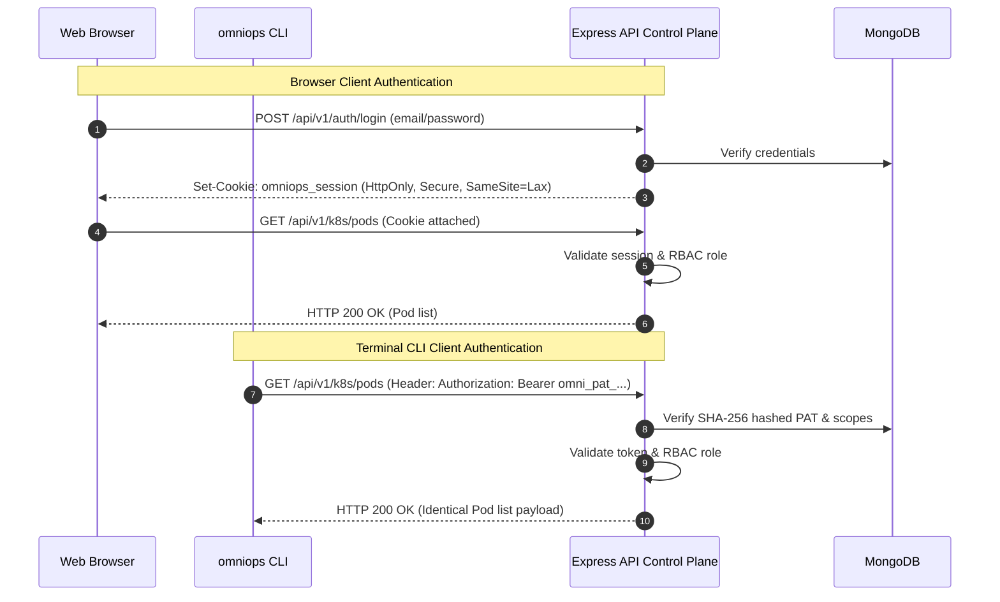

# OmniOPS — System Architecture Specification

| Attribute | Details |
| :--- | :--- |
| **Document ID** | `DOC-01-ARC-01` |
| **Status** | `Draft` (Pending Review) |
| **Version** | `0.1.0` |
| **Document Owner** | Principal Systems Architect Placeholder |
| **Target Audience** | Lead Architects, Security Engineers, Backend/Frontend/DevOps Engineers |
| **Last Updated** | 2026-11-04 (UTC) |

---

## 1. Document Control & Executive Summary

### 1.1 Executive Summary
This document specifies the end-to-end system architecture, component topology, trust boundaries, and execution models of the OmniOPS platform. OmniOPS is engineered as a **Modular Monolith control plane** written in Node.js and Express, persisting to a schema-enforced MongoDB cluster. It serves two first-class clients: a **Single-Page React Web Application** (JavaScript / JSX, Tailwind CSS, Radix UI) and a standalone **Node.js Command-Line Interface (`omniops`)**.

Both clients communicate through a single, strictly versioned REST API (`/api/v1/*`), sharing an identical tenant isolation and Role-Based Access Control (RBAC) engine.

---

## 2. Purpose, Audience, Scope & Terminology

### 2.1 Scope & Architectural Guardrails
- **In Scope**: System context, container models, internal modular component partitioning, trust zones, sync/async execution models, secrets flow, and failure domains.
- **Architectural Guardrails**:
  - Microservices are explicitly rejected for the initial phases to prevent distributed transaction overhead (per [ADR-0003](ARCHITECTURAL_DECISIONS.md#adr-0003-backend-architecture--runtime)).
  - Next.js and TypeScript are not part of the active frontend stack (per [ADR-0002](ARCHITECTURAL_DECISIONS.md#adr-0002-frontend-framework-styling-and-language)).
  - All operations follow least-privilege, read-only defaults for infrastructure integrations.

---

## 3. C4 Architecture Models

### 3.1 C4 Level 1: System Context Diagram



---

### 3.2 C4 Level 2: Container Diagram (Platform Topography)

```mermaid
flowchart TD
    subgraph ClientZone["Client Zone (Untrusted / User-Controlled)"]
        BROWSER["Web Browser\n(React SPA, TanStack Query, Radix UI)"]
        TERM["Developer Terminal / CI Agent\n(Node.js CLI 'omniops')"]
    end

    subgraph EdgeZone["Edge & Ingress Zone (DMZ)"]
        LB["TLS Termination & Reverse Proxy\n(Nginx / Cloud Ingress / Rate Limiter)"]
    end

    subgraph AppZone["Application & Control Plane Zone (Private Subnet)"]
        API["Express API Server (Modular Monolith)\n- Auth Middleware\n- RBAC Enforcement\n- Route Handlers\n- Redaction Pipeline"]
        WORKER["Background Task & Sync Worker\n- Telemetry Poller\n- Webhook Dispatcher\n- Health Checker"]
    end

    subgraph DataZone["Persistence Zone (Isolated VPC Tier)"]
        DB[(MongoDB Primary & Secondary Replicas\n- Tenant Partitioned Collections\n- Encrypted Credentials\n- Immutable Audit Logs)]
        CACHE[(Optional Cache / Queue\nRedis / In-Memory Worker)]
    end

    BROWSER -->|HTTPS (Session Cookie + CSRF Token)| LB
    TERM -->|HTTPS (Bearer PAT)| LB
    LB -->|Reverse Proxy HTTP/1.1| API
    API -->|Read/Write Queries| DB
    API -->|Enqueue Tasks| CACHE
    WORKER -->|Dequeue Tasks| CACHE
    WORKER -->|Persist Ingested State| DB
```

---

### 3.3 C4 Level 3: Component Diagram (Express API Internal Modular Monolith)

Inside `apps/api`, components are partitioned into domain modules that interact through explicit service interfaces, completely avoiding tight coupling:

```mermaid
flowchart LR
    subgraph Middlewares["Cross-Cutting Middlewares"]
        M_SEC["Helmet & CORS"]
        M_AUTH["Auth & Session Parser"]
        M_RBAC["Tenant & RBAC Validator"]
        M_AUDIT["Audit Logger Interceptor"]
    end

    subgraph DomainModules["Internal Domain Modules"]
        MOD_AUTH["Auth Module\n(Login, Sessions, PATs)"]
        MOD_K8S["K8s Module\n(Cluster Ingest, Pods, Logs)"]
        MOD_GH["GitHub Module\n(Webhook Handler, Repos, PRs)"]
        MOD_DOCKER["Docker Module\n(Registry, Containers)"]
        MOD_INC["Incident Module\n(Alert Triage, Timelines)"]
        MOD_LOG["Logging Module\n(Search, Stream Tail)"]
    end

    subgraph DataAccess["Data Access & Security Layer"]
        SVC_ENC["AES-256-GCM Envelope Encryption"]
        REPO_DB["Mongoose Tenant Scoped Models"]
    end

    Middlewares --> DomainModules
    DomainModules --> SVC_ENC
    DomainModules --> REPO_DB
```



---

## 4. Trust Boundaries & Security Architecture

### 4.1 Trust Zones
1. **Public / Untrusted Zone**: Web browsers, third-party internet networks, developer terminal laptops. All incoming requests are treated as untrusted and potentially hostile.
2. **DMZ / Ingress Zone**: TLS termination proxies, DDoS mitigation, and edge rate-limiting gateways.
3. **Application Core Zone (Private Subnet)**: Contains the Express API and background workers. Accessible only through the internal load balancer.
4. **Data Isolation Zone (Restricted Subnet)**: Houses the MongoDB replica set. Network security groups permit connections *only* from the API and Worker security groups.

### 4.2 Web vs. CLI Client Authorization Parity



---

## 5. Synchronous vs. Asynchronous Execution Model

| Operation Type | Execution Mode | Processing Engine | Failure Handling & Retries |
| :--- | :--- | :--- | :--- |
| **Authentication & Profile Query** | Synchronous | Express HTTP Request/Response | Immediate HTTP 401/403/400 error |
| **Dashboard Metric Fetching** | Synchronous (Cached) | TanStack Query Cache + In-Memory Store | Stale-while-revalidate fallback |
| **GitHub Webhook Ingestion** | Asynchronous | Webhook receiver -> Background Queue | 202 Accepted; exponential worker retry |
| **Kubernetes Pod Telemetry Ingest** | Asynchronous / Polling | Background Poller Worker (Interval: 15s) | Circuit breaker on cluster API timeout |
| **Pod Log Streaming** | Synchronous Stream | Server-Sent Events (SSE) Pipe | Auto-reconnect with last-event-id |
| **Infrastructure Mutation (Post-MVP)** | Async / Gated | Approval Queue -> Worker Execution | Strict dual-approval timeout & audit abort |

---

## 6. Secrets Flow & Envelope Encryption Architecture

OmniOPS interacts with external cloud environments and container registries. Secrets are managed through an envelope encryption model:
1. **Master Key**: A 256-bit Key Encryption Key (KEK) is injected via AWS KMS, GCP KMS, or HashiCorp Vault into the backend environment.
2. **Data Encryption Keys (DEK)**: For every customer organization, an ephemeral DEK is generated.
3. **Storage**: Third-party integration credentials (GitHub App private keys, AWS IAM session keys, Kubeconfig tokens) are encrypted via **AES-256-GCM** before writing to MongoDB.
4. **Client Protection**: Decrypted secrets **NEVER** leave server memory. Neither the React client nor the CLI ever receive decrypted third-party integration keys.

---

## 7. Failure Domains & High Availability Strategy

- **Stateless Control Plane**: Express API instances maintain zero in-memory session state; horizontal autoscaling (HPA) dynamically adds instances based on CPU/memory utilization.
- **Database Resilience**: MongoDB deployed as a 3-node Replica Set (Primary with two Secondaries across distinct availability zones) with automated failover in under 10 seconds.
- **Provider Outage Isolation**: If an external provider (e.g., GitHub or AWS) experiences an outage, circuit breakers trip, preventing API worker thread starvation and serving cached telemetry marked `stale: true`.

---

## 8. Testing Strategy & Acceptance Criteria

1. **Boundary Isolation Tests**: Automated network and integration suites confirming no unauthenticated access to `/api/v1/*` routes.
2. **Client Parity Assertions**: End-to-end tests executing identical commands via HTTP client and CLI verifying equal JSON payload structures.
3. **Secret Leak Detection**: Static CI checks asserting no cryptographic keys, connection strings, or access tokens exist in source control.

---

## 9. Related Documents & Traceability

- [Monorepo Architecture](MONOREPO_ARCHITECTURE.md)
- [Folder Structure](FOLDER_STRUCTURE.md)
- [Data Flow Specification](DATA_FLOW.md)
- [Architectural Decision Records](ARCHITECTURAL_DECISIONS.md)
- [Security Architecture](../06-security/SECURITY_ARCHITECTURE.md)
- [API Standards](../03-backend/API_STANDARDS.md)
