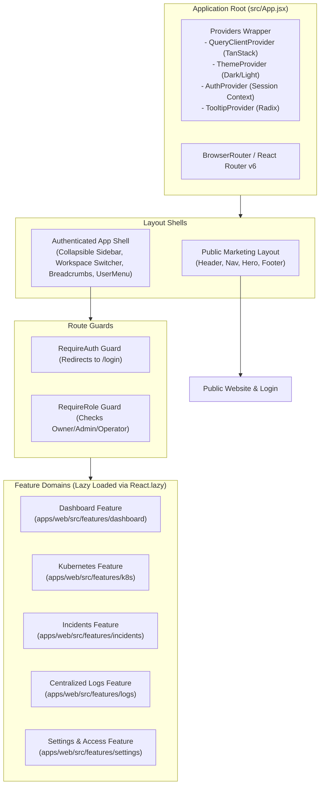

# OmniOPS — Frontend Architecture & Specification

| Attribute | Details |
| :--- | :--- |
| **Document ID** | `DOC-02-FRO-01` |
| **Status** | `Draft` (Pending Review) |
| **Version** | `0.1.0` |
| **Document Owner** | Principal Frontend Architect Placeholder |
| **Target Audience** | Frontend Engineers, UI/UX Designers, Accessibility Specialists, QA Engineers |
| **Last Updated** | 2026-11-04 (UTC) |

---

## 1. Document Control & Executive Summary

### 1.1 Executive Summary
This document specifies the technical architecture, component hierarchy, build tooling, routing, accessibility standards, and performance benchmarks for the OmniOPS web client (`apps/web`). The application is engineered as a high-performance **Single Page Application (SPA)** utilizing **React (v18+)** with **JavaScript (JSX)**, built via **Vite**, styled using **Tailwind CSS**, and structured with headless accessible primitives from **Radix UI** and **Lucide React** icons (per [ADR-0002](../01-architecture/ARCHITECTURAL_DECISIONS.md#adr-0002-frontend-framework-styling-and-language)).

Next.js, TypeScript, and server-side rendering (SSR) frameworks are explicitly excluded from this application architecture.

---

## 2. Technical Baseline & Build System

### 2.1 Build Tooling & Environment Configuration
- **Bundler & Dev Server**: Vite (`vite.config.js`) providing sub-100ms Hot Module Replacement (HMR) and optimized Rollup production builds.
- **Language**: Modern ECMAScript (JavaScript / JSX) with ESLint (`@omniops/config/eslint/react.js`).
- **Client Environment Variables**:
  - Validated via Zod at build time.
  - Prefixed strictly with `VITE_` (e.g., `VITE_API_BASE_URL`).
  - **Zero Secret Rule**: Secret API keys, encryption keys, or private tokens **MUST NEVER** be injected into client environment variables.

---

## 3. Component Architecture & Feature Module Organization

---

## 4. UI Component Hierarchy & Design Primitives

OmniOPS organizes components into three distinct layers to maximize reusability and accessibility:
1. **Primitive UI Components (`src/components/ui/`)**: Built on top of Radix UI primitives (`@radix-ui/react-dialog`, `@radix-ui/react-dropdown-menu`, `@radix-ui/react-tooltip`) styled with Tailwind classes. Ensures 100% WCAG 2.1 AA keyboard navigation and screen-reader aria properties.
2. **Composite Platform Components (`src/components/common/`)**: Shared domain-agnostic widgets: `DataTable.jsx`, `EmptyState.jsx`, `MetricCard.jsx`, `TerminalViewer.jsx`.
3. **Feature-Bound Components (`src/features/*/components/`)**: Domain-specific widgets: `PodStatusCard.jsx`, `IncidentTriageRoom.jsx`, `ClusterSelector.jsx`.

---

## 5. Form Handling & Schema Validation

All user input forms (login, workspace creation, token generation, incident notes) use:
- **React Hook Form**: For performant, un-opinionated form state management without re-rendering the entire view on every keystroke.
- **Zod Resolvers**: Direct integration with `@omniops/validation` schemas via `@hookform/resolvers/zod`.
- **Accessible Error States**: Input errors dynamically update `aria-invalid="true"` and `aria-describedby` pointing to the error message container.

---

## 6. Theme Handling & Dark/Light Mode

- Default theme: System preference (`prefers-color-scheme: dark`), with dark mode tailored for developer terminal and operations center aesthetics.
- User preference stored in `localStorage.getItem("omniops_theme")`.
- Toggled by adding/removing the `dark` class on the root `document.documentElement` element.
- Zero layout shift or flashing during load achieved via inline initialization script in `index.html`.

---

## 7. Performance Targets & Code Splitting

| Metric | Target SLA | Strategy |
| :--- | :--- | :--- |
| **First Contentful Paint (FCP)** | `< 1.2s` | Preloaded fonts, critical CSS inlining via Vite. |
| **Largest Contentful Paint (LCP)** | `< 2.0s` | Route-based code-splitting with `React.lazy()` and dynamic `import()`. |
| **Initial JS Bundle Size** | `< 250 KB (gzipped)` | Tree-shaken dependencies; Lucide icons imported individually. |
| **Cumulative Layout Shift (CLS)** | `< 0.05` | Explicit width/height on images, skeleton loading wrappers. |

---

## 8. Frontend Testing Strategy

1. **Unit Tests (Vitest)**: Testing pure helper functions, custom hooks, and state reducers.
2. **Component Tests (React Testing Library)**: User-interaction testing (e.g., clicking acknowledge triggers API mutation and optimistic UI update).
3. **End-to-End Tests (Playwright)**: Full browser journeys across authentication, workspace selection, and Kubernetes pod filtering.

---

## 9. Related Documents & Traceability

- [UI/UX Design System](UI_UX_DESIGN_SYSTEM.md)
- [Routing & Navigation](ROUTING_AND_NAVIGATION.md)
- [Frontend State Management](FRONTEND_STATE_MANAGEMENT.md)
- [Monorepo Architecture](../01-architecture/MONOREPO_ARCHITECTURE.md)
- [API Standards](../03-backend/API_STANDARDS.md)
