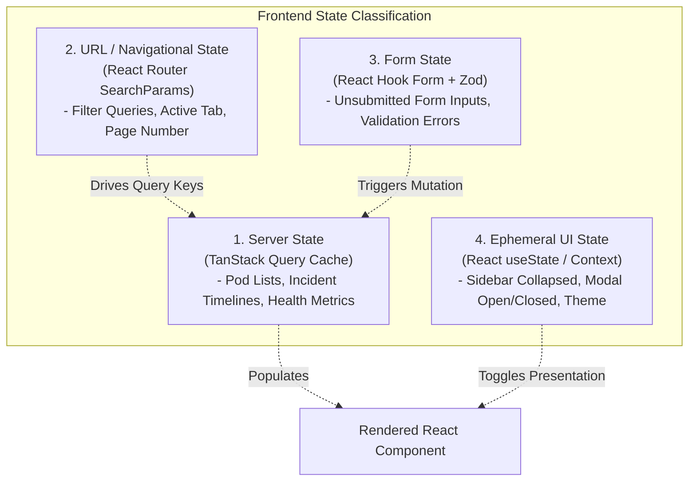

# OmniOPS — Frontend State Management Specification

| Attribute | Details |
| :--- | :--- |
| **Document ID** | `DOC-02-FRO-04` |
| **Status** | `Draft` (Pending Review) |
| **Version** | `0.1.0` |
| **Document Owner** | Lead Frontend Architect Placeholder |
| **Target Audience** | Frontend Engineers, Performance Leads |
| **Last Updated** | 2026-11-04 (UTC) |

---

## 1. Document Control & Executive Summary

### 1.1 Executive Summary
This document specifies the state stratification, server-state caching lifecycle, mutation workflows, and cache boundary controls for the OmniOPS web client (`apps/web`). In accordance with [ADR-0005](../01-architecture/ARCHITECTURAL_DECISIONS.md#adr-0005-frontend-server-state-management), the frontend eliminates monolithic Redux stores in favor of **TanStack Query (v5)** for asynchronous server state, paired with **React URL State** and lightweight **Local Component State**.

---

## 2. State Classification & Boundary Strategy

Client state in OmniOPS is strictly stratified into four isolated tiers:



---

## 3. TanStack Query Configuration & Query Key Hierarchy

### 3.1 Global QueryClient Defaults

```javascript
// apps/web/src/lib/query-client.js
import { QueryClient } from "@tanstack/react-query";

export const queryClient = new QueryClient({
  defaultOptions: {
    queries: {
      staleTime: 30 * 1000,         // 30 seconds default freshness
      gcTime: 5 * 60 * 1000,        // 5 minutes garbage collection window
      retry: (failureCount, error) => {
        // Do not retry 401 Unauthorized or 403 Forbidden
        if (error?.status === 401 || error?.status === 403) return false;
        return failureCount < 2;
      },
      refetchOnWindowFocus: true,   // Auto-resync when returning to tab
      refetchOnReconnect: true
    },
    mutations: {
      retry: 0                      // Never auto-retry mutations without explicit policy
    }
  }
});
```

### 3.2 Canonical Query Key Factory
To guarantee deterministic cache invalidation and prevent key collisions, all query keys use structured tuple factories:

```javascript
// Query Key Factory: apps/web/src/features/k8s/hooks/query-keys.js
export const k8sKeys = {
  all: ["k8s"],
  clusters: () => [...k8sKeys.all, "clusters"],
  cluster: (clusterId) => [...k8sKeys.clusters(), clusterId],
  namespaces: (clusterId) => [...k8sKeys.cluster(clusterId), "namespaces"],
  pods: (clusterId, namespace, filters) => [
    ...k8sKeys.cluster(clusterId),
    "pods",
    namespace,
    { ...filters }
  ],
  podLogs: (clusterId, podName, container) => [
    ...k8sKeys.cluster(clusterId),
    "logs",
    podName,
    container
  ]
};
```

---

## 4. Mutation Safeguards & Optimistic Updates

For high-frequency operator actions (such as acknowledging an incident), the UI performs safe optimistic updates with rollback protection:

```javascript
// Optimistic Incident Acknowledgment Pattern
export function useAcknowledgeIncident() {
  const queryClient = useQueryClient();

  return useMutation({
    mutationFn: (incidentId) => apiClient.post(`/incidents/${incidentId}/ack`),
    onMutate: async (incidentId) => {
      // 1. Cancel in-flight queries
      await queryClient.cancelQueries({ queryKey: ["incidents"] });

      // 2. Snapshot previous state
      const previousIncidents = queryClient.getQueryData(["incidents"]);

      // 3. Optimistically update cache
      queryClient.setQueryData(["incidents"], (old) => {
        if (!old) return old;
        return {
          ...old,
          data: old.data.map((inc) =>
            inc.id === incidentId ? { ...inc, status: "ACKNOWLEDGED" } : inc
          )
        };
      });

      return { previousIncidents };
    },
    onError: (err, incidentId, context) => {
      // 4. Rollback on failure
      if (context?.previousIncidents) {
        queryClient.setQueryData(["incidents"], context.previousIncidents);
      }
    },
    onSettled: () => {
      // 5. Invalidate to refetch authoritative server state
      queryClient.invalidateQueries({ queryKey: ["incidents"] });
      queryClient.invalidateQueries({ queryKey: ["dashboard", "summary"] });
    }
  });
}
```

---

## 5. Cache Isolation on Logout & Tenant Switch

To prevent catastrophic cross-tenant data leakage in shared browser environments:
1. **Tenant Switch Trigger**: When a user switches active workspace via the header dropdown, `queryClient.clear()` is called **immediately** before fetching the new workspace payload.
2. **Logout Trigger**: Upon user logout, `queryClient.clear()` wipes all cached queries, localStorage session identifiers are purged, and browser HTTP cookies are cleared by the backend.

---

## 6. Related Documents & Traceability

- [Frontend Architecture & Specification](FRONTEND_SPECIFICATION.md)
- [UI/UX Design System](UI_UX_DESIGN_SYSTEM.md)
- [Routing & Navigation](ROUTING_AND_NAVIGATION.md)
- [API Endpoints Reference](../03-backend/API_ENDPOINTS.md)
