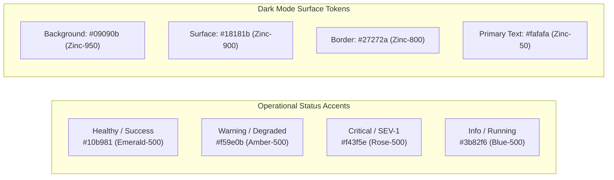

# OmniOPS — UI/UX Design System Specification

| Attribute | Details |
| :--- | :--- |
| **Document ID** | `DOC-02-FRO-02` |
| **Status** | `Draft` (Pending Review) |
| **Version** | `0.1.0` |
| **Document Owner** | Lead Design Systems Engineer / Product Designer Placeholder |
| **Target Audience** | Frontend Engineers, Product Designers, Accessibility Auditors |
| **Last Updated** | 2026-11-04 (UTC) |

---

## 1. Document Control & Executive Summary

### 1.1 Executive Summary
This document specifies the design tokens, visual hierarchy, interaction principles, accessibility requirements (WCAG 2.1 AA), and component contracts comprising the OmniOPS Design System. The design system is constructed on top of **Tailwind CSS**, headless primitives from **Radix UI**, and vector iconography from **Lucide React** (`lucide-react`, approved per [ADR-0002](../01-architecture/ARCHITECTURAL_DECISIONS.md#adr-0002-frontend-framework-styling-and-language)).

---

## 2. Core Design Principles

1. **Information Density with Extreme Clarity**: DevOps engineers require compact, data-rich operational cockpits without visual clutter or unnecessary padding.
2. **Terminal & Operational Aesthetic**: Dark-mode-first color palette with high-contrast status accents (emerald for healthy, amber for degraded/warning, rose for critical incidents).
3. **Uncompromised Accessibility**: Every interactive control must be fully navigable via keyboard, announce state to screen readers via WAI-ARIA, and respect user operating system settings (e.g., `prefers-reduced-motion`).

---

## 3. Design Tokens & Visual Specifications

### 3.1 Color Palette & Theme Tokens

| Token Name | Light Theme Value | Dark Theme Value | Usage |
| :--- | :--- | :--- | :--- |
| `--background` | `#ffffff` (White) | `#09090b` (Zinc-950) | Root canvas background |
| `--surface` | `#f4f4f5` (Zinc-100) | `#18181b` (Zinc-900) | Card, modal, panel surfaces |
| `--surface-border` | `#e4e4e7` (Zinc-200) | `#27272a` (Zinc-800) | Component borders, dividers |
| `--text-primary` | `#09090b` (Zinc-950) | `#fafafa` (Zinc-50) | Headings, primary metrics |
| `--text-muted` | `#71717a` (Zinc-500) | `#a1a1aa` (Zinc-400) | Secondary metadata, labels |
| `--status-healthy` | `#059669` (Emerald-600) | `#10b981` (Emerald-500)| Healthy pods, passing checks |
| `--status-warning` | `#d97706` (Amber-600) | `#f59e0b` (Amber-500) | High memory, pending builds |
| `--status-critical`| `#e11d48` (Rose-600) | `#f43f5e` (Rose-500) | CrashLoopBackOff, SEV incidents |

---

### 3.2 Typography Hierarchy
- **Font Family (UI)**: Inter, `-apple-system`, BlinkMacSystemFont, "Segoe UI", Roboto, sans-serif.
- **Font Family (Monospace / Code / Logs)**: JetBrains Mono, Fira Code, Menlo, monospace.

| Scale Token | Font Size | Line Height | Weight | Tailwind Class |
| :--- | :--- | :--- | :--- | :--- |
| `display-1` | 32px (2.0rem) | 38px | 700 (Bold) | `text-3xl font-bold tracking-tight` |
| `heading-1` | 24px (1.5rem) | 30px | 600 (Semibold) | `text-2xl font-semibold` |
| `heading-2` | 20px (1.25rem)| 26px | 600 (Semibold) | `text-xl font-semibold` |
| `body-base` | 14px (0.875rem)| 20px | 400 (Regular) | `text-sm leading-5` |
| `body-mono` | 13px (0.8125rem)| 18px | 400 / 500 | `font-mono text-xs leading-snug` |
| `caption` | 12px (0.75rem)| 16px | 400 (Regular) | `text-xs text-muted-foreground` |

---

## 4. Component Standards & Accessible States

### 4.1 Focus Rings & Keyboard Navigation
Every focusable element (buttons, inputs, links, tabs) **MUST** feature an explicit, high-contrast focus ring:
- Tailwind utility: `focus-visible:outline-none focus-visible:ring-2 focus-visible:ring-primary focus-visible:ring-offset-2 focus-visible:ring-offset-background`
- Outline suppression without replacement (`outline: none`) is strictly prohibited.

### 4.2 Buttons & Interactive Controls
- **States**: `Default`, `Hover`, `Active`, `Focus-Visible`, `Disabled`, `Loading` (with spinning Lucide `Loader2` icon and `aria-busy="true"`).

### 4.3 Data Tables (`DataTable.jsx`)
- Compact density (row height 36px) with zebra striping in dark mode.
- Sticky header during vertical scrolling.
- Clickable column headers with sorting indicators (`ArrowUpDown`, `ArrowUp`, `ArrowDown`).
- Empty states featuring clear iconography, descriptive explanation, and primary call-to-action button.

---

## 5. Terminal & Code Log Presentation

For pod logs and CLI output viewers (`apps/web/src/components/common/TerminalViewer.jsx`):
- Pure black surface (`bg-black` / `#000000`).
- Crisp monospace rendering (`font-mono text-xs`).
- Virtualized list rendering (e.g., `@tanstack/react-virtual`) to allow smooth scrolling over 100,000+ log lines without browser memory exhaustion.
- Integrated search bar with regex toggle and hit highlight badges.

---

## 6. Related Documents & Traceability

- [Frontend Architecture & Specification](FRONTEND_SPECIFICATION.md)
- [Routing & Navigation](ROUTING_AND_NAVIGATION.md)
- [Frontend State Management](FRONTEND_STATE_MANAGEMENT.md)
- [Monorepo Architecture](../01-architecture/MONOREPO_ARCHITECTURE.md)
