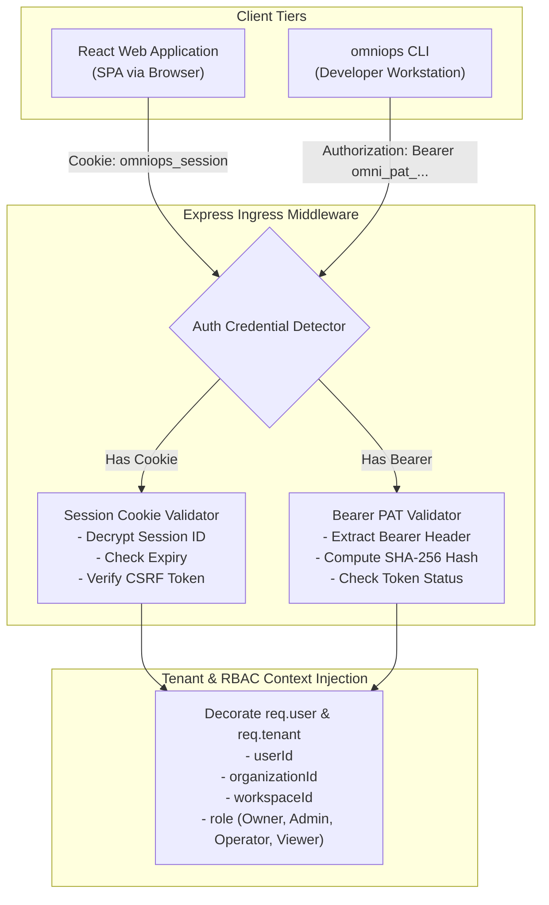
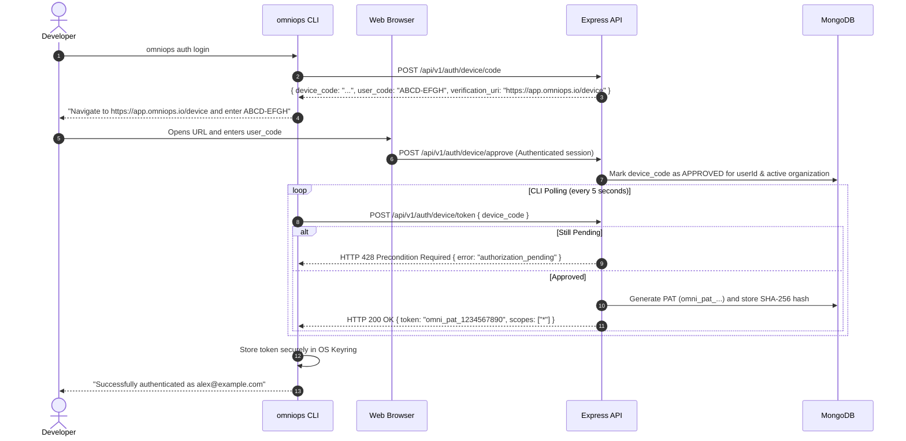

# OmniOPS — Authentication & Authorization Specification

| Attribute | Details |
| :--- | :--- |
| **Document ID** | `DOC-03-BAK-04` |
| **Status** | `Draft` (Pending Review) |
| **Version** | `0.1.0` |
| **Document Owner** | Principal Security Architect / Identity Lead Placeholder |
| **Target Audience** | Backend Engineers, Security Engineers, Frontend Engineers, CLI Maintainers |
| **Last Updated** | 2026-11-04 (UTC) |

---

## 1. Document Control & Executive Summary

### 1.1 Executive Summary
This specification defines the identity, authentication, session lifecycle, and authorization architecture for OmniOPS. The platform establishes a **Dual-Client Security Model** that provides:
1. **Web Browser Client**: Stateful, `HttpOnly`, `SameSite=Lax`, TLS-encrypted session cookies paired with double-submit CSRF tokens.
2. **Terminal CLI & Automation**: Scoped, revokable Personal Access Tokens (PAT) utilizing cryptographic SHA-256 hash lookups, managed via native OS keyrings.

Both clients resolve into a unified, server-enforced **Role-Based Access Control (RBAC)** context across the shared Express API control plane.

---

## 2. Authentication Framework Evaluation & Decision

### 2.1 Better Auth vs. Auth.js for React + Express

| Feature / Evaluator | Better Auth | Auth.js (v5) | Custom Native Express Auth |
| :--- | :--- | :--- | :--- |
| **Next.js Decoupling** | First-class standalone Node/Express support | Heavily Next.js centric; Express adapter is secondary | Native Express architecture |
| **MongoDB Support** | Native adapter with clean schemas | Requires specific Prisma/MongoDB adapters | Directly integrates with Mongoose |
| **Multi-Tenancy / Orgs** | Built-in organization & team plugin | Requires custom session schema extensions | Native domain modeling |
| **CLI / PAT Support** | Built-in API Key / PAT plugin | Focuses on browser sessions | Custom token hash collection |

### 2.2 Recommendation (Pending ADR-0006)
We recommend **Better Auth** (with Express adapter) or a **disciplined custom Express auth module** using Argon2id and crypto-secure tokens. Next.js Auth.js is rejected due to tight coupling with Next.js edge runtimes and framework assumptions.

---

## 3. Session & Token Architecture



---

## 4. Authentication Workflows

### 4.1 Web Authentication Flow & CSRF Protection
1. **Login Request**: User submits credentials to `POST /api/v1/auth/login`.
2. **Verification**: Backend queries `users` collection, verifies password hash using **Argon2id**.
3. **Session Creation**: Generates a 256-bit cryptographically secure random session token. Inserts record into `sessions` collection with 30-day TTL.
4. **Cookie Dispatch**: Returns response with headers:
   ```http
   Set-Cookie: omniops_session=<token>; Path=/; HttpOnly; Secure; SameSite=Lax; Max-Age=2592000
   Set-Cookie: omniops_csrf=<csrf_token>; Path=/; Secure; SameSite=Lax; Max-Age=2592000
   ```
5. **CSRF Defense**: On mutating requests (`POST`, `PUT`, `PATCH`, `DELETE`), the client must send the `X-CSRF-Token` header matching the cookie value.

---

### 4.2 CLI Authentication Flow (Device Authorization Grant)



---

## 5. Role-Based Access Control (RBAC) Specification

OmniOPS defines four standard hierarchical roles per organization:

| Role | Scope | Permitted Operations | Restricted Operations |
| :--- | :--- | :--- | :--- |
| **Owner** | Organization-wide | Billing, Organization deletion, Member role assignment, Security key management | None |
| **Admin** | Organization-wide | Integration setup, Workspace management, Member invites, Incident management | Billing ownership, Org deletion |
| **Operator** | Workspace-scoped | Pod restart (approved), Rollback triggers, Incident acknowledgment/resolution, Log inspection | Credential rotation, Member invites |
| **Viewer** | Workspace-scoped | Read-only dashboards, metric queries, sanitized log tails, CLI status commands | All mutating actions (POST/PUT/DELETE) |

### 5.1 Permission Evaluation Matrix

```javascript
// Canonical Permission Mapping
const PERMISSIONS = {
  "org:delete": ["Owner"],
  "org:billing": ["Owner"],
  "team:invite": ["Owner", "Admin"],
  "integration:configure": ["Owner", "Admin"],
  "k8s:pod:restart": ["Owner", "Admin", "Operator"],
  "incident:acknowledge": ["Owner", "Admin", "Operator"],
  "incident:resolve": ["Owner", "Admin", "Operator"],
  "k8s:pod:read": ["Owner", "Admin", "Operator", "Viewer"],
  "logs:read": ["Owner", "Admin", "Operator", "Viewer"],
  "dashboard:read": ["Owner", "Admin", "Operator", "Viewer"]
};
```

---

## 6. Token Invalidation, Revocation & Session Lifecycle

1. **Immediate Revocation**: Users or Admins can revoke any PAT or active session via `/settings/tokens` or `omniops auth token revoke <id>`. Revocation deletes the session record or marks the PAT `isRevoked: true` in MongoDB.
2. **Password Change Cascade**: When a user changes their password, all active sessions and CLI PATs across all devices are deleted immediately, requiring fresh authentication.
3. **Audit Trail**: Every login attempt (success or failure), token generation, token revocation, and role mutation writes an immutable entry to `audit_events`.

---

## 7. Related Documents & Traceability

- [API Standards](API_STANDARDS.md)
- [API Endpoints Reference](API_ENDPOINTS.md)
- [Data Models & Schemas](../05-database/DATA_MODELS_AND_SCHEMAS.md)
- [Security Architecture](../06-security/SECURITY_ARCHITECTURE.md)
- [CLI Configuration & Auth](../04-cli/CLI_CONFIGURATION_AND_AUTH.md)
