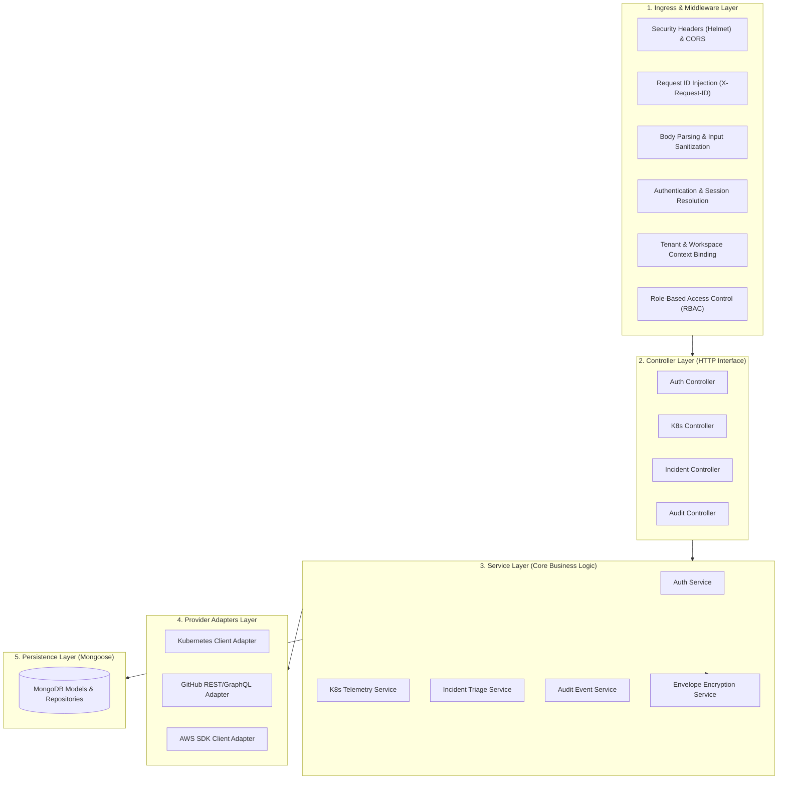

# OmniOPS — Backend Architecture & Specification

| Attribute | Details |
| :--- | :--- |
| **Document ID** | `DOC-03-BAK-01` |
| **Status** | `Draft` (Pending Review) |
| **Version** | `0.1.0` |
| **Document Owner** | Principal Backend Architect Placeholder |
| **Target Audience** | Backend Engineers, Platform Leads, QA Automation Engineers |
| **Last Updated** | 2026-11-04 (UTC) |

---

## 1. Document Control & Executive Summary

### 1.1 Executive Summary
This document specifies the technical architecture, execution patterns, layered abstractions, and operational lifecycle of the OmniOPS backend control plane (`apps/api`). Implemented as a **Modular Monolith** using **Node.js (LTS)** and **Express**, the backend provides a unified, secure REST and streaming API serving both the React Web UI and the `omniops` CLI.

---

## 2. Layered Architecture & Module Separation



### 2.1 Architectural Rules & Boundaries
1. **Thin Controllers**: Controllers **MUST NOT** contain business logic, database queries, or provider-specific SDK calls. They strictly validate HTTP inputs (via Zod), invoke appropriate service methods, and serialize JSON responses.
2. **Provider Isolation**: Direct third-party API SDK calls (e.g., `@kubernetes/client-node`, `@octokit/rest`, `@aws-sdk/*`) are isolated inside `src/adapters/` behind uniform interface contracts.
3. **No Direct Model Access in Controllers**: Controllers must interact with database state exclusively through the Service layer.

---

## 3. Middleware Order & Pipeline Execution

The Express middleware pipeline executes in strict chronological order:

```javascript
// apps/api/src/app.js - Canonical Middleware Pipeline Order
app.use(helmet());                                 // 1. Security headers
app.use(cors(corsOptions));                        // 2. CORS policy enforcement
app.use(requestIdMiddleware);                      // 3. Inject X-Request-ID
app.use(express.json({ limit: "1mb" }));           // 4. Safe body parsing
app.use(express.urlencoded({ extended: true }));  // 5. Form parsing
app.use(rateLimiterMiddleware);                    // 6. Tenant-aware rate limiting
app.use(authMiddleware);                           // 7. Session cookie / PAT resolver
app.use(tenantContextMiddleware);                  // 8. Injects req.tenant
app.use(auditInterceptorMiddleware);               // 9. Mutation audit logger
app.use("/api/v1", apiRouter);                     // 10. API Route Handlers
app.use(notFoundHandler);                          // 11. 404 Route Catcher
app.use(globalErrorHandler);                       // 12. Global Exception Serializer
```

---

## 4. Environment Configuration & Runtime Bootstrap

Environment variables are validated against a strict Zod schema at application boot. If any required variable is missing or malformed, the process immediately exits with a non-zero code:

```javascript
// apps/api/src/config/env.js
import { z } from "zod";

const envSchema = z.object({
  PORT: z.coerce.number().default(4000),
  NODE_ENV: z.enum(["development", "production", "test"]).default("development"),
  MONGODB_URI: z.string().url(),
  MASTER_KEY_HEX: z.string().length(64), // 256-bit encryption key
  CLIENT_URL: z.string().url().default("http://localhost:3000")
});

export const ENV = envSchema.parse(process.env);
```

---

## 5. Graceful Shutdown & Health Probes

To prevent dropped requests during container deployments or auto-scaling events, `apps/api` implements a standard termination handler:
1. Listens for `SIGTERM` and `SIGINT` signals.
2. Stops accepting new inbound HTTP requests.
3. Allows in-flight requests a 15-second grace period to complete.
4. Flushes background telemetry queues and closes MongoDB connection pools cleanly.
5. Exits process with code `0`.

---

## 6. Testing & Dependency Injection Seams

To facilitate fast, reliable unit and integration testing without spinning up live cloud providers:
- **Adapter Mocking**: Provider adapters expose factory functions allowing integration tests to inject mock adapters (e.g., `MockKubernetesAdapter`).
- **In-Memory Testing**: Database integration tests run against `mongodb-memory-server` in CI for isolated, sub-second execution.

---

## 7. Related Documents & Traceability

- [API Standards](API_STANDARDS.md)
- [API Endpoints Reference](API_ENDPOINTS.md)
- [Authentication & Authorization](AUTHENTICATION_AND_AUTHORIZATION.md)
- [Background Jobs & Events](BACKGROUND_JOBS_AND_EVENTS.md)
- [Folder Structure](../01-architecture/FOLDER_STRUCTURE.md)
