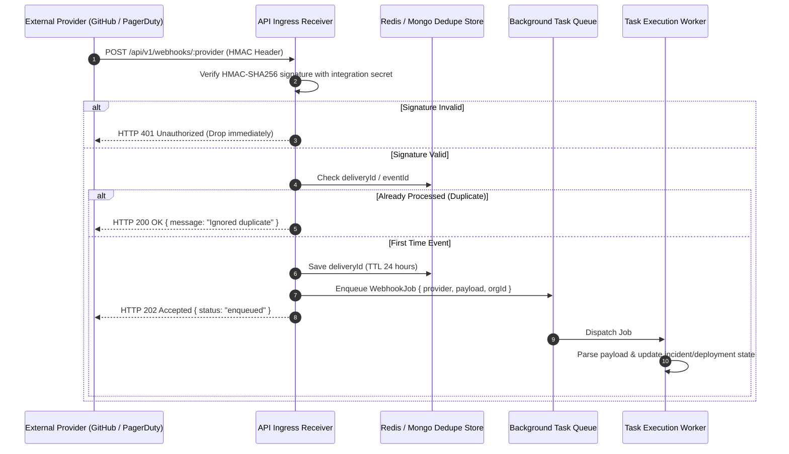

# OmniOPS — Background Jobs, Queues & Events Specification

| Attribute | Details |
| :--- | :--- |
| **Document ID** | `DOC-03-BAK-05` |
| **Status** | `Draft` (Pending Review) |
| **Version** | `0.1.0` |
| **Document Owner** | Lead Distributed Systems Architect Placeholder |
| **Target Audience** | Backend Engineers, SREs, Platform Engineers |
| **Last Updated** | 2026-11-04 (UTC) |

---

## 1. Document Control & Executive Summary

### 1.1 Executive Summary
This document specifies the background asynchronous task processing, webhook ingestion pipeline, and real-time event streaming architecture for OmniOPS. The platform cleanly decouples synchronous HTTP user interactions from long-running, external I/O tasks—such as scraping Kubernetes cluster metrics, polling GitHub repository workflows, processing alert webhooks, and streaming sanitized live pod logs.

---

## 2. Asynchronous Job Categories & Processing Tiers

Background jobs are categorized into three operational tiers based on latency sensitivity and failure tolerance:

| Job Tier | Typical Tasks | Priority | Retry Strategy | Target Latency |
| :--- | :--- | :--- | :--- | :--- |
| **Tier 1: Real-Time Alerts & Webhooks** | PagerDuty webhook, GitHub deployment event | Critical | 5 retries, exponential backoff (2s, 4s, 8s, 16s, 32s) | `< 500ms` |
| **Tier 2: Periodic Telemetry Scrapes** | Kubernetes pod status poll, Docker container check | Normal | 2 retries, fail fast (next poll cycle replaces state) | `15s interval` |
| **Tier 3: Maintenance & Rollups** | Daily cost aggregation, TTL log purge, restore drills | Low | 3 retries, Dead-Letter Queue (DLQ) on terminal failure | Scheduled (Cron) |

---

## 3. Webhook Ingestion & Deduplication Pipeline

---

## 4. Real-Time Telemetry Streaming Architecture (SSE Gateway)

Per [ADR-0008](../01-architecture/ARCHITECTURAL_DECISIONS.md#adr-0008-real-time-telemetry-streaming), OmniOPS utilizes **Server-Sent Events (SSE)** for unidirectional real-time updates (dashboard counters, pod logs):

### 4.1 Connection Lifecycle & Tenant Authorization
1. **Client Handshake**: Browser or CLI initiates `GET /api/v1/events/stream` or `/api/v1/k8s/pods/:id/logs/stream`.
2. **Session / Token Verification**: Standard auth middleware validates session cookie or Bearer PAT before upgrading the connection to `text/event-stream`.
3. **Heartbeat Protocol**: The server sends a comment ping (`: keep-alive\n\n`) every 15 seconds to prevent intermediate proxy timeouts.
4. **Resilience & Reconnection**: Clients supply the `Last-Event-ID` header upon reconnecting; the server resumes event streaming from that point if buffer allows.

---

## 5. Dead-Letter Queue (DLQ) & Failure Handling

When a background job exceeds its maximum retry threshold:
1. The job payload and error stack trace are moved to the `dead_letter_jobs` collection.
2. A system alert is generated and dispatched to the Command Center.
3. Operators can inspect failed jobs via the Admin console and trigger manual replay after addressing the underlying infrastructure failure.

---

## 6. Related Documents & Traceability

- [Backend Specification](BACKEND_SPECIFICATION.md)
- [API Endpoints Reference](API_ENDPOINTS.md)
- [Database Architecture & Design](../05-database/DATABASE_DESIGN.md)
- [Security Architecture](../06-security/SECURITY_ARCHITECTURE.md)
