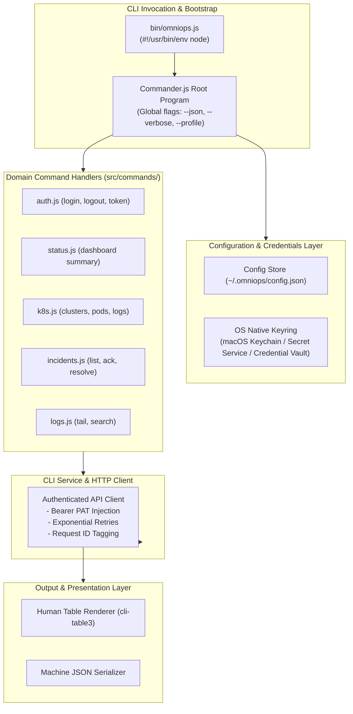

# OmniOPS — CLI Architecture & Engineering Specification

| Attribute | Details |
| :--- | :--- |
| **Document ID** | `DOC-04-CLI-02` |
| **Status** | `Draft` (Pending Review) |
| **Version** | `0.1.0` |
| **Document Owner** | Principal CLI Architect Placeholder |
| **Target Audience** | CLI Developers, Monorepo Maintainers, Tooling Engineers |
| **Last Updated** | 2026-11-04 (UTC) |

---

## 1. Document Control & Executive Summary

### 1.1 Executive Summary
This document specifies the internal software architecture, executable bundling, command parsing pipelines, and service layers for the OmniOPS Command-Line Interface (`packages/cli`). The CLI is structured as a modular Node.js executable built using **Commander.js**, communicating strictly over HTTPS with the OmniOPS Express API.

The CLI acts as a pure API client: it **MUST NOT** execute un-sandboxed local root commands or access customer cloud infrastructure directly.

---

## 2. Command Parser Selection & Engineering Stack

### 2.1 Parser Selection (Commander.js vs. Yargs)
- **Decision**: Adopt **Commander.js** (`commander`).
  - Rationale: High execution speed, minimal cold-start footprint (< 50ms), declarative subcommand nesting, robust TypeScript/JavaScript ecosystem alignment.
- **Supporting Tooling Stack**:
  - Tables & Columns: `cli-table3`
  - ANSI Terminal Colors: `chalk` (with automatic `NO_COLOR` detection)
  - Interactive Prompts: `@inquirer/prompts`
  - Spinners & Progress: `ora`
  - HTTP Client: `axios` or native Node.js `fetch` with token injection interceptor.
  - Secure Keyring Storage: `keytar` / platform secret vault adapter.

---

## 3. Internal Component Architecture & Flow

---

## 4. Signal Handling, Cancellation & Timeouts

1. **Graceful Cancellation (`SIGINT` / `Ctrl+C`)**:
   - Registered signal handlers immediately stop active spinners, terminate pending HTTP requests using `AbortController`, and restore terminal cursor visibility.
   - Process exits cleanly with code `130` (standard 128 + SIGINT).
2. **Network Timeout Enforcement**:
   - Standard queries timeout after 10 seconds.
   - Streaming commands (`omniops logs tail`, `omniops k8s logs`) run indefinitely until user interrupts via `Ctrl+C`.

---

## 5. Testing & Verification Strategy

1. **Unit Tests (Vitest)**: Testing argument parsers, output formatters, and exit code mappers.
2. **E2E CLI Integration Tests**: Executing compiled CLI commands against a mock API server (`nock` or mock Express instance) asserting stdout strings, exit codes, and `--json` schemas.

---

## 6. Related Documents & Traceability

- [CLI Product Specification](CLI_PRODUCT_SPECIFICATION.md)
- [CLI Configuration & Authentication](CLI_CONFIGURATION_AND_AUTH.md)
- [CLI Command Reference](CLI_COMMAND_REFERENCE.md)
- [API Standards](../03-backend/API_STANDARDS.md)
