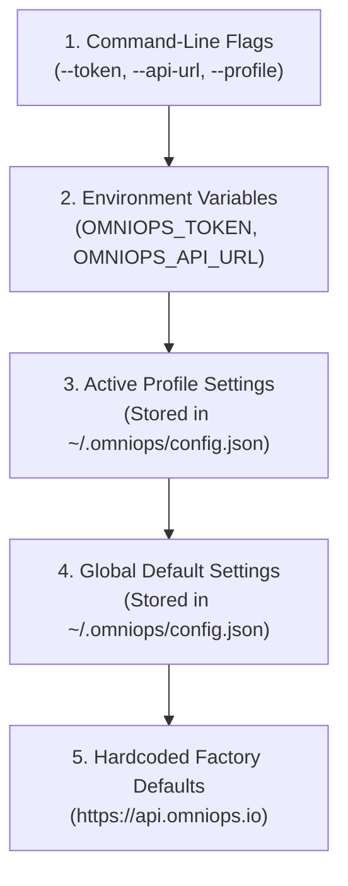

# OmniOPS — CLI Configuration, Profiles & Authentication Specification

| Attribute | Details |
| :--- | :--- |
| **Document ID** | `DOC-04-CLI-03` |
| **Status** | `Draft` (Pending Review) |
| **Version** | `0.1.0` |
| **Document Owner** | Lead Security Engineer / CLI Maintainer Placeholder |
| **Target Audience** | Software Engineers, DevOps Leads, CI/CD Maintainers |
| **Last Updated** | 2026-11-04 (UTC) |

---

## 1. Document Control & Executive Summary

### 1.1 Executive Summary
This document specifies the configuration hierarchy, profile management, credential storage mechanisms, and authentication workflows for the OmniOPS CLI. The specification mandates a **Zero-Plaintext Default**: user tokens are stored securely in the host operating system's native cryptographic credential vault rather than in plaintext disk files.

---

## 2. Configuration Storage & Path Hierarchy

### 2.1 File System Paths per Operating System
- **Linux / macOS**: `~/.omniops/config.json`
- **Windows**: `%APPDATA%\omniops\config.json`
- **Fallback Permission Guard**: If stored on POSIX file systems, the configuration file **MUST** be created with restricted file mode `0600` (`-rw-------`). If permissions are looser than `0600`, the CLI warns the user and automatically tightens the permissions.

---

## 3. Configuration Precedence Resolution

When resolving runtime parameters (such as the target API URL, active organization, or auth token), the CLI evaluates sources in strict order:



---

## 4. Secure Credential Storage Architecture

```mermaid
flowchart TD
    subgraph HostOS["Host Operating System Keyring"]
        KC_MAC["macOS Keychain\n(SecKeychainAddGenericPassword)"]
        KC_LIN["Linux Secret Service API\n(GNOME Keyring / KWallet via libsecret)"]
        KC_WIN["Windows Credential Vault\n(CredWriteW API)"]
    end

    subgraph HeadlessFallback["Headless & Container Fallback"]
        ENV["Environment Variable: OMNIOPS_TOKEN\n(Recommended for Docker / CI/CD)"]
        ENC_FILE["Restricted Config File: ~/.omniops/config.json\n(chmod 0600, Obfuscated Token)"]
    end

    CLI["omniops CLI Engine"] -->|Detects Keyring Service| HostOS
    CLI -->|Keyring Unavailable (e.g. CI/Docker)| HeadlessFallback
```

### 4.1 Native Vault Mapping
- **macOS**: `keytar` queries the Darwin Keychain Services API.
- **Linux**: Queries DBus Secret Service interface.
- **Windows**: Queries the Windows Data Protection API (DPAPI) Credential Manager.

---

## 5. Headless CI/CD Automation & Ephemeral Environments

In automated pipelines (GitHub Actions, GitLab CI, Jenkins), interactive browser logins are impossible. The CLI supports headless authentication exclusively via environment variables:

```yaml
# Example: GitHub Actions Pipeline
jobs:
  omniops-check:
    runs-on: ubuntu-latest
    steps:
      - uses: actions/checkout@v4
      - name: Install OmniOPS CLI
        run: npm install -g omniops
      - name: Verify Cluster Telemetry
        env:
          OMNIOPS_TOKEN: ${{ secrets.OMNIOPS_CI_TOKEN }}
          OMNIOPS_ORG: acme-cloud
        run: omniops k8s pods -n production --json
```

---

## 6. Profile Management Commands

The CLI supports multi-account and multi-environment workflows via profiles:
```bash
# List configured profiles
omniops config profile list

# Create a new profile for staging
omniops config profile create staging --api-url https://staging-api.omniops.io

# Switch active profile
omniops config profile use staging

# View resolved configuration (sensitive tokens are automatically masked)
omniops config view
```

---

## 7. Related Documents & Traceability

- [CLI Product Specification](CLI_PRODUCT_SPECIFICATION.md)
- [CLI Architecture](CLI_ARCHITECTURE.md)
- [CLI Command Reference](CLI_COMMAND_REFERENCE.md)
- [Authentication & Authorization](../03-backend/AUTHENTICATION_AND_AUTHORIZATION.md)
