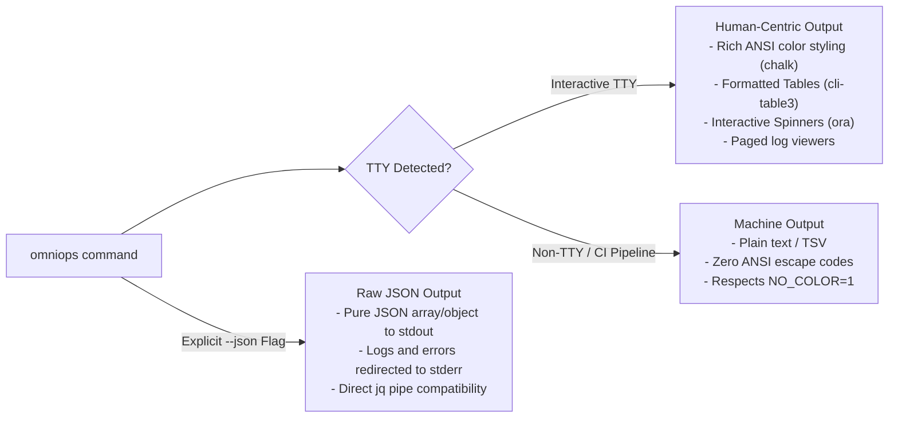

# OmniOPS — CLI Product Specification

| Attribute | Details |
| :--- | :--- |
| **Document ID** | `DOC-04-CLI-01` |
| **Status** | `Draft` (Pending Review) |
| **Version** | `0.1.0` |
| **Document Owner** | Lead CLI Maintainer / Developer Experience Lead Placeholder |
| **Target Audience** | Software Engineers, DevOps Engineers, CI/CD Maintainers |
| **Last Updated** | 2026-11-04 (UTC) |

---

## 1. Document Control & Executive Summary

### 1.1 Executive Summary
This document defines the user-facing product requirements, runtime environment targets, interaction design, installation lifecycle, and exit code standards for the OmniOPS Command-Line Interface (`omniops`). The CLI acts as a first-class client to the OmniOPS Express control plane, offering complete parity with the web dashboard for terminal-centric workflows and headless CI/CD automation.

The proposed package name is `omniops` (npm registry availability **MUST** be verified and claimed prior to public release).

---

## 2. Platform Compatibility & Distribution

### 2.1 Target Runtimes & Operating Systems
- **Runtime**: Node.js v18.0.0+ (Active & Maintenance LTS).
- **Supported Operating Systems**:
  - macOS (Apple Silicon arm64 & Intel x64)
  - Linux (Ubuntu, Debian, Fedora, Arch, Alpine - x64 & arm64)
  - Windows 10/11 (PowerShell, Command Prompt, and WSL2)
- **Supported Shells**: Bash, Zsh, Fish, PowerShell.

### 2.2 Installation & Versioning
- **Installation**:
  ```bash
  # Global npm installation (Proposed)
  npm install -g omniops

  # Direct execution via npx
  npx omniops status
  ```
- **Update Notification**: Automatically performs a non-blocking check against npm registry once every 24 hours. If a new version exists, outputs a subtle notice to stderr upon command completion:
  ```text
  Update available: 0.1.0 -> 0.2.0. Run `npm install -g omniops` to update.
  ```

---

## 3. Interaction Modes & Output Formatting

The CLI provides two primary interaction modes:



### 3.1 Standard Exit Codes

The CLI strictly respects standard Unix process exit codes for predictable shell script and CI automation behavior:

| Exit Code | Identifier | Meaning |
| :--- | :--- | :--- |
| `0` | `SUCCESS` | Command completed successfully. |
| `1` | `GENERAL_ERROR` | Unhandled operational exception or command failure. |
| `2` | `USAGE_ERROR` | Invalid arguments, missing required flags, or syntax error. |
| `3` | `AUTH_ERROR` | Missing or expired Personal Access Token (requires login). |
| `4` | `NETWORK_ERROR` | Unable to connect to OmniOPS API (DNS/timeout/connection refused). |
| `5` | `PERMISSION_DENIED`| Valid credentials, but RBAC role lacks authorization. |

---

## 4. Shell Autocompletion & Command Discoverability

The CLI provides dynamic autocompletion for subcommands, namespaces, and flags:
```bash
# Setup shell completion
omniops completion bash >> ~/.bashrc
omniops completion zsh > "${fpath[1]}/_omniops"
omniops completion fish > ~/.config/fish/completions/omniops.fish
```

---

## 5. Privacy, Telemetry & Headless Operation

- **Zero Secret Output**: Personal access tokens, database connection URIs, and cloud keys are never output to stdout or stderr.
- **Opt-In Telemetry**: The CLI does not transmit telemetry by default. Any future anonymous diagnostic telemetry must be strictly opt-in and adhere to `DO_NOT_TRACK=1`.
- **CI / Headless Mode**: When running in headless environments (`CI=true` or `--non-interactive`), interactive confirmation prompts are disabled; commands requiring confirmation will fail unless explicitly passed `--yes` / `-y`.

---

## 6. Related Documents & Traceability

- [CLI Architecture](CLI_ARCHITECTURE.md)
- [CLI Configuration & Authentication](CLI_CONFIGURATION_AND_AUTH.md)
- [CLI Command Reference](CLI_COMMAND_REFERENCE.md)
- [API Endpoints Reference](../03-backend/API_ENDPOINTS.md)
