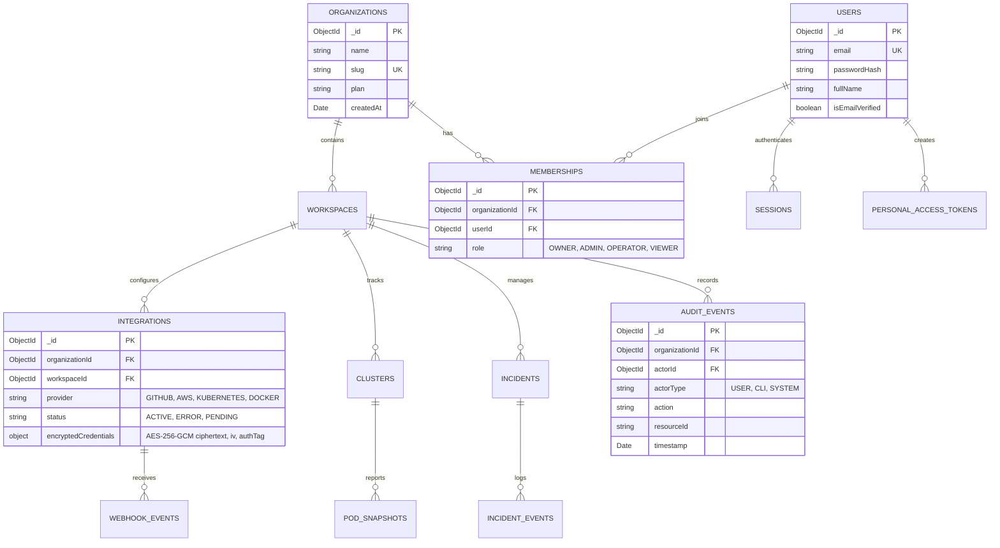

# OmniOPS — Database Architecture & Design Specification

| Attribute | Details |
| :--- | :--- |
| **Document ID** | `DOC-05-DAT-01` |
| **Status** | `Draft` (Pending Review) |
| **Version** | `0.1.0` |
| **Document Owner** | Lead Database Architect / Data Engineer Placeholder |
| **Target Audience** | Backend Engineers, Database Administrators, Security Leads |
| **Last Updated** | 2026-11-04 (UTC) |

---

## 1. Document Control & Executive Summary

### 1.1 Executive Summary
This document establishes the persistence architecture, deployment topology, tenancy partitioning, data access patterns, and indexing strategies for the OmniOPS datastore. OmniOPS adopts **MongoDB** as its primary persistence engine, modeled and schema-enforced via **Mongoose** (per [ADR-0004](../01-architecture/ARCHITECTURAL_DECISIONS.md#adr-0004-primary-database--data-layer)).

Relational SQL migrations and Prisma relational migrations are explicitly prohibited. Document schemas are strictly validated at both the application level and the database engine level (`$jsonSchema`).

---

## 2. Purpose, Audience, Scope & Terminology

### 2.1 Scope & Tenancy Strategy
- **Logical Multi-Tenancy**: OmniOPS employs a shared database, shared collections architecture. Every core collection document is partitioned by an immutable `organizationId` index key.
- **Data Access Layer**: All queries pass through Mongoose middleware that transparently injects `{ organizationId: currentOrgId }` into query filters.
- **Embedding vs. Referencing Decision**:
  - *Embedded Documents*: Used for bounded, tightly coupled data with high co-access rates (e.g., user notification preferences, cluster node statuses, webhook headers).
  - *Referenced Documents*: Used for unbounded growth series, high-frequency mutation entities, or cross-referenced resources (e.g., incidents, audit logs, cluster pods, deployments).

---

## 3. Deployment Topology & Connection Configuration

```mermaid
flowchart TD
    subgraph AppCluster["Application Tier (Private Subnet)"]
        API1["Express API Instance 1"]
        API2["Express API Instance 2"]
        WRK["Background Ingest Worker"]
    end

    subgraph MongoCluster["MongoDB Replica Set (Isolated Data Tier)"]
        PRI["Primary Node (Read / Write)"]
        SEC1["Secondary Node 1 (Replication / Read Analytics)"]
        SEC2["Secondary Node 2 (Replication / Failover)"]
    end

    API1 -->|Connection Pool (maxPoolSize: 50)| PRI
    API2 -->|Connection Pool (maxPoolSize: 50)| PRI
    WRK -->|Connection Pool (maxPoolSize: 20)| PRI
    PRI -.->|Oplog Replication| SEC1
    PRI -.->|Oplog Replication| SEC2
```

### 3.1 Connection Pool & Driver Parameters
The backend connects to MongoDB using the official Node.js driver via Mongoose with production-hardened connection string flags:
- `maxPoolSize`: 50 connections per API instance.
- `minPoolSize`: 10 connections per instance.
- `maxIdleTimeMS`: 30000ms.
- `serverSelectionTimeoutMS`: 5000ms.
- `retryWrites`: `true` (enables automatic retry on transient write errors).
- `w`: `majority` (acknowledgment only after writing to a majority of replica set nodes).
- `readPreference`: `primaryPreferred` (analytics/telemetry queries can explicitly opt into `secondaryPreferred`).

---

## 4. Document Entity-Relationship Diagram



---

## 5. Primary Collections & Indexing Strategy

### 5.1 Collection Index Specifications

| Collection Name | Index Fields | Index Type | Purpose / Justification |
| :--- | :--- | :--- | :--- |
| `users` | `{ email: 1 }` | Unique | Fast lookup during login; email uniqueness. |
| `memberships` | `{ organizationId: 1, userId: 1 }` | Unique Compound | Fast user authorization; prevents duplicate memberships. |
| `sessions` | `{ sessionToken: 1 }` | Unique | Fast cookie session verification. |
| `sessions` | `{ expiresAt: 1 }` | TTL Index | Automatic MongoDB deletion of expired sessions. |
| `personal_access_tokens` | `{ tokenHash: 1 }` | Unique | O(1) hash lookup for CLI bearer authentication. |
| `integrations` | `{ organizationId: 1, provider: 1 }` | Compound | Fast retrieval of configured provider credentials. |
| `pod_snapshots` | `{ organizationId: 1, clusterId: 1, namespace: 1 }` | Compound | Namespace-scoped pod queries. |
| `pod_snapshots` | `{ updatedAt: 1 }` | TTL Index (7 days) | Telemetry retention cleanup. |
| `incidents` | `{ organizationId: 1, status: 1, severity: 1 }` | Compound | Fast filtering on active high-severity incidents. |
| `audit_events` | `{ organizationId: 1, timestamp: -1 }` | Compound | Chronological audit log traversal and filtering. |
| `webhook_events` | `{ provider: 1, deliveryId: 1 }` | Unique Compound | Webhook idempotency and deduplication engine. |

---

## 6. Transactions & Consistency Model

1. **Single-Document Atomicity**: MongoDB guarantees ACID atomicity for single-document modifications. Operations updating embedded arrays (e.g., adding an incident timeline note) are inherently atomic.
2. **Multi-Document ACID Transactions**: Used strictly where state divergence would cause security or billing corruption:
   - Organization creation with initial Owner membership.
   - User account deletion with cascading membership cleanup.
   - Webhook token rotation with previous token invalidation.
3. **Write Concern & Read Concern**:
   - Critical updates (auth, roles, audit events) use `w: "majority"` and `j: true` (journaled).
   - High-volume telemetry writes use `w: 1` to optimize ingest throughput without stalling the worker pool.

---

## 7. Migration Strategy & Schema Evolution

Because OmniOPS uses MongoDB, traditional SQL `ALTER TABLE` operations do not exist. Schema migrations follow the **Expand and Contract** pattern:
1. **Schema Versioning**: Every document includes a `_schemaVersion: Number` field (default `1`).
2. **On-Read Transformation**: When older schema documents are retrieved, the Mongoose model applies default values dynamically.
3. **Background Backfill**: For large schema transitions, a Node.js migration script (`apps/api/scripts/migrations/*.js`) iterates through documents in batches of 1,000 using cursor streaming, updating records with zero platform downtime.

---

## 8. Security & Tenancy Enforcement

### 8.1 Tenant Scoping Plugin
Every Mongoose model (except `users` and global system configs) registers the `@omniops/tenant-scoping` plugin:

```javascript
// Illustrative Mongoose Tenant Plugin
function tenantScopingPlugin(schema) {
  schema.add({
    organizationId: {
      type: mongoose.Schema.Types.ObjectId,
      ref: 'Organization',
      required: true,
      index: true
    }
  });

  schema.pre(/^find/, function() {
    if (!this.getQuery().organizationId && !this.getOptions().bypassTenantCheck) {
      throw new Error("SECURITY_VIOLATION: Query attempted without organizationId context.");
    }
  });
}
```

---

## 9. Related Documents & Traceability

- [Data Models & Schemas](DATA_MODELS_AND_SCHEMAS.md)
- [Data Lifecycle & Backups](DATA_LIFECYCLE_AND_BACKUPS.md)
- [Architectural Decision Records](../01-architecture/ARCHITECTURAL_DECISIONS.md)
- [System Architecture](../01-architecture/SYSTEM_ARCHITECTURE.md)
- [Authentication & Authorization](../03-backend/AUTHENTICATION_AND_AUTHORIZATION.md)
