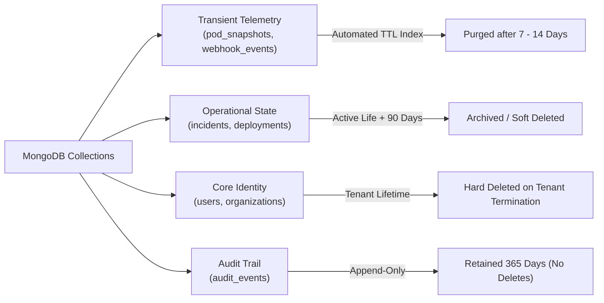
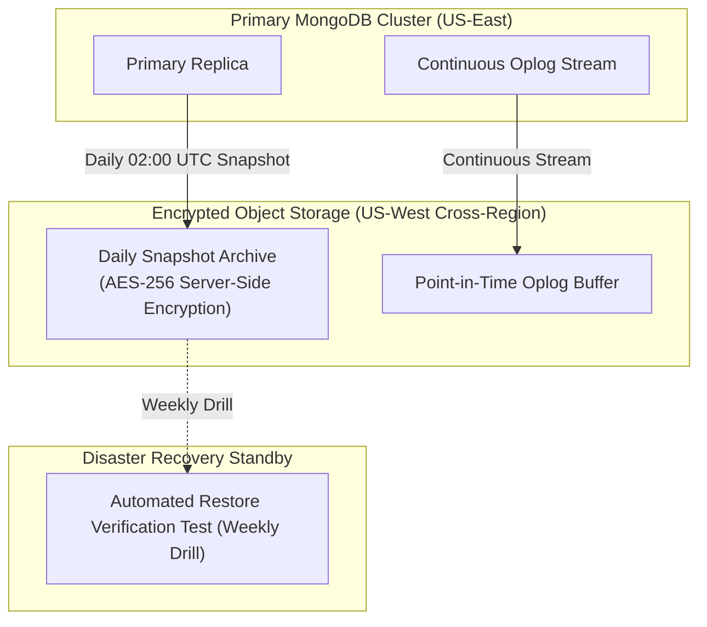

# OmniOPS — Data Lifecycle, Retention & Backup Specification

| Attribute | Details |
| :--- | :--- |
| **Document ID** | `DOC-05-DAT-03` |
| **Status** | `Draft` (Pending Review) |
| **Version** | `0.1.0` |
| **Document Owner** | Principal Data Architect / Site Reliability Engineer Placeholder |
| **Target Audience** | SREs, Database Administrators, Security Leads, Compliance Officers |
| **Last Updated** | 2026-11-04 (UTC) |

---

## 1. Document Control & Executive Summary

### 1.1 Executive Summary
This document defines the lifecycle, retention policies, deletion protocols, and business continuity recovery procedures for all data stored within OmniOPS. It establishes Recovery Point Objectives (RPO) and Recovery Time Objectives (RTO), backup automation cadences, disaster recovery scenarios, and cryptographic retention guarantees across both managed MongoDB Atlas and self-hosted MongoDB replica set topologies.

---

## 2. Recovery Objectives & Disaster Recovery Targets

The following parameters are proposed operational targets subject to production infrastructure validation:

| Metric | Target Objective | Description |
| :--- | :--- | :--- |
| **RPO (Recovery Point Objective)** | `< 15 Minutes` | Maximum acceptable data loss window during a disaster scenario. |
| **RTO (Recovery Time Objective)** | `< 60 Minutes` | Maximum allowable downtime to restore database availability. |
| **Backup Frequency** | Continuous / Daily | Continuous oplog streaming + daily snapshot snapshots. |
| **Snapshot Retention** | 30 Days (Rolling) | Daily snapshots retained for 30 days before automated purging. |

---

## 3. Data Retention & Purging Policies by Collection



### 3.1 Collection Retention Matrix

| Collection Name | Lifecycle Policy | Mechanism | Retention Period | Rationale |
| :--- | :--- | :--- | :--- | :--- |
| `pod_snapshots` | Ephemeral | MongoDB TTL Index on `updatedAt` | 7 Days | High-frequency telemetry; historical trend data aggregated separately. |
| `webhook_events` | Transient | MongoDB TTL Index on `createdAt` | 14 Days | Deduplication window only requires short sliding retention. |
| `sessions` | Ephemeral | MongoDB TTL Index on `expiresAt` | Max 30 Days | Session security; automatic cleanup on expiration. |
| `incidents` | Retained | Soft delete (`deletedAt` flag) | Indefinite (Active) | Historical incident triage and post-mortem analysis. |
| `audit_events` | Immutable | Write-Once; No Deletes | Minimum 365 Days | Regulatory compliance and security forensic auditability. |
| `users` | Account Bounded | Soft delete followed by 30-day grace | Indefinite until requested | GDPR / CCPA right to erasure workflow. |

---

## 4. Tenant Deletion & Offboarding Protocols

When an organization triggers account termination via `Owner` authorization:
1. **Soft Delete & Freeze**: The organization status is marked `TERMINATED`. All active sessions and PATs are immediately revoked. Database access is rejected at the API middleware layer.
2. **30-Day Grace Period**: Data remains frozen for 30 days to protect against accidental deletion or payment dispute recovery.
3. **Hard Deletion Execution**: A background maintenance worker executes a batch purge:
   - Deletes all records matching `organizationId` from `workspaces`, `integrations`, `incidents`, `pod_snapshots`.
   - Cleanses user memberships.
   - Credentials in `integrations` are cryptographically shredded by purging the associated Data Encryption Key (DEK).
4. **Audit Log Preservation**: `audit_events` entries documenting the deletion itself are retained for compliance, with user email/PII scrubbed to anonymized identifiers.

---

## 5. Backup Strategy & Disaster Recovery Architecture



### 5.1 Atlas vs. Self-Hosted Deployment Considerations
- **Managed (MongoDB Atlas)**:
  - Leverages continuous cloud backups and Point-In-Time Recovery (PITR) to any second within the past 7 days.
  - Snapshot isolation handled across multi-region AWS/GCP buckets.
- **Self-Hosted Replica Set (AWS EC2 / EBS)**:
  - Backups orchestrated via consistent EBS volume snapshots coordinated with `fsyncLock()`.
  - Oplog tailing streamed to Amazon S3 via secure IAM instance profiles.

---

## 6. Operational Runbook: Point-In-Time Disaster Recovery

In the event of catastrophic data corruption or primary cluster loss:

### Step 1: Declare Incident & Lock Routing
1. SRE declares `SEV-1` incident.
2. Update edge reverse proxy to return maintenance mode (HTTP 503) to halt all inbound mutations.

### Step 2: Provision Target Cluster & Restore Snapshot
```bash
# Example restoration using mongorestore for self-hosted backup
mongorestore --host dr-mongo.internal.omniops.io:27017 \
  --ssl --sslCAFile /etc/ssl/ca.pem \
  --username admin --password "${DR_RESTORE_SECRET}" \
  --authenticationDatabase admin \
  --dir /backups/snapshots/2026-11-04-snapshot/ \
  --nsInclude="omniops.*"
```

### Step 3: Replay Oplog to Target Timestamp
Replay transactions up to the exact minute prior to corruption:
```bash
mongorestore --host dr-mongo.internal.omniops.io:27017 \
  --ssl --oplogReplay \
  --oplogLimit="1793798400:1" \
  /backups/oplog/
```

### Step 4: Verification & DNS Cutover
1. Run automated data integrity test suite verifying count parity on `users`, `organizations`, and `incidents`.
2. Update Express API environment variable `MONGODB_URI` to point to the restored cluster.
3. Disable maintenance mode and restore traffic.

---

## 7. Testing Strategy & Acceptance Criteria

1. **Automated Weekly Restore Drill**: CI/CD executes a weekly automated restore of production backup snapshots to an isolated sandbox environment, asserting schema and index integrity.
2. **TTL Index Verification**: Unit test confirming documents with expired timestamps are evicted by the MongoDB background thread within 60 seconds of expiration window.

---

## 8. Related Documents & Traceability

- [Database Architecture & Design](DATABASE_DESIGN.md)
- [Data Models & Schemas](DATA_MODELS_AND_SCHEMAS.md)
- [System Architecture](../01-architecture/SYSTEM_ARCHITECTURE.md)
- [Incident Management Guidelines](../00-overview/SCOPE_AND_FEATURES.md#module-9-incident-management)
