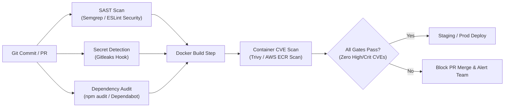

# OmniOPS — Security Controls, Policy & Compliance Specification

| Attribute | Details |
| :--- | :--- |
| **Document ID** | `DOC-06-SEC-03` |
| **Status** | `Draft` (Pending Legal & Security Review) |
| **Version** | `0.1.0` |
| **Document Owner** | Lead Compliance & Security Architect Placeholder |
| **Target Audience** | Security Engineers, Legal Advisors, DevOps Leads, Auditors |
| **Last Updated** | 2026-11-04 (UTC) |

---

## 1. Document Control & Executive Summary

### 1.1 Executive Summary
This document specifies the operational security controls, browser security headers, vulnerability disclosure frameworks, and regulatory baseline for OmniOPS. It establishes concrete technical defenses against Cross-Site Scripting (XSS), Cross-Site Request Forgery (CSRF), SQL/NoSQL injection, and supply-chain tampering.

**Legal Disclaimer**: This specification establishes technical engineering controls and readiness frameworks. It does not constitute formal legal counsel nor does it certify formal compliance with SOC 2, ISO 27001, HIPAA, or GDPR without formal third-party audit verification.

---

## 2. Ingress Security Headers & Browser Hardening

The Express API and Web ingress proxies inject standardized security headers on 100% of HTTP responses (via Helmet middleware):

```http
Strict-Transport-Security: max-age=31536000; includeSubDomains; preload
Content-Security-Policy: default-src 'self'; script-src 'self'; style-src 'self' 'unsafe-inline'; font-src 'self'; img-src 'self' data: https:; connect-src 'self' https://api.omniops.io wss://api.omniops.io; frame-ancestors 'none'; object-src 'none'; base-uri 'self'; form-action 'self';
X-Content-Type-Options: nosniff
X-Frame-Options: DENY
Referrer-Policy: strict-origin-when-cross-origin
Permissions-Policy: camera=(), microphone=(), geolocation=(), payment=()
```

### 2.1 Cross-Origin Resource Sharing (CORS) Policy
- Web requests originate from authorized domains (e.g., `https://app.omniops.io`).
- Wildcards (`Access-Control-Allow-Origin: *`) are strictly prohibited on authenticated `/api/v1/*` routes.
- `Access-Control-Allow-Credentials: true` is enabled strictly for verified origin domains to permit secure session cookie transmission.

---

## 3. Web Application Defenses

1. **XSS Defense**: React natively encodes rendered strings, preventing DOM-based script injection. `dangerouslySetInnerHTML` is prohibited across the codebase via strict ESLint rules.
2. **NoSQL Injection Defense**: MongoDB operator injection (e.g., `req.body.username = { "$gt": "" }`) is mitigated by:
   - Sanitizing all inbound request bodies via `express-mongo-sanitize` (stripping keys starting with `$`).
   - Validating all request payloads with strict Zod schemas before reaching Mongoose queries.
3. **CSRF Protection**: Stateful browser mutations enforce double-submit CSRF cookies (`omniops_csrf`) matched against the `X-CSRF-Token` HTTP header.

---

## 4. Automated Security Scanning Pipeline (DevSecOps)



---

## 5. Vulnerability Disclosure Policy (VDP)

OmniOPS welcomes security researchers to report potential vulnerabilities under a responsible disclosure framework:
- **Security Contact**: Security inquiries and reports must be emailed to `security@omniops.io` (monitored 24/7 by on-call security engineers).
- **Encryption**: Vulnerability reports should be encrypted using the published OmniOPS PGP Key.
- **SLA**: Initial acknowledgment within 24 hours; preliminary assessment within 72 hours.
- **Safe Harbor**: Researchers acting in good faith without compromising customer data integrity or service availability are granted safe harbor protection.

---

## 6. Related Documents & Traceability

- [Security Architecture](SECURITY_ARCHITECTURE.md)
- [Threat Model Specification](THREAT_MODEL.md)
- [Backend Specification](../03-backend/BACKEND_SPECIFICATION.md)
- [Testing Strategy](../07-testing/TESTING_STRATEGY.md)
