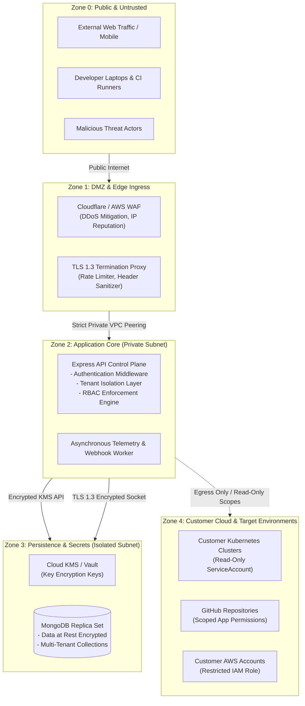

# OmniOPS — Security Architecture & Execution Controls

| Attribute | Details |
| :--- | :--- |
| **Document ID** | `DOC-06-SEC-01` |
| **Status** | `Draft` (Pending Security Board Review) |
| **Version** | `0.1.0` |
| **Document Owner** | Chief Information Security Officer / Principal Security Architect Placeholder |
| **Target Audience** | Security Engineers, Systems Architects, Compliance Auditors, SREs |
| **Last Updated** | 2026-11-04 (UTC) |

---

## 1. Document Control & Executive Summary

### 1.1 Executive Summary
OmniOPS interfaces directly with high-value, business-critical customer infrastructure—including Kubernetes clusters, production Docker registries, cloud provider accounts (AWS/GCP), and code repositories. Consequently, the platform is designed under an uncompromising **Zero Trust, Least-Privilege by Default** operational paradigm.

All infrastructure integrations default to **strictly read-only telemetry ingestion**. Mutating or destructive operations (e.g., container restarts, rollbacks, node cordoning) are gated behind Role-Based Access Control (RBAC), multi-party policy approvals, cryptographically verified tokens, and tamper-evident audit logging.

---

## 2. Trust Zones & Threat Boundaries

---

## 3. Cryptographic Storage & Envelope Encryption

OmniOPS strictly enforces **Zero Plaintext Secret Ingestion**. Third-party cloud tokens, kubeconfig files, and GitHub App private keys are protected via **Envelope Encryption**:
1. **Key Encryption Key (KEK)**: Stored in an external Key Management Service (AWS KMS or GCP Cloud KMS). The backend never stores the KEK.
2. **Data Encryption Key (DEK)**: For every customer organization, a cryptographically random 256-bit DEK is generated.
3. **Cipher Suite**: **AES-256-GCM** with a unique 96-bit Initialization Vector (IV) and a 128-bit authentication tag per secret.
4. **Decryption Lifecycle**: Decrypted secrets reside solely in ephemeral worker memory during telemetry collection and are immediately dereferenced for garbage collection.

---

## 4. Multi-Tenant Isolation Verification

- **Logical Data Partitioning**: Every collection schema in MongoDB requires an `organizationId` index key.
- **Query Scoping Enforcement**: Mongoose query interceptors reject any query execution that lacks an explicit `organizationId` filter unless marked with an audited administrative flag.
- **Tenant Context Bleed Defense**: All caching layers (TanStack Query on the web client, in-memory caches on the backend) prefix keys with the tenant ID (`tenant:${orgId}:${resource}`). Switching active tenants flushes client memory completely.

---

## 5. Destructive Operations & Approval Safeguards

For post-MVP phases introducing infrastructure mutations:
1. **Two-Person Rule (Dual Authorization)**: Critical actions (such as pod eviction, deployment rollback, or secret rotation) require initiation by an `Operator` and secondary approval by an `Admin` or `Owner`.
2. **Policy-as-Code Validation**: Proposed mutations are evaluated against automated safety policies (e.g., prohibiting production pod restarts during peak traffic hours).
3. **Time-Bound Execution Leases**: Approved action tokens expire after 10 minutes. If not claimed by the execution worker within this lease window, the action is automatically aborted.

---

## 6. Audit Trail & Non-Repudiation

- 100% of authentication attempts, RBAC mutations, configuration edits, credential views, and operational queries write an immutable log entry to the `audit_events` collection.
- Database roles assigned to the API service account are restricted to `insert` and `find` on the `audit_events` collection; `update` and `delete` privileges are explicitly revoked at the database engine level.

---

## 7. Related Documents & Traceability

- [Threat Model Specification](THREAT_MODEL.md)
- [Security & Compliance](SECURITY_AND_COMPLIANCE.md)
- [System Architecture](../01-architecture/SYSTEM_ARCHITECTURE.md)
- [Authentication & Authorization](../03-backend/AUTHENTICATION_AND_AUTHORIZATION.md)
- [Database Design](../05-database/DATABASE_DESIGN.md)
