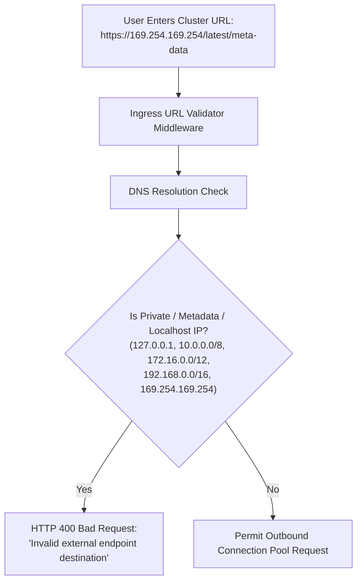

# OmniOPS — Threat Model & Risk Assessment

| Attribute | Details |
| :--- | :--- |
| **Document ID** | `DOC-06-SEC-02` |
| **Status** | `Draft` (Pending Review) |
| **Version** | `0.1.0` |
| **Document Owner** | Lead Application Security Engineer Placeholder |
| **Target Audience** | Security Engineers, Backend Developers, Platform Architects |
| **Last Updated** | 2026-11-04 (UTC) |

---

## 1. Document Control & Executive Summary

### 1.1 Executive Summary
This document provides a structured threat model for the OmniOPS DevOps control plane utilizing the **STRIDE** methodology (Spoofing, Tampering, Repudiation, Information Disclosure, Denial of Service, and Elevation of Privilege). It identifies critical attack vectors, evaluates likelihood and impact, defines technical mitigations, and establishes automated test verification criteria.

No claims of formal third-party certification (e.g., SOC 2, ISO 27001) are made in this specification.

---

## 2. Threat Actor Taxonomy & System Assets

### 2.1 Threat Actors
1. **External Opportunistic Attacker**: Scans public IP ranges for exposed endpoints, unpatched vulnerabilities, or weak credentials.
2. **Malicious Insider / Compromised Tenant User**: Authenticated organization member attempting unauthorized privilege escalation or lateral data exfiltration.
3. **Compromised Upstream Dependency / Supply Chain**: Malicious code injected into third-party npm packages.
4. **Untrusted External Service**: Compromised third-party webhook sender attempting SSRF or data tampering.

### 2.2 Critical Assets
- **A1**: Customer Cloud Credentials & Kubeconfigs (Stored in MongoDB).
- **A2**: Immutable Audit Ledger (`audit_events` collection).
- **A3**: Personal Access Tokens (CLI & CI/CD secrets).
- **A4**: Tenant Isolation Boundary (Separation between customer organizations).
- **A5**: Production Infrastructure Control Surface (Target customer clusters and cloud accounts).

---

## 3. STRIDE Threat Analysis Matrix

| Threat ID | Category | Threat Scenario | Likelihood | Impact | Primary Technical Mitigation | Residual Risk |
| :--- | :--- | :--- | :--- | :--- | :--- | :--- |
| **`TH-001`** | **Spoofing** | Forged webhook requests impersonating GitHub or PagerDuty. | High | High | Mandatory HMAC-SHA256 signature verification using stored webhook secrets. | Low |
| **`TH-002`** | **Tampering** | Man-in-the-Middle tampering of API payloads or CLI communications. | Low | Critical | Strict TLS 1.3 enforcement with HSTS (`max-age=31536000`). | Low |
| **`TH-003`** | **Repudiation**| User denies triggering a destructive pod restart or token rotation. | Medium | High | Append-only immutable `audit_events` logging capturing actor ID, timestamp, and source IP. | Negligible |
| **`TH-004`** | **Info Disclosure**| Plaintext credential exfiltration from database compromise. | Medium | Critical | AES-256-GCM envelope encryption via external KMS; zero plaintext secrets at rest. | Low |
| **`TH-005`** | **Denial of Service**| Flooding telemetry ingestion endpoints or API login endpoints. | High | Medium | Ingress rate limiting (IP and tenant-based) + circuit breakers on external provider calls. | Low |
| **`TH-006`** | **Elevation of Privilege**| Cross-Tenant data leak (Tenant A accessing Tenant B telemetry). | Medium | Critical | Automated Mongoose tenant scoping plugin enforcing `organizationId` filter on 100% of queries. | Low |
| **`TH-007`** | **Info Disclosure**| Stolen developer laptop leading to CLI Personal Access Token theft. | High | High | Tokens stored in OS native cryptographic keyring (macOS Keychain, Windows Credential Manager). | Medium |
| **`TH-008`** | **Elevation of Privilege**| Server-Side Request Forgery (SSRF) via user-provided cluster endpoints. | High | Critical | IP allowlisting/denylisting preventing API workers from connecting to private RFC-1918 IPs or metadata services (`169.254.169.254`). | Low |
| **`TH-009`** | **Tampering** | AI Prompt Injection via untrusted log streams (Phase 5). | High | High | Strict log sanitization prior to LLM submission; zero autonomous execution permissions granted to AI. | Low |

---

## 4. Deep-Dive Attack Vector Mitigations

### 4.1 SSRF Defense on Integration Endpoints

### 4.2 Cross-Tenant Bleed Defense
Every repository method is wrapped with invariant tenant assertions. Automated fuzz testing in CI verifies that swapping `organizationId` headers in API requests returns HTTP 403 Forbidden or 404 Not Found, never sibling tenant data.

---

## 5. Security Test Verification Strategy

1. **Static Analysis (SAST)**: Automated Semgrep and ESLint security plugins running on every PR to detect hardcoded secrets and prototype pollution.
2. **Secret Scanning**: Gitleaks integrated into GitHub Actions to reject commits containing tokens, private keys, or AWS credentials.
3. **Dependency Scanning (SCA)**: Automated `npm audit` and Dependabot scanning for known CVEs in transitive dependencies.

---

## 6. Related Documents & Traceability

- [Security Architecture](SECURITY_ARCHITECTURE.md)
- [Security & Compliance](SECURITY_AND_COMPLIANCE.md)
- [Authentication & Authorization](../03-backend/AUTHENTICATION_AND_AUTHORIZATION.md)
- [Database Design](../05-database/DATABASE_DESIGN.md)
