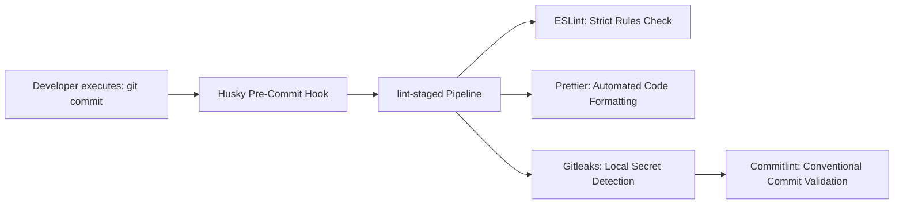

# OmniOPS — Engineering Quality Standards & Coding Conventions

| Attribute | Details |
| :--- | :--- |
| **Document ID** | `DOC-07-TES-02` |
| **Status** | `Approved / Living Document` |
| **Version** | `1.0.0` |
| **Document Owner** | Lead Systems Architect / Engineering Standards Committee |
| **Target Audience** | All Software Engineers, Monorepo Maintainers, Code Reviewers |
| **Last Updated** | 2026-11-04 (UTC) |

---

## 1. Document Control & Executive Summary

### 1.1 Executive Summary
This document establishes the mandatory code quality standards, static linting rules, formatting guidelines, Git workflow conventions, and pull request review criteria for all repositories and packages within OmniOPS. Adherence to these standards is automated via pre-commit hooks (Husky, lint-staged) and strictly verified in CI pipelines.

---

## 2. Language Standards & Code Conventions

### 2.1 ECMAScript / JavaScript Standards
- Modern ECMAScript (ES2022+) with native ECMAScript Modules (`import` / `export`).
- TypeScript-specific syntax (`type`, `interface`, generics) is **strictly forbidden** until an approved ADR authorizes a migration.
- Prefer `async` / `await` over raw promise `.then()` chaining.
- All asynchronous operations must feature explicit error handling; unhandled promise rejections are treated as critical defects.

### 2.2 Import Ordering Standards
Imports must follow a deterministic four-tier group order separated by blank lines:
```javascript
// 1. Node.js built-in modules
import crypto from "node:crypto";
import path from "node:path";

// 2. Third-party dependencies
import express from "express";
import { z } from "zod";

// 3. Workspace packages
import { AppError } from "@omniops/shared";
import { loginSchema } from "@omniops/validation";

// 4. Internal relative modules
import { authService } from "./auth-service.js";
```

---

## 3. Pre-Commit Automation & Linting Tools



### 3.1 Conventional Commit Format
All git commit messages **MUST** follow the Conventional Commits specification:
```text
<type>(<optional scope>): <description>

[optional body]

[optional footer(s)]
```
- **Allowed Types**:
  - `feat`: New user-facing feature or API endpoint.
  - `fix`: Bug fix.
  - `docs`: Documentation updates only.
  - `refactor`: Code change that neither fixes a bug nor adds a feature.
  - `test`: Adding or correcting tests.
  - `chore`: Tooling, dependency, or configuration updates.

---

## 4. Pull Request Review Checklist

Reviewers must verify that every PR satisfies the following criteria before approval:
- [ ] **Lint & Format**: Clean run of `npm run lint` and `npm run format`.
- [ ] **Zero Secrets**: No tokens, credentials, connection strings, or private keys in code or diffs.
- [ ] **Test Coverage**: Added tests for all new code paths; no dropped test coverage.
- [ ] **Tenant Scoping**: All database queries explicitly include `organizationId`.
- [ ] **Error Handling**: Uses standardized error classes (`AppError`, `NotFoundError`, `ForbiddenError`).
- [ ] **Accessibility (Frontend)**: Semantic HTML, focus visible states, and proper ARIA labels.
- [ ] **Performance**: No unindexed MongoDB queries or unbounded array allocations.

---

## 5. Related Documents & Traceability

- [Testing Strategy](TESTING_STRATEGY.md)
- [Monorepo Architecture](../01-architecture/MONOREPO_ARCHITECTURE.md)
- [Folder Structure](../01-architecture/FOLDER_STRUCTURE.md)
- [Development Guidelines](../09-developer-experience/DEVELOPMENT_GUIDELINES.md)
