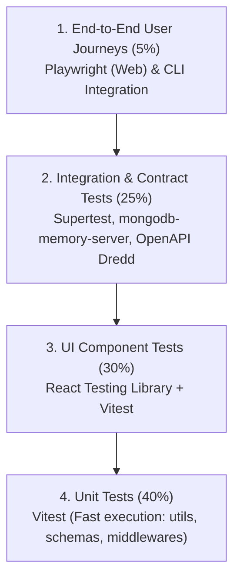

# OmniOPS — Testing Strategy & Quality Assurance Framework

| Attribute | Details |
| :--- | :--- |
| **Document ID** | `DOC-07-TES-01` |
| **Status** | `Draft` (Pending Review) |
| **Version** | `0.1.0` |
| **Document Owner** | Principal QA Architect / Test Automation Lead Placeholder |
| **Target Audience** | Software Engineers, QA Leads, DevOps Engineers, CI/CD Maintainers |
| **Last Updated** | 2026-11-04 (UTC) |

---

## 1. Document Control & Executive Summary

### 1.1 Executive Summary
This document defines the comprehensive testing strategy, automated test pyramid, quality gates, and toolchain standards for OmniOPS. It establishes rigorous verification frameworks spanning unit tests, component tests, API integration tests, CLI command tests, security checks, and end-to-end browser journeys.

---

## 2. Test Automation Pyramid & Tooling Matrix

| Test Level | Scope | Primary Framework | Target Execution Time | CI Gate Requirement |
| :--- | :--- | :--- | :--- | :--- |
| **Unit** | Pure functions, Zod schemas, crypto utils, error mappers | **Vitest** | `< 10 seconds` | 100% Pass; blocks PR merge |
| **Component** | React components, accessible dialogs, form validation | **React Testing Library** | `< 30 seconds` | 100% Pass; blocks PR merge |
| **Integration** | Express routes, MongoDB Mongoose queries, RBAC checks | **Supertest + Mongo In-Memory**| `< 45 seconds` | 100% Pass; blocks PR merge |
| **CLI E2E** | `omniops` commands against mock API endpoints | **Vitest + Execa** | `< 20 seconds` | 100% Pass; blocks PR merge |
| **Browser E2E** | Complete login, dashboard filtering, incident acknowledge | **Playwright** | `< 2 minutes` | Runs on PR & main merge |
| **Performance** | API load test (p95 latency under 250ms @ 500 RPS) | **k6** | Scheduled / Nightly | Alerts on SLA breach |

---

## 3. Critical Journey Test Suites

1. **Multi-Tenant Isolation Suite**:
   - Asserts that an authenticated API token for `org_A` cannot query or mutate records belonging to `org_B`, returning HTTP 403/404.
2. **Dual-Client Auth Parity Suite**:
   - Executes identical operations via browser session cookies and CLI Personal Access Tokens, validating that identical data schemas are returned.
3. **Secret Redaction Suite**:
   - Streams simulated pod logs containing test JWTs, AWS secret keys, and passwords, asserting that the output text masks all sensitive substrings to `[REDACTED]`.
4. **Graceful Degraded Ingestion Suite**:
   - Injects mock HTTP 429 and 503 errors into external GitHub/Kubernetes adapters, asserting that background workers trip circuit breakers without crashing the API process.

---

## 4. Code Coverage Thresholds & Flaky Test Management

### 4.1 Proposed Target Coverage Thresholds
- **Backend Core Services & Middlewares (`apps/api`)**: `85% statement coverage`.
- **Validation Schemas (`packages/validation`)**: `95% statement coverage`.
- **Frontend Core Hooks & Utilities (`apps/web`)**: `80% statement coverage`.
- **CLI Commands (`packages/cli`)**: `80% statement coverage`.

### 4.2 Zero Tolerance for Flaky Tests
- Any test that fails intermittently without code changes is quarantined immediately to prevent blocking the engineering team.
- A P1 tracking ticket is filed; if not resolved within 72 hours, the test is rewritten or replaced.

---

## 5. Related Documents & Traceability

- [Quality Standards](QUALITY_STANDARDS.md)
- [CI/CD & Deployment Strategy](../08-devops/CI_CD_AND_DEPLOYMENT.md)
- [Backend Specification](../03-backend/BACKEND_SPECIFICATION.md)
- [Frontend Specification](../02-frontend/FRONTEND_SPECIFICATION.md)
