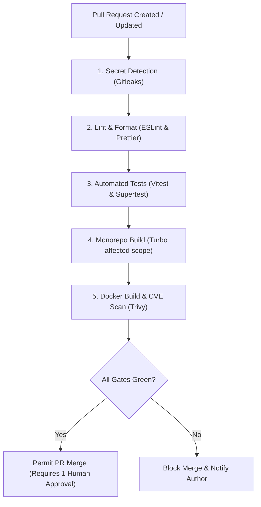
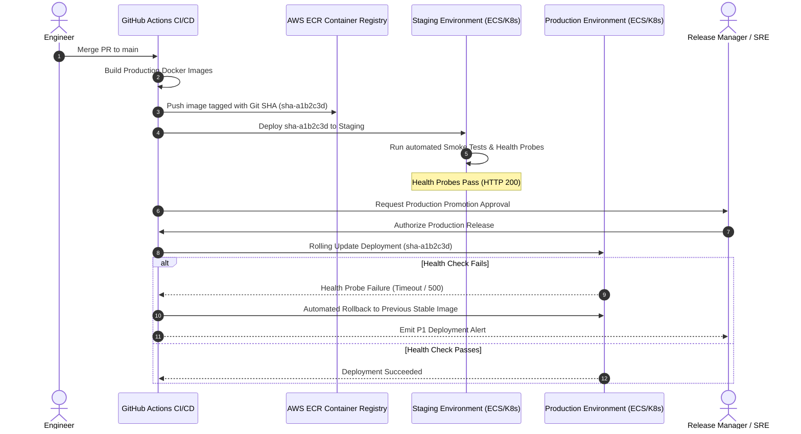

# OmniOPS — CI/CD Pipeline & Deployment Strategy

| Attribute | Details |
| :--- | :--- |
| **Document ID** | `DOC-08-OPS-02` |
| **Status** | `Draft` (Pending Review) |
| **Version** | `0.1.0` |
| **Document Owner** | Lead CI/CD Architect / Release Engineer Placeholder |
| **Target Audience** | DevOps Engineers, SREs, Release Managers, Software Engineers |
| **Last Updated** | 2026-11-04 (UTC) |

---

## 1. Document Control & Executive Summary

### 1.1 Executive Summary
This document specifies the Continuous Integration (CI), Continuous Delivery (CD), environment promotion, and release management pipelines for OmniOPS. Implemented using **GitHub Actions**, the pipeline enforces rigorous automated quality gates, secret leak detection, container image vulnerability scanning, and cryptographic artifact provenance before promoting builds across Staging and Production environments.

---

## 2. CI Pipeline Architecture & Quality Gates

Every Pull Request and commit to `main` triggers automated validation:

### 2.1 Branch Protection Rules on `main`
- Direct commits or pushes to `main` are strictly blocked.
- Merges require a minimum of 1 approved code review from a designated code owner.
- All status checks (Lint, Unit Tests, Integration Tests, Gitleaks, Trivy) must pass.
- Linear git history is enforced via squash-and-merge.

---

## 3. Cloud Deployment Pipeline & Environment Promotion

---

## 4. OIDC Cloud Authentication & Secrets Management

To prevent secret leakage, GitHub Actions **MUST NOT** store long-lived AWS IAM access keys or cloud credentials:
- **OpenID Connect (OIDC)**: GitHub Actions authenticates to AWS using short-lived STS tokens exchanged via OIDC (`aws-actions/configure-aws-credentials`).
- **Least-Privilege Roles**: The CI role is strictly restricted to pushing images to Amazon ECR and triggering ECS task updates.

---

## 5. NPM CLI Release Pipeline (`omniops`)

When a new semantic version tag (`v*.*.*`) is pushed to `main`:
1. Automated CI asserts clean test suite across Linux, macOS, and Windows runners.
2. Generates npm package provenance using GitHub's signed attestation.
3. Publishes package to public npm registry via scoped automated publish token.
4. Generates GitHub Release notes based on Conventional Commit history.

---

## 6. Related Documents & Traceability

- [Containerization & Local Development](CONTAINERIZATION_AND_LOCAL_DEVELOPMENT.md)
- [Infrastructure as Code](INFRASTRUCTURE_AS_CODE.md)
- [Testing Strategy](../07-testing/TESTING_STRATEGY.md)
- [Quality Standards](../07-testing/QUALITY_STANDARDS.md)
