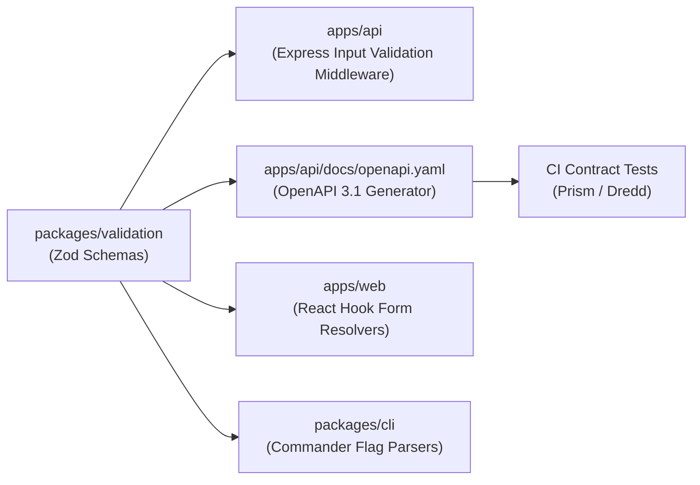

# OmniOPS — API Documentation & Contract Standards

| Attribute | Details |
| :--- | :--- |
| **Document ID** | `DOC-09-DEV-02` |
| **Status** | `Approved / Living Document` |
| **Version** | `1.0.0` |
| **Document Owner** | Lead API Architect / Documentation Maintainer Placeholder |
| **Target Audience** | Backend Engineers, Frontend Engineers, CLI Developers, Technical Writers |
| **Last Updated** | 2026-11-04 (UTC) |

---

## 1. Document Control & Executive Summary

### 1.1 Executive Summary
This document defines the specification formats, schema reuse rules, contract testing tools, and documentation workflows for the OmniOPS REST API. OmniOPS adopts **OpenAPI Specification (OAS) 3.1** as the canonical contract format. Both the React Web UI and the Node.js CLI consume and validate against this authoritative schema to eliminate client/server drift.

---

## 2. OpenAPI Specification Standard & Storage

### 2.1 Canonical Source of Truth
- **Specification Format**: OpenAPI 3.1 (JSON/YAML).
- **Location**: `apps/api/docs/openapi.yaml`.
- **Interactive Documentation**: Rendered in development environments at `http://localhost:4000/api/docs` using Swagger UI or Scalar.
- **Production Guard**: Interactive API documentation consoles are disabled in production unless accessed by an authenticated administrator.

---

## 3. Schema Reuse & Code Generation

To guarantee single-source-of-truth consistency:
1. **Schema Source**: Core request body schemas are defined in `packages/validation` using **Zod**.
2. **OpenAPI Generation**: Tooling (such as `@asteasolutions/zod-to-openapi`) converts runtime Zod schemas directly into OpenAPI 3.1 components.
3. **Client Types / Validation**: The Web client and CLI import these exact Zod schemas to validate form inputs and terminal flags prior to dispatching network requests.



---

## 4. Contract Linting & CI Verification

Every pull request that modifies API routes or schemas undergoes automated contract validation:
- **Spectral Linter**: Enforces style rules: camelCase query parameters, plural resource naming, mandatory descriptions, and explicit response status codes.
- **Prism Mock Testing**: Automated integration tests spin up an ephemeral Prism mock server to assert that mock payloads fulfill client expectations.

---

## 5. Security Schemes & Authentication Definitions

OpenAPI documents must explicitly declare the two primary security schemes:

```yaml
components:
  securitySchemes:
    SessionCookieAuth:
      type: apiKey
      in: cookie
      name: omniops_session
      description: Stateful session cookie for authenticated browser clients.
    BearerPATAuth:
      type: http
      scheme: bearer
      bearerFormat: PAT
      description: Personal Access Token for CLI terminal and CI automation.
```

---

## 6. Related Documents & Traceability

- [API Standards](../03-backend/API_STANDARDS.md)
- [API Endpoints Reference](../03-backend/API_ENDPOINTS.md)
- [Backend Specification](../03-backend/BACKEND_SPECIFICATION.md)
- [Quality Standards](../07-testing/QUALITY_STANDARDS.md)
