# OmniOPS — Developer Contribution & Workflow Guidelines

| Attribute | Details |
| :--- | :--- |
| **Document ID** | `DOC-09-DEV-01` |
| **Status** | `Approved / Living Document` |
| **Version** | `1.0.0` |
| **Document Owner** | Developer Experience Lead / Engineering Onboarding Coordinator Placeholder |
| **Target Audience** | All Software Engineers, Open Source Contributors, Engineering Interns |
| **Last Updated** | 2026-11-04 (UTC) |

---

## 1. Document Control & Executive Summary

### 1.1 Executive Summary
This handbook serves as the definitive onboarding guide, operational manual, and contribution standard for engineers developing on the OmniOPS platform. It details workstation setup, monorepo orchestration workflows, local debugging, branching conventions, code review expectations, and safe secrets management.

---

## 2. Onboarding & Workstation Prerequisites

### 2.1 Tooling Requirements
Before cloning the repository, ensure your development machine has the following installed:
- **Node.js**: `v18.18.0` or higher (LTS). Verify with `node -v`.
- **Package Manager**: `npm` v9+ (shipped with Node.js) or `pnpm`.
- **Docker Engine & Docker Compose**: Docker Desktop (macOS/Windows) or Docker Engine (Linux).
- **Git**: v2.38+ with SSH key configured.

---

## 3. Fast-Track Local Bootstrap (Under 5 Minutes)

```bash
# 1. Clone the monorepo
git clone git@github.com:omniops/omniops.git
cd omniops

# 2. Install dependencies across all workspaces
npm install

# 3. Initialize local environment variables
cp .env.example .env

# 4. Start local backing databases (MongoDB)
docker compose -f infrastructure/docker/docker-compose.dev.yml up -d

# 5. Start development servers with Hot Module Replacement
npm run dev
```

- Web UI: Accessible at `http://localhost:3000`
- API Control Plane: Accessible at `http://localhost:4000`
- API Health Check: Accessible at `http://localhost:4000/api/v1/health`

---

## 4. Monorepo Workspace Command Reference

OmniOPS uses Turborepo for fast, cached workspace execution:

| Command | Purpose |
| :--- | :--- |
| `npm run dev` | Starts all applications in parallel in development watch mode. |
| `npm run build` | Builds all packages and applications in topological dependency order. |
| `npm run test` | Executes unit and integration test suites across all packages. |
| `npm run lint` | Runs ESLint and Prettier formatting checks. |
| `npm run format` | Automatically formats all `.js`, `.jsx`, `.json`, and `.md` files. |
| `npm run clean` | Cleans build artifacts (`dist/`, `.turbo/`) and `node_modules`. |

---

## 5. Git Branching & Contribution Workflow

```mermaid
flowchart LR
    MAIN["main branch (Protected)"] -->|Checkout: git checkout -b feat/xyz| FEAT["Feature Branch (feat/* or fix/*)"]
    FEAT --> CODE["Develop Code & Write Tests"]
    CODE --> COMMIT["git commit -m 'feat(k8s): add pod log streamer'"]
    COMMIT --> HUSKY["Pre-commit Checks (Lint + Gitleaks)"]
    HUSKY --> PR["Open Pull Request to main"]
    PR --> CI["GitHub Actions Green + 1 Human Review"]
    CI --> MERGE["Squash & Merge to main"]
```



### 5.1 Branch Naming Conventions
- `feat/<short-description>`: New features or UI components.
- `fix/<issue-id>-<description>`: Bug fixes.
- `docs/<document-name>`: Documentation modifications.
- `chore/<tooling-name>`: Dependency updates or CI adjustments.

---

## 6. Safe Secrets Management for Contributors

- **Never Commit Secrets**: Real credentials, cloud tokens, database connection strings with passwords, and private keys **MUST NEVER** be committed to source control.
- **Local Overrides**: If specific tests require custom environment values, store them in `.env.local` (which is strictly ignored by Git).
- **Accidental Commit Protocol**: If you accidentally commit a credential, immediately alert the on-call security engineer (`security@omniops.io`), rotate the credential immediately, and rebase the commit history.

---

## 7. Related Documents & Traceability

- [Quality Standards](../07-testing/QUALITY_STANDARDS.md)
- [Testing Strategy](../07-testing/TESTING_STRATEGY.md)
- [Monorepo Architecture](../01-architecture/MONOREPO_ARCHITECTURE.md)
- [Folder Structure](../01-architecture/FOLDER_STRUCTURE.md)
