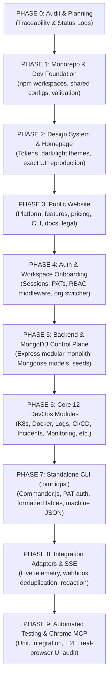

# OmniOPS — Production-Grade Implementation Plan

| Attribute | Details |
| :--- | :--- |
| **Document ID** | `PLAN-IMP-001` |
| **Status** | `Approved Execution Plan` |
| **Version** | `1.0.0` |
| **Author** | Principal Software Architect & Full-Stack Lead |
| **Last Updated** | 2026-11-04 (UTC) |

---

## 1. Executive Summary & Architectural Scope

This implementation plan establishes the phased, production-oriented engineering roadmap for **OmniOPS**—a unified DevOps command center spanning:
1. **Public Website & Documentation Portal**: High-conversion marketing pages, pricing, platform overview, integration catalogs, and technical documentation.
2. **Authentication & Onboarding**: Dual-client authentication engine with secure `HttpOnly` session cookies for the web and Personal Access Tokens (PAT) for the CLI, complete with workspace provisioning.
3. **Authenticated DevOps Command Center**: High-density operational dashboards with live cluster telemetry, container views, real-time log streaming, and incident triage rooms.
4. **12 Planned DevOps Modules**: Command Center Dashboard, GitHub, CI/CD, Docker, Kubernetes, Infrastructure Monitoring, Centralized Logging, Cloud Management, Incident Management, Terraform IaC, Team & Access, and Intelligent DevOps Assistant.
5. **Shared Backend / API Control Plane**: Versioned Node.js + Express modular monolith (`/api/v1/*`) with unified RBAC, MongoDB persistence, structured logging, rate limiting, and Server-Sent Events (SSE).
6. **Independently Installable Node.js CLI (`omniops`)**: Standalone executable package distributed via npm providing complete command parity with the dashboard.
7. **Production DevOps & Local Emulation**: Multi-stage Dockerfiles, Docker Compose backing services, and CI/CD automation.
8. **Real-Browser Verification**: Verification using Chrome MCP across dark and light themes.

---

## 2. Phased Engineering Execution Roadmap

---

## 3. Detailed Phase Breakdown

### Phase 0: Repository Audit & Planning Baseline
- **Deliverables**:
  - `docs/implementation/IMPLEMENTATION_PLAN.md`
  - `docs/implementation/REQUIREMENT_TRACEABILITY_MATRIX.md`
  - `docs/implementation/IMPLEMENTATION_STATUS.md`
- **Exit Criteria**: Complete inventory of documented requirements mapped to implementation files and test plans.

### Phase 1: Monorepo Foundation & Core Infrastructure
- **Packages & Workspaces**:
  - Root `package.json` with npm workspaces (`apps/*`, `packages/*`).
  - `packages/shared`: Universal error classes (`AppError`), HTTP constants, date utilities, sensitive string sanitizers.
  - `packages/validation`: Comprehensive Zod schemas for auth, organizations, integrations, k8s, incidents, logs.
  - `packages/config`: Shared ESLint configs, Prettier presets, Tailwind tokens.
  - `infrastructure/docker`: `docker-compose.dev.yml` for local MongoDB and backing services.
- **Exit Criteria**: `npm install` runs cleanly; shared packages compile and export valid ESM modules.

### Phase 2: Cyber-Industrial Design System & Homepage
- **Visual Baseline**: Extracted directly from `UI/dark/` and `UI/light/` specifications and code.
- **Components**:
  - Tokenized Tailwind configuration with exact hex colors, typography scale (`Inter` + `JetBrains Mono`), borders, and luminescence shadows.
  - Layouts: `PublicLayout` and `AppLayout` with responsive navigation, sticky header, theme toggle.
  - Primitive and composite components: `Button`, `Card`, `Badge`, `DataTable`, `TerminalViewer`, `MetricCard`, `ModalDialog`.
  - Homepage: Pixel-accurate implementation supporting seamless dark/light switching with zero layout shift.
- **Exit Criteria**: Chrome MCP visual verification confirms layout and theme fidelity against `UI/dark/code.html` and `UI/light/code.html`.

### Phase 3: Public Website Routes
- **Routes Implemented**:
  - `/`: Master Homepage.
  - `/features`: Deep dive into all 12 modules.
  - `/integrations`: Provider directory (GitHub, Kubernetes, AWS, Docker, Terraform).
  - `/cli`: CLI installation, interactive command preview, and terminal showcase.
  - `/pricing`: Tiered plans (`Starter`, `Team`, `Enterprise`) with feature matrix.
  - `/docs`: Developer documentation portal.
  - `/status`: Live infrastructure health and incident history.
  - `/privacy` & `/terms`: Legal notices and terms of service.
- **Exit Criteria**: Full client-side routing with responsive navigation, SEO meta tags, and functional buttons.

### Phase 4: Authentication, Tenancy & Onboarding
- **Architecture**:
  - Hybrid session management: `HttpOnly`, `SameSite=Lax`, `Secure` cookies for Web; SHA-256 hashed Bearer PATs for CLI.
  - Argon2id/bcrypt password hashing.
  - Organization & Workspace switching.
  - RBAC permission evaluation (`Owner`, `Admin`, `Operator`, `Viewer`).
- **Pages**: `/login`, `/register`, `/device` (CLI device authorization code approval).
- **Exit Criteria**: Automated auth integration tests pass; Web and CLI tokens correctly authenticate against the API.

### Phase 5: Shared Backend & Database Foundation
- **Architecture**:
  - Modular Monolith Express API (`apps/api`) listening on port 4000.
  - MongoDB connection pooling via Mongoose with multi-tenant scoping plugin.
  - Centralized middleware: Helmet, CORS, Request ID, Rate Limiter, Auth, Tenant, Error Handler.
  - Seed script (`apps/api/src/scripts/seed.js`) populating realistic development organizations, clusters, pods, logs, and incidents.
- **Exit Criteria**: `GET /api/v1/health` returns HTTP 200 with database connectivity status; seed data populates cleanly.

### Phase 6: Core 12 DevOps Modules Implementation
- **Module Implementation Matrix**:
  1. **Command Center**: Global health index, active alerts, cross-cluster deployment feeds.
  2. **GitHub Integration**: Repository sync, Pull Request status, webhook events.
  3. **CI/CD Management**: Pipeline telemetry, step execution durations, build logs.
  4. **Docker Management**: Local/remote container runtime metrics, image registries, vulnerability tags.
  5. **Kubernetes Management**: Multi-cluster view, pod status, container metrics, and live log tailing.
  6. **Infrastructure Monitoring**: Host telemetry (CPU, Memory, Disk, Network) with interactive charts.
  7. **Centralized Logging**: Structured log search, severity stratification, regex secret redaction.
  8. **Cloud Management**: Multi-cloud asset inventory and cost burn rate tracking.
  9. **Incident Management**: Alert ingestion, severity classification (`SEV-1` - `SEV-4`), acknowledgment, and triage timeline.
  10. **Terraform / IaC**: Workspace state inspection, drift detection status.
  11. **Team & Access**: Member invitations, RBAC assignment, PAT generation and revocation, immutable audit explorer.
  12. **Intelligent DevOps Assistant**: Context-aware diagnosis drawer with strict human confirmation gates.
- **Exit Criteria**: All 12 modules accessible via dashboard navigation with realistic telemetry and state management.

### Phase 7: Standalone Node.js CLI (`packages/cli`)
- **Package Specifications**:
  - Package name: `omniops`, binary `bin/omniops.js`.
  - Commands: `omniops status`, `omniops auth login/logout/status`, `omniops k8s pods/logs`, `omniops incident list/ack/resolve`, `omniops logs search`.
  - Output: Formatted ANSI tables by default; pure JSON via `--json` flag.
  - Authentication: Credential storage via OS keyring adapter with secure `chmod 0600` file fallback.
- **Exit Criteria**: CLI successfully links locally (`npm link`), authenticates, and executes against the running backend.

### Phase 8: Real-Time Telemetry & Webhook Ingestion
- **Features**:
  - Server-Sent Events (SSE) route: `GET /api/v1/k8s/pods/:id/logs/stream` providing live log streaming.
  - Webhook receiver: `POST /api/v1/webhooks/github` with HMAC-SHA256 signature verification and delivery deduplication.
  - Dynamic log redaction engine masking bearer tokens, AWS keys, and credit cards.
- **Exit Criteria**: SSE streams live log lines to both browser terminal component and CLI.

### Phase 9: Automated Testing & Real-Browser Chrome MCP Verification
- **Test Suites**:
  - Unit tests for validation schemas and cryptographic utilities.
  - Backend integration tests for API routes, auth, and RBAC.
  - Frontend component tests for key UI components.
  - Chrome MCP automated browser audit across desktop, laptop, tablet, and mobile viewports.
  - Dark and light theme visual verification.
- **Deliverables**:
  - `docs/implementation/TEST_EXECUTION_REPORT.md`
  - `docs/implementation/UI_TEST_REPORT.md`
  - `docs/implementation/FINAL_DELIVERY_REPORT.md`

---

## 4. Risk Mitigation & Operational Rules

1. **Least-Privilege by Default**: Infrastructure integrations default to read-only queries.
2. **Zero Plaintext Secrets**: Secrets in database use AES-256-GCM envelope encryption; client variables never receive secrets.
3. **No Mocks in Production Code**: Clear separation between development demo fixtures and real integration pipelines.
4. **Chrome MCP Verification**: All web flows verified in live browser sessions before marking complete.
